<a href="https://filigran.io/products/xtm-one">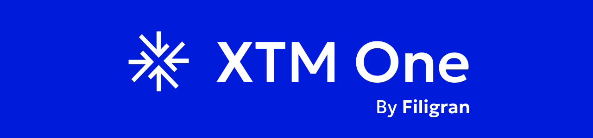</a>

<p align="center">
  <a href="https://github.com/XTM-One-Platform/xtm-one/stargazers"></a>
  <a href="https://github.com/XTM-One-Platform/xtm-one/releases/latest"></a>
  <a href="https://hub.docker.com/r/xtmone/platform"></a>
  <a href="LICENSE"></a>
  <a href="https://github.com/XTM-One-Platform/xtm-one/actions/workflows/ci.yml"></a>
  <a href="https://docs.xtmone.io/latest/"></a>
  <a href="https://community.filigran.io"></a>
</p>

<p align="center"><b>The open source agentic core of the XTM Platform: Agentic CTEM, from threat signal to verified fix.</b></p>

XTM One gives security teams one command center for Continuous Threat Exposure Management (CTEM). It reads the threats that target you from [OpenCTI](https://github.com/OpenCTI-Platform/opencti), proves which of them get through your defenses with [OpenAEV](https://github.com/OpenAEV-Platform/openaev), prices the risk with [OpenCRQ](https://github.com/OpenCRQ-Platform/opencrq), and puts AI agents and fleets to work on the exposures that matter, under your control.

<p align="center">If XTM One helps your security program, <a href="https://github.com/XTM-One-Platform/xtm-one/stargazers">give it a star</a>: it is how the project grows.</p>

<picture>
  <source media="(prefers-color-scheme: dark)" srcset="./.github/img/readme/hero-dark.webp">
  <source media="(prefers-color-scheme: light)" srcset="./.github/img/readme/hero-light.webp">
  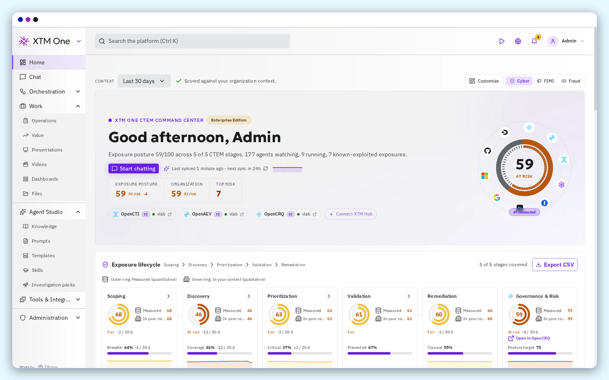
</picture>

## Table of contents

- [Why XTM One](#why-xtm-one)
- [Capabilities](#capabilities)
- [Gallery](#gallery)
- [How it works](#how-it-works)
- [Part of the XTM Platform](#part-of-the-xtm-platform)
- [Use cases by security role](#use-cases-by-security-role)
- [Quick start](#quick-start)
- [Editions](#editions)
- [Integrations and ecosystem](#integrations-and-ecosystem)
- [Community](#community)
- [Contributing](#contributing)
- [Security](#security)
- [License](#license)
- [About Filigran](#about-filigran)

## Why XTM One

Security teams drown in findings and still cannot answer the question that matters: which exposures will an adversary actually use against us, and are they fixed?

- **Threat-informed, not severity-informed.** Exposures are ranked by the adversaries that target your sector and regions, by the techniques your defenses failed to stop in validation and by the expected loss, not by a raw CVSS score.
- **One posture across the five CTEM stages.** Scoping, Discovery, Prioritization, Validation and Mobilization are scored from the data already in OpenCTI, OpenAEV and OpenCRQ, so the program sees where it is weakest.
- **Agents that do the work, humans that decide.** Stage analysts, an exposure briefing and ready-made CTEM fleets read your platforms, explain what changed and propose the next actions; approvals stay with your team.

## Capabilities

| CTEM stage | What XTM One gives your team |
|---|---|
| **Scoping** | The attack surface and threat landscape that matter to you: sectors, regions, primary assets, tech stack and priority intelligence requirements, read by every CTEM agent. |
| **Discovery** | The vulnerabilities, assets and threat activity in that scope, the attacker techniques never tested, and the blind spots where a connected source returns no data. |
| **Prioritization** | A funnel from every known vulnerability down to the few that are relevant, exploitable and open, ranked by exploitation, targeting adversaries and expected loss. |
| **Validation** | Proof of whether prevention and detection hold against the techniques that matter, from OpenAEV simulations, failed expectations and detection coverage. |
| **Mobilization** | Remediation cases grouped by fix, with their assets, primary assets and known exploitation, followed to closure and re-test by agents and fleets. |

## Gallery

<table>
  <tr>
    <td width="50%" valign="top">
      <picture>
        <source media="(prefers-color-scheme: dark)" srcset="./.github/img/readme/g1-dark.webp">
        <source media="(prefers-color-scheme: light)" srcset="./.github/img/readme/g1-light.webp">
        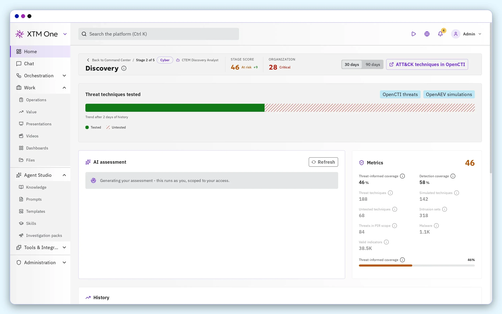
      </picture>
      <p><b>Discovery.</b> See which techniques of the adversaries that target you were never tested.</p>
    </td>
    <td width="50%" valign="top">
      <picture>
        <source media="(prefers-color-scheme: dark)" srcset="./.github/img/readme/g2-dark.webp">
        <source media="(prefers-color-scheme: light)" srcset="./.github/img/readme/g2-light.webp">
        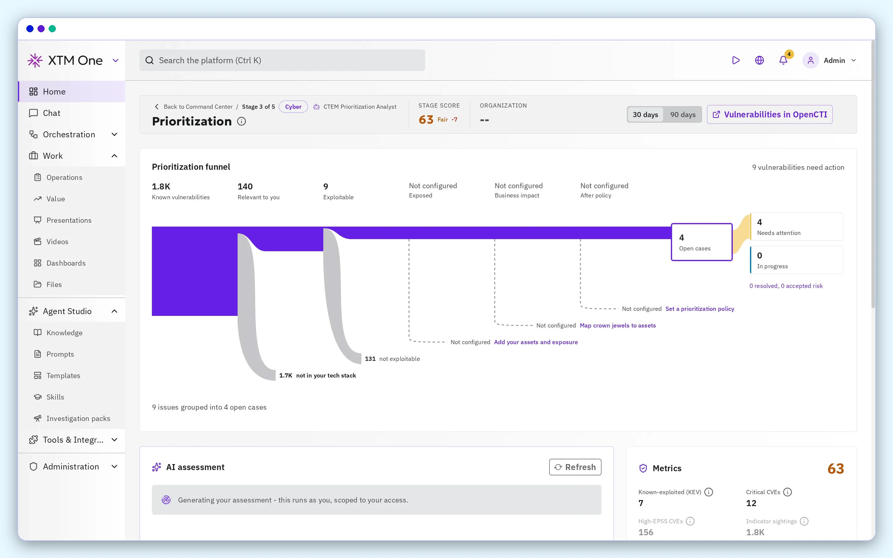
      </picture>
      <p><b>Prioritization.</b> Read which of thousands of known vulnerabilities are exploited and open on the assets that matter.</p>
    </td>
  </tr>
  <tr>
    <td width="50%" valign="top">
      <picture>
        <source media="(prefers-color-scheme: dark)" srcset="./.github/img/readme/g3-dark.webp">
        <source media="(prefers-color-scheme: light)" srcset="./.github/img/readme/g3-light.webp">
        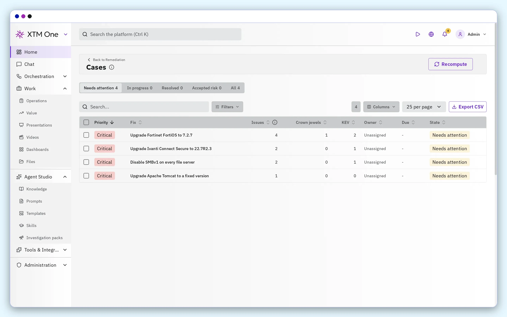
      </picture>
      <p><b>Remediation cases.</b> One case per fix, ranked, with the primary assets and exploitation it touches.</p>
    </td>
    <td width="50%" valign="top">
      <picture>
        <source media="(prefers-color-scheme: dark)" srcset="./.github/img/readme/g4-dark.webp">
        <source media="(prefers-color-scheme: light)" srcset="./.github/img/readme/g4-light.webp">
        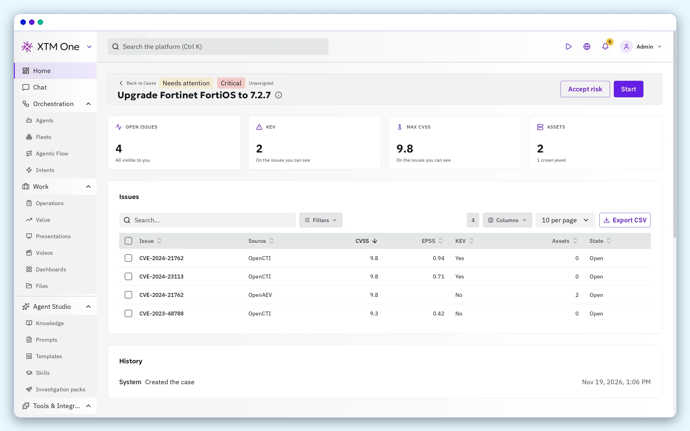
      </picture>
      <p><b>Case detail.</b> Every issue behind a fix, from intelligence and validation, with the assets at stake.</p>
    </td>
  </tr>
  <tr>
    <td width="50%" valign="top">
      <picture>
        <source media="(prefers-color-scheme: dark)" srcset="./.github/img/readme/g5-dark.webp">
        <source media="(prefers-color-scheme: light)" srcset="./.github/img/readme/g5-light.webp">
        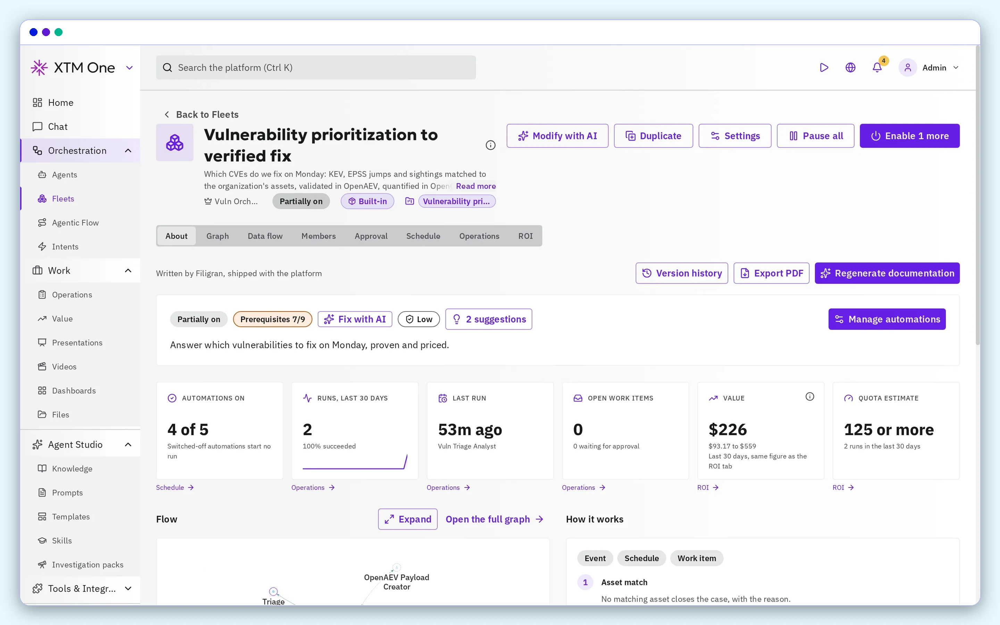
      </picture>
      <p><b>CTEM fleets.</b> A team of agents that takes a vulnerability from triage to a verified fix.</p>
    </td>
    <td width="50%" valign="top">
      <picture>
        <source media="(prefers-color-scheme: dark)" srcset="./.github/img/readme/g6-dark.webp">
        <source media="(prefers-color-scheme: light)" srcset="./.github/img/readme/g6-light.webp">
        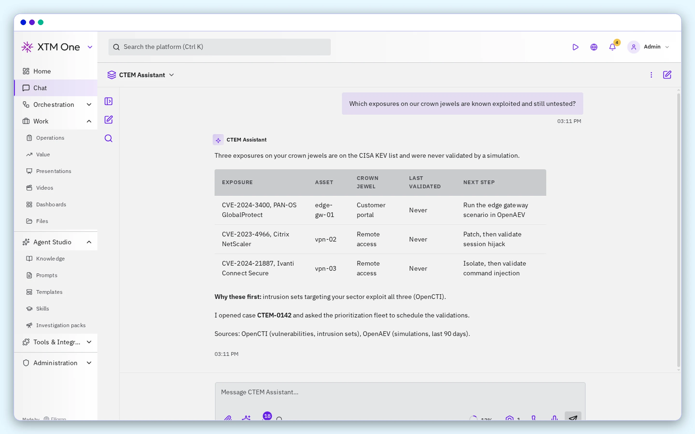
      </picture>
      <p><b>Agentic chat.</b> Ask in plain words; agents answer from your platforms with your permissions.</p>
    </td>
  </tr>
</table>

**Walkthrough.** From the command center to a remediation case and the fleet that closes it, in 15 seconds.

<picture>
  <source media="(prefers-color-scheme: dark)" srcset="./.github/img/readme/walkthrough-dark.webp">
  <source media="(prefers-color-scheme: light)" srcset="./.github/img/readme/walkthrough-light.webp">
  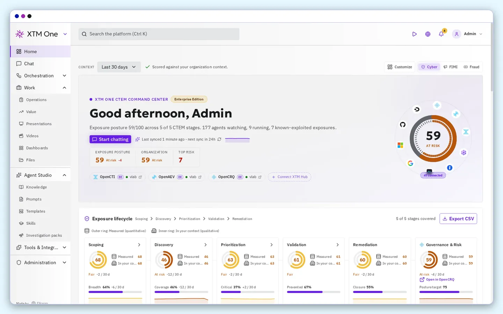
</picture>

## How it works

XTM One connects to OpenCTI, OpenAEV and OpenCRQ with the user's own identity, computes the CTEM posture from their data and runs agents, fleets and flows on schedules, webhooks, platform events and work items. It is self-hosted with PostgreSQL (pgvector), Redis and an S3-compatible store, works with your own AI provider or a local model, and runs agent code in an isolated sandbox with closed egress.

<picture>
  <source media="(prefers-color-scheme: dark)" srcset="./.github/img/readme/flow-dark.svg">
  <source media="(prefers-color-scheme: light)" srcset="./.github/img/readme/flow-light.svg">
  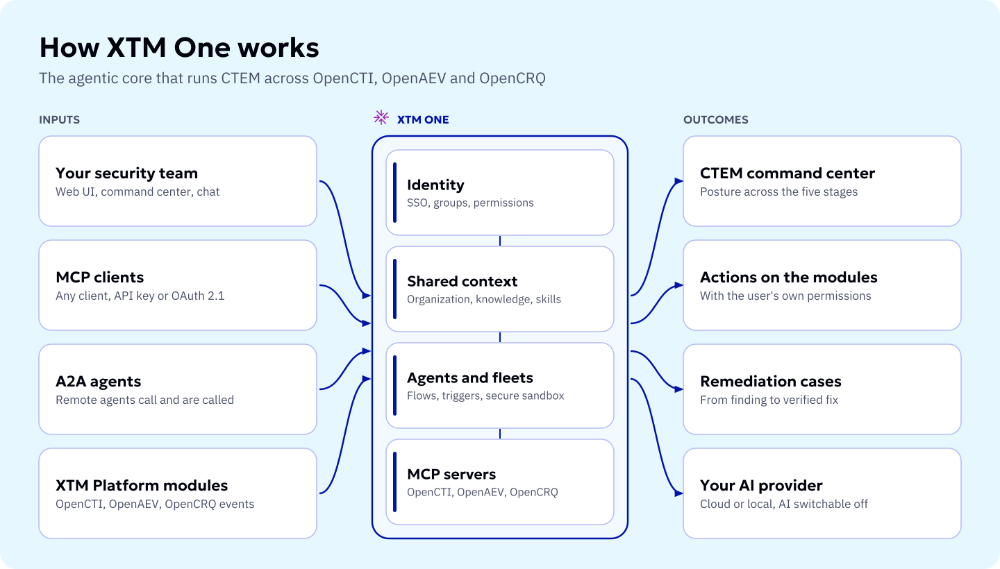
</picture>

## Part of the XTM Platform

XTM One is one of the five products of the [XTM Platform](https://filigran.io), the open platform for Agentic CTEM. Each product owns stages of the CTEM loop; XTM One runs the loop across them.

<picture>
  <source media="(prefers-color-scheme: dark)" srcset="./.github/img/readme/xtm-platform-ctem-dark.svg">
  <source media="(prefers-color-scheme: light)" srcset="./.github/img/readme/xtm-platform-ctem-light.svg">
  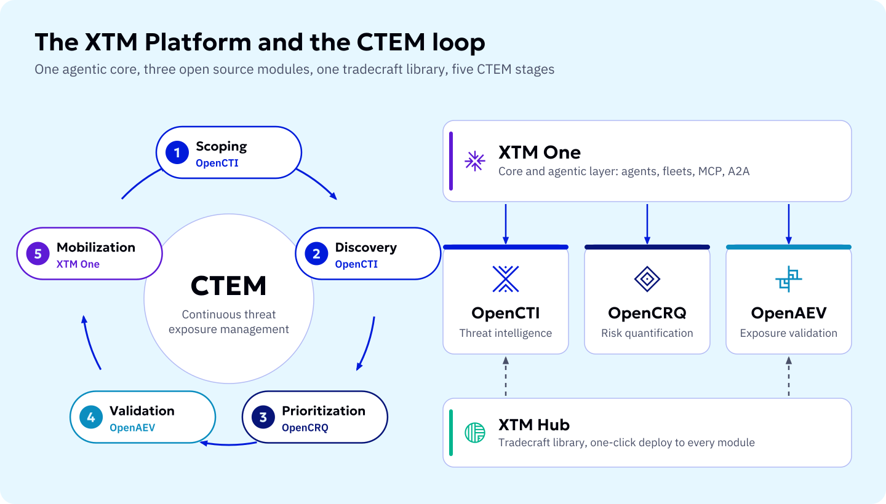
</picture>

| | Product | Role in CTEM | Repository | Product page |
|---|---|---|---|---|
| <picture><source media="(prefers-color-scheme: dark)" srcset="./.github/img/readme/mark-xtm-one-dark.svg"></picture> | **XTM One** | Core and agentic layer: runs CTEM across the modules and gets the fix done | [XTM-One-Platform/xtm-one](https://github.com/XTM-One-Platform/xtm-one) | [filigran.io/products/xtm-one](https://filigran.io/products/xtm-one) |
| <picture><source media="(prefers-color-scheme: dark)" srcset="./.github/img/readme/mark-opencti-dark.svg"></picture> | **OpenCTI** | Scoping and Discovery: know the adversary and the threats that target you | [OpenCTI-Platform/opencti](https://github.com/OpenCTI-Platform/opencti) | [filigran.io/products/opencti](https://filigran.io/products/opencti) |
| <picture><source media="(prefers-color-scheme: dark)" srcset="./.github/img/readme/mark-opencrq-dark.svg"></picture> | **OpenCRQ** | Prioritization: turn exposure into financial risk | [OpenCRQ-Platform/opencrq](https://github.com/OpenCRQ-Platform/opencrq) | [filigran.io/products/opencrq](https://filigran.io/products/opencrq) |
| <picture><source media="(prefers-color-scheme: dark)" srcset="./.github/img/readme/mark-openaev-dark.svg"></picture> | **OpenAEV** | Validation: prove your defenses against real attacker techniques | [OpenAEV-Platform/openaev](https://github.com/OpenAEV-Platform/openaev) | [filigran.io/products/openaev](https://filigran.io/products/openaev) |
| <picture><source media="(prefers-color-scheme: dark)" srcset="./.github/img/readme/mark-xtm-hub-dark.svg"></picture> | **XTM Hub** | Tradecraft library and gateway: integrations, dashboards and scenarios for every product | [XTM-Hub/xtm-hub](https://github.com/XTM-Hub/xtm-hub) | [filigran.io/platforms/xtm-hub](https://filigran.io/platforms/xtm-hub/) |

## Use cases by security role

| Role | What XTM One does for it |
|---|---|
| **CTI** | Search, read and write STIX 2.1 knowledge in OpenCTI in natural language with your own permissions; extract objects and TTPs from reports, grounded in their source. |
| **SOC** | Threat hunting packages from high-value indicators, simulation results and failed expectations, and agents that answer in the chat, in MCP clients or over A2A. |
| **Detection engineering** | STIX patterns converted to SPL, KQL, Elastic, Sigma, YARA, Snort and Suricata; detections generated for the techniques OpenAEV proved undetected. |
| **Red and purple team** | Adversary emulation scenarios mapped to MITRE ATT&CK, built from the techniques of the adversaries that target you and run as OpenAEV simulations. |
| **Vulnerability and exposure management** | The prioritization funnel, remediation cases by fix and the fleet that triages, validates, quantifies and re-tests. |
| **Risk and CISO** | The exposure posture and its trend, the exposure briefing, expected loss from OpenCRQ and the value the agents and fleets delivered. |

## Quick start

Requirements: Docker with Docker Compose.

```bash
git clone https://github.com/XTM-One-Platform/xtm-one.git && cd xtm-one
cp .env.sample .env      # set SECRET_KEY, DB_PASSWORD, ADMIN_EMAIL and ADMIN_PASSWORD
docker compose up -d
```

Open http://localhost:4000, sign in with `ADMIN_EMAIL` and `ADMIN_PASSWORD`, add an AI provider in **Settings** (or run without AI), then register your OpenCTI, OpenAEV and OpenCRQ instances.

- **Docker**: [`xtmone/platform`](https://hub.docker.com/r/xtmone/platform) and [`xtmone/worker`](https://hub.docker.com/r/xtmone/worker), one tag per [release](https://github.com/XTM-One-Platform/xtm-one/releases).
- **Helm**: [Kubernetes and Helm](https://docs.xtmone.io/latest/deployment/installation/#kubernetes-and-helm).
- **Docs**: [installation](https://docs.xtmone.io/latest/deployment/installation/), [configuration](https://docs.xtmone.io/latest/deployment/configuration/) and [upgrade](https://docs.xtmone.io/latest/deployment/upgrade/).

## Editions

| | Community Edition | Enterprise Edition |
|---|---|---|
| License | [Apache 2.0](LICENSE) | [XTM One Enterprise Edition License](LICENSE) |
| CTEM command center, stage metrics, remediation cases | Yes | Yes |
| Agentic chat, agents, fleets, flows, assignments | | Yes |
| Knowledge bases, skills, MCP servers, custom tools, A2A | | Yes |
| Exposure briefing and stage assessments | | Yes |

The Community Edition runs with AI off. Enterprise Edition is active with a Filigran license, or once a connected OpenCTI, OpenAEV or OpenCRQ platform is in Enterprise Edition ([editions and licensing](https://docs.xtmone.io/latest/administration/editions-and-licensing/)).

## Integrations and ecosystem

- **XTM Platform:** OpenCTI, OpenAEV and OpenCRQ through their APIs and events; their native MCP servers are served by XTM One.
- **[XTM Hub](https://hub.filigran.io):** integrations, dashboards and scenarios for the XTM Platform.
- **Ecosystem:** threat intelligence, detection and response, exposure and validation tools through the [integration catalog](https://docs.xtmone.io/latest/).
- **MCP and A2A:** connect remote MCP servers as agent tools, expose XTM One to MCP clients and to other agents over A2A.

## Community

Star XTM One to follow it and to help other security teams find it.

<picture>
  <source media="(prefers-color-scheme: dark)" srcset="./.github/img/readme/stars-dark.svg">
  <source media="(prefers-color-scheme: light)" srcset="./.github/img/readme/stars-light.svg">
  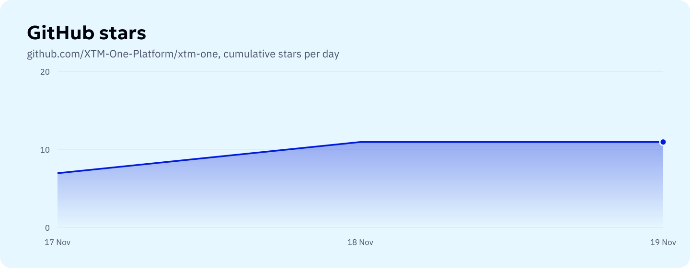
</picture>

- **Questions and discussion**: the Filigran [community Slack](https://community.filigran.io).
- **Bugs and feature requests**: [GitHub issues](https://github.com/XTM-One-Platform/xtm-one/issues).
- **Learn**: free courses on [Filigran Academy](https://academy.filigran.io).

## Contributing

Read the [contributing guide](CONTRIBUTING.md) to set up a development environment and propose a change. XTM One has adopted a [Code of Conduct](CODE_OF_CONDUCT.md). First contribution: the [good first issues](https://github.com/XTM-One-Platform/xtm-one/labels/good%20first%20issue).

## Security

Report vulnerabilities privately as described in [SECURITY.md](SECURITY.md), never in a public issue.

## License

XTM One is open source under the [Apache 2.0 license](LICENSE); the Enterprise Edition features are under the XTM One Enterprise Edition License, as stated in [LICENSE](LICENSE) and in each source file header.

## About Filigran

XTM One is designed and developed by [Filigran](https://filigran.io), the company behind the [XTM Platform](https://filigran.io) for Agentic CTEM.

<picture>
  <source media="(prefers-color-scheme: dark)" srcset="./.github/img/readme/filigran-dark.svg">
  <source media="(prefers-color-scheme: light)" srcset="./.github/img/readme/filigran-light.svg">
  
</picture>
