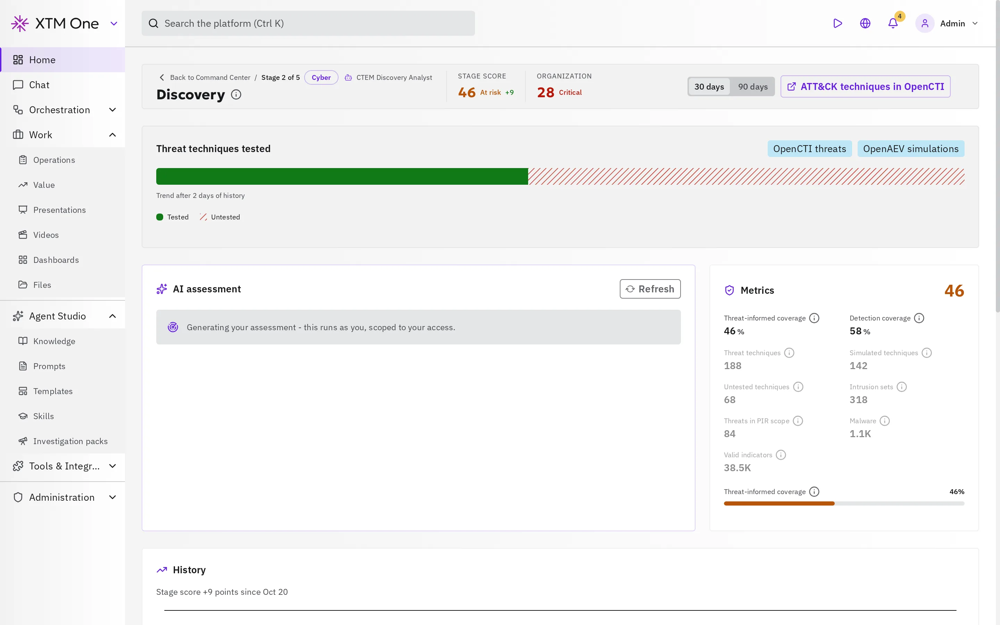
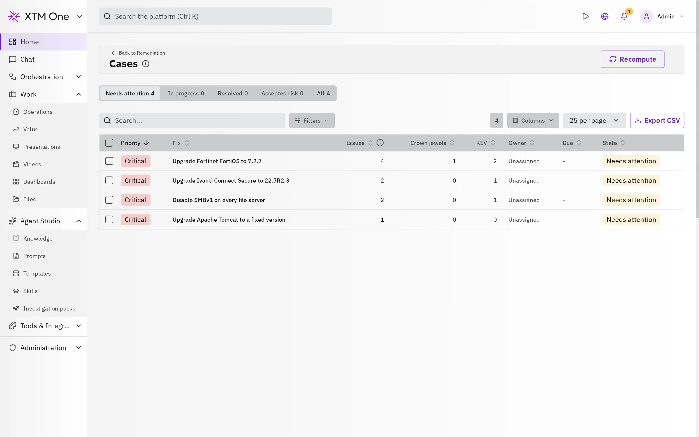
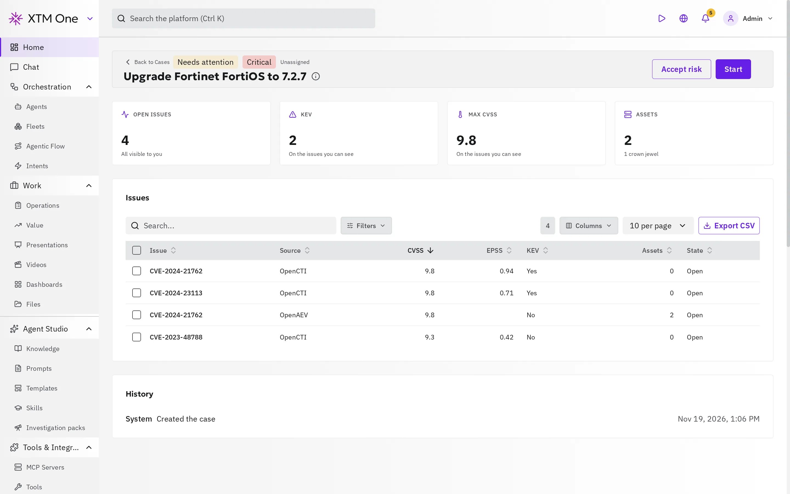
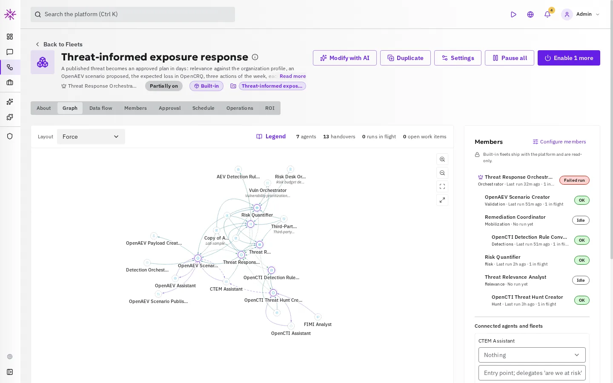
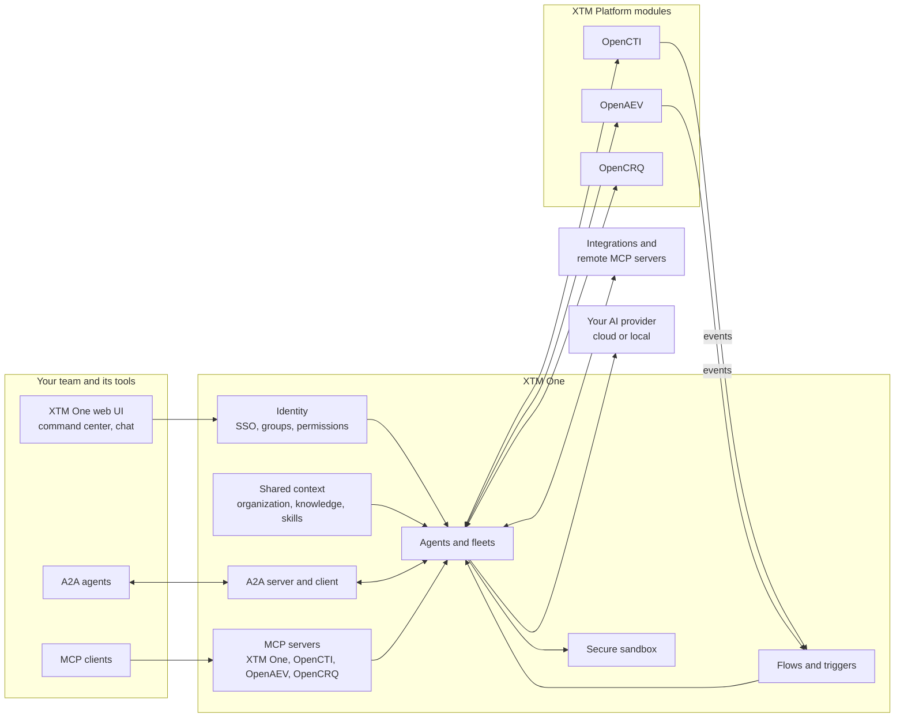
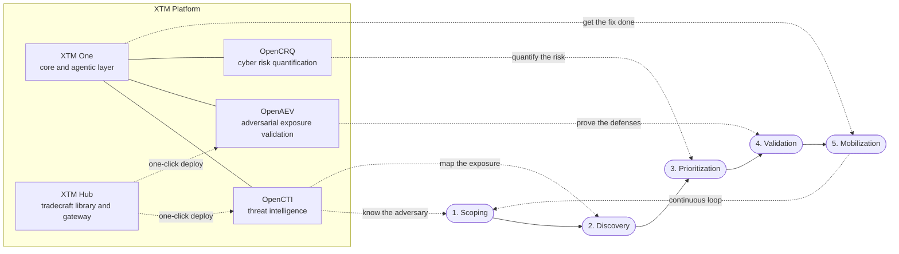

<h1 align="center">
  <a href="https://filigran.io/products/xtm-one"></a>
</h1>

<p align="center">
  <a href="https://github.com/XTM-One-Platform/xtm-one/stargazers"></a>
  <a href="https://github.com/XTM-One-Platform/xtm-one/releases/latest"></a>
  <a href="LICENSE"></a>
  <a href="https://docs.xtmone.io/latest/"></a>
  <a href="https://hub.docker.com/r/xtmone/platform"></a>
  <a href="https://community.filigran.io"></a>
</p>

<p align="center"><b>The open source agentic core of the XTM Platform: Agentic CTEM, from threat signal to verified fix.</b></p>

XTM One gives security teams one command center for Continuous Threat Exposure Management (CTEM). It reads the threats that target you from [OpenCTI](https://github.com/OpenCTI-Platform/opencti), proves which of them get through your defenses with [OpenAEV](https://github.com/OpenAEV-Platform/openaev), prices the risk with [OpenCRQ](https://filigran.io/products/opencrq), and puts AI agents and fleets to work on the exposures that matter, under your control. Self-hosted, with your own AI provider and your own data.

<p align="center">If XTM One helps your security program, <a href="https://github.com/XTM-One-Platform/xtm-one/stargazers">give it a star</a>: it is how the project grows.</p>

<picture>
  <source media="(prefers-color-scheme: dark)" srcset="./.github/img/readme-command-center-dark.webp">
  <source media="(prefers-color-scheme: light)" srcset="./.github/img/readme-command-center-light.webp">
  
</picture>

## Table of contents

- [Why XTM One](#why-xtm-one)
- [Capabilities](#capabilities)
- [Gallery](#gallery)
- [How it works](#how-it-works)
- [Part of the XTM Platform](#part-of-the-xtm-platform)
- [Quick start](#quick-start)
- [Editions](#editions)
- [Integrations and ecosystem](#integrations-and-ecosystem)
- [Community](#community)
- [Contributing](#contributing)
- [Security](#security)
- [License](#license)
- [About Filigran](#about-filigran)

## Why XTM One

Security teams drown in findings and still cannot answer the question that matters: which exposures will an adversary actually use against us, and are they fixed?

- **Threat-informed, not severity-informed.** Exposures are ranked by the adversaries that target your sector and regions, by the techniques your defenses failed to stop in validation and by the expected loss, not by a raw CVSS score.
- **One posture across the five CTEM stages.** Scoping, Discovery, Prioritization, Validation and Mobilization are scored from the data already in OpenCTI, OpenAEV and OpenCRQ, so the program sees where it is weakest.
- **Agents that do the work, humans that decide.** Stage analysts, an exposure briefing and ready-made CTEM fleets read your platforms, explain what changed and propose the next actions. Every automation is opt-in and approvals stay with your team.
- **Open by default.** The command center, the stage metrics and the remediation cases work in the Community Edition, with no AI and no license.

## Capabilities

### By CTEM stage

| Stage | What your team gets | Built on |
|---|---|---|
| **Scoping** | The attack surface and threat landscape that matter to your organization: sectors, regions, crown jewels, tech stack and priority intelligence requirements, read by every CTEM agent. | OpenCTI, OpenAEV, organization context |
| **Discovery** | The vulnerabilities, assets and threat activity relevant to that scope, the attacker techniques never tested, and the blind spots where a connected source returns no data. | OpenCTI, OpenAEV |
| **Prioritization** | A funnel from every known vulnerability down to the few that are relevant, exploitable and open, ranked by known exploitation, adversaries targeting you, missing coverage and expected loss. | OpenCTI, OpenAEV, OpenCRQ |
| **Validation** | Proof of whether prevention and detection hold against the techniques that matter, from simulations, failed expectations and detection coverage. | OpenAEV, OpenCTI |
| **Mobilization** | Remediation cases that group issues by fix (an upgrade, a configuration), carry their assets, crown jewels and known exploitation, and follow the fix to closure and re-test. | OpenCTI, OpenAEV |

### By job to be done

| Team | What XTM One does for it |
|---|---|
| **CTI analysts** | Search, read and write STIX 2.1 knowledge in OpenCTI in natural language with your own permissions; extract STIX objects and TTPs from reports, each grounded in its source text; summarize any entity's activity and history. |
| **Detection engineers** | Convert STIX indicator patterns into Splunk SPL, Microsoft Sentinel KQL, Elastic, Sigma, YARA, Snort and Suricata rules; generate detections for the techniques OpenAEV proved undetected. |
| **Red and purple teams** | Design adversary emulation scenarios mapped to MITRE ATT&CK with payloads grounded in public references, and turn the techniques of the adversaries that target you into OpenAEV simulations. |
| **Vulnerability and exposure management** | The prioritization funnel, remediation cases by fix, and the "Vulnerability prioritization to verified fix" fleet: triage against your assets, exploitability validated in OpenAEV, risk quantified, fix coordinated and re-tested. |
| **SOC** | Threat hunting packages built from high-value indicators, results of simulations and failed expectations, and agents that answer in the chat, in MCP clients or through A2A. |
| **Risk and CISO** | The exposure posture and its trend, the exposure briefing (Enterprise Edition), expected loss from OpenCRQ and the value the agents and fleets delivered. |

### The agentic engine

- **Agents, fleets and flows**: agents with tools, skills and knowledge; fleets of agents around an orchestrator; visual flows. Triggered by schedules, webhooks, platform events (a new intrusion set in OpenCTI, a finished simulation in OpenAEV) and work items, with human approval where you want it and a full trace of every run.
- **Ready-made CTEM fleets**: threat-informed exposure response, vulnerability prioritization to verified fix, and CTEM posture and reporting. Shipped disabled until an administrator switches them on.
- **Secure sandbox**: agents run code and checks in isolated containers ([OpenSandbox](https://github.com/opensandbox-group/OpenSandbox), part of the Compose stack) with closed egress.
- **Evaluations**: score agents and models against reference sets before you trust them with your program.

## Gallery

<table>
  <tr>
    <td width="50%">
      <picture>
        <source media="(prefers-color-scheme: dark)" srcset="./.github/img/readme-discovery-dark.webp">
        <source media="(prefers-color-scheme: light)" srcset="./.github/img/readme-discovery-light.webp">
        
      </picture>
      <p><b>Discovery.</b> See which techniques of the adversaries that target you were never tested.</p>
    </td>
    <td width="50%">
      <picture>
        <source media="(prefers-color-scheme: dark)" srcset="./.github/img/readme-prioritization-dark.webp">
        <source media="(prefers-color-scheme: light)" srcset="./.github/img/readme-prioritization-light.webp">
        
      </picture>
      <p><b>Prioritization.</b> Go from thousands of known vulnerabilities to the handful that are relevant, exploitable and open.</p>
    </td>
  </tr>
  <tr>
    <td width="50%">
      <picture>
        <source media="(prefers-color-scheme: dark)" srcset="./.github/img/readme-cases-dark.webp">
        <source media="(prefers-color-scheme: light)" srcset="./.github/img/readme-cases-light.webp">
        
      </picture>
      <p><b>Remediation cases.</b> One case per fix, ranked, with the crown jewels and known exploitation it touches.</p>
    </td>
    <td width="50%">
      <picture>
        <source media="(prefers-color-scheme: dark)" srcset="./.github/img/readme-case-dark.webp">
        <source media="(prefers-color-scheme: light)" srcset="./.github/img/readme-case-light.webp">
        
      </picture>
      <p><b>Case detail.</b> Every issue behind a fix, from intelligence and from validation, with the assets at stake.</p>
    </td>
  </tr>
  <tr>
    <td colspan="2">
      <picture>
        <source media="(prefers-color-scheme: dark)" srcset="./.github/img/readme-fleet-dark.webp">
        <source media="(prefers-color-scheme: light)" srcset="./.github/img/readme-fleet-light.webp">
        
      </picture>
      <p><b>CTEM fleets.</b> A team of agents that takes a vulnerability from triage to a verified fix, with the value it delivered.</p>
    </td>
  </tr>
</table>

## How it works



- **Self-hosted.** XTM One, its PostgreSQL with pgvector, Redis and S3-compatible object store run where you deploy them. Your data stays with you.
- **Bring your own model.** Anthropic, OpenAI, Azure OpenAI, Google Gemini and Vertex AI, Amazon Bedrock, Mistral AI, xAI, OpenRouter, LiteLLM, any OpenAI-compatible endpoint, or a local model through Ollama or LM Studio. AI can be switched off for the whole platform or per group.
- **Your permissions, not a service account.** Platform tools act with the connecting user's identity on OpenCTI, OpenAEV and OpenCRQ.
- **Credentials encrypted at rest.** Integration and provider credentials are stored encrypted in the database and configured from the settings, never in configuration files.
- **Open interfaces.** Any MCP client connects to `POST /mcp/opencti`, `/mcp/openaev` or `/mcp/opencrq` with a personal API key or OAuth 2.1 ([native MCP servers](dev-docs/platform-mcp-servers.md)); XTM One agents are published to other agents and call remote ones over [A2A](dev-docs/a2a-server-operations.md).

## Part of the XTM Platform

XTM One is one of the five products of the [XTM Platform](https://filigran.io), the open platform for Agentic CTEM.



| Product | What it does for a CTEM program |
| --- | --- |
| [XTM One](https://github.com/XTM-One-Platform/xtm-one) | The core and agentic layer that runs CTEM across the modules ([product page](https://filigran.io/products/xtm-one)) |
| [OpenCTI](https://github.com/OpenCTI-Platform/opencti) | Threat intelligence: know the adversary and the threats that target you ([product page](https://filigran.io/products/opencti)) |
| [OpenAEV](https://github.com/OpenAEV-Platform/openaev) | Adversarial exposure validation: prove your defenses against real attacker techniques ([product page](https://filigran.io/products/openaev)) |
| [OpenCRQ](https://filigran.io/products/opencrq) | Cyber risk quantification: turn exposure into financial risk |
| [XTM Hub](https://github.com/XTM-Hub/xtm-hub) | The tradecraft library and gateway for all of them ([hub.filigran.io](https://hub.filigran.io), [product page](https://filigran.io/platforms/xtm-hub/)) |

## Quick start

Requirements: Docker with Docker Compose.

```bash
git clone https://github.com/XTM-One-Platform/xtm-one.git && cd xtm-one
cp .env.sample .env      # set SECRET_KEY, DB_PASSWORD, ADMIN_EMAIL and ADMIN_PASSWORD
docker compose up -d
```

Then:

1. Open **http://localhost:4000** and sign in with `ADMIN_EMAIL` and `ADMIN_PASSWORD`.
2. In **Settings**, add an AI provider and pick the default model (skip it to run without AI).
3. In **Settings**, register your OpenCTI and OpenAEV instances (URL and API key), and OpenCRQ if you run it.
4. Open the home page: the CTEM command center syncs from the registered platforms.

Everything beyond the environment file (SSO, integrations, AI providers) is configured from the settings.

- **Container images**: [`xtmone/platform`](https://hub.docker.com/r/xtmone/platform) and [`xtmone/worker`](https://hub.docker.com/r/xtmone/worker) on Docker Hub, one tag per [release](https://github.com/XTM-One-Platform/xtm-one/releases).
- **Kubernetes**: the official Helm chart runs the same images; see [Kubernetes and Helm](https://docs.xtmone.io/latest/deployment/installation/#kubernetes-and-helm).
- **Full guide**: [installation](https://docs.xtmone.io/latest/deployment/installation/), [configuration](https://docs.xtmone.io/latest/deployment/configuration/) and [upgrade](https://docs.xtmone.io/latest/deployment/upgrade/).

XTM One follows the release train of the XTM Platform: run it alongside the current releases of OpenCTI, OpenAEV and OpenCRQ.

## Editions

| | Community Edition | Enterprise Edition |
|---|---|---|
| License | [Apache 2.0](LICENSE) | [XTM One Enterprise Edition License](LICENSE) |
| Identity, SSO, settings, platform connections, integrations | Yes | Yes |
| CTEM command center, stage pages and metrics, remediation cases | Yes | Yes |
| Agentic chat, agents, fleets, flows, assignments | | Yes |
| Knowledge bases, skills, MCP servers, custom tools, A2A | | Yes |
| Exposure briefing and stage assessments | | Yes |

The Community Edition runs with AI off: every CTEM metric that needs no model is computed and shown, and each Enterprise Edition surface says what it would add. Enterprise Edition is active with a Filigran license, or as soon as a connected OpenCTI, OpenAEV or OpenCRQ platform is itself in Enterprise Edition ([editions and licensing](https://docs.xtmone.io/latest/administration/editions-and-licensing/)). Each source file states its license in its header. [Contact Filigran](https://filigran.io/contact) for a license.

## Integrations and ecosystem

- **XTM Platform**: OpenCTI, OpenAEV and OpenCRQ, natively, through their APIs and events; their native MCP servers are served by XTM One.
- **Threat intelligence**: MITRE ATT&CK, MITRE ATLAS, MISP, VulnCheck, GreyNoise, Shodan, abuse.ch, ThreatConnect, ThreatQ, Feedly, Flashpoint and more.
- **Detection and response**: Microsoft Sentinel and Defender, Google SecOps, CrowdStrike, SentinelOne, Elastic Security, QRadar, Sumo Logic, TheHive, Cortex XSOAR.
- **Exposure and validation**: Tenable, Qualys, Rapid7, Wiz, AttackIQ, Picus, HackerOne, SecurityScorecard.
- The full catalog is in the [documentation](https://docs.xtmone.io/latest/).
- **Any MCP server**: connect remote MCP servers as tools for your agents, and expose XTM One to MCP clients.
- **[XTM Hub](https://hub.filigran.io)**: integrations, dashboards and scenarios for the XTM Platform.
- **[Filigran Academy](https://academy.filigran.io)**: free courses on OpenCTI and OpenAEV.

## Community

- **Questions and discussion**: the Filigran [community Slack](https://community.filigran.io).
- **Bugs and feature requests**: [GitHub issues](https://github.com/XTM-One-Platform/xtm-one/issues).
- **Star the project** to follow it and help other security teams find it.

<a href="https://star-history.com/#XTM-One-Platform/xtm-one&Date"></a>

<a href="https://github.com/XTM-One-Platform/xtm-one/graphs/contributors"></a>

## Contributing

- Read the [contributing guide](CONTRIBUTING.md) to set up a development environment, propose a fix and test your change.
- XTM One has adopted a [Code of Conduct](CODE_OF_CONDUCT.md).
- Looking for a first contribution: see the [good first issues](https://github.com/XTM-One-Platform/xtm-one/labels/good%20first%20issue).
- Developer documentation: [architecture](dev-docs/architecture.md) and [dev-docs](dev-docs/).

## Security

Report vulnerabilities privately as described in [SECURITY.md](SECURITY.md), never in a public issue.

## License

XTM One is open source under the [Apache 2.0 license](LICENSE); the Enterprise Edition features are under the XTM One Enterprise Edition License, as stated in [LICENSE](LICENSE) and in each source file header.

## About Filigran

XTM One is designed and developed by [Filigran](https://filigran.io), the company behind the [XTM Platform](https://filigran.io) for Agentic CTEM.

<a href="https://filigran.io"></a>
