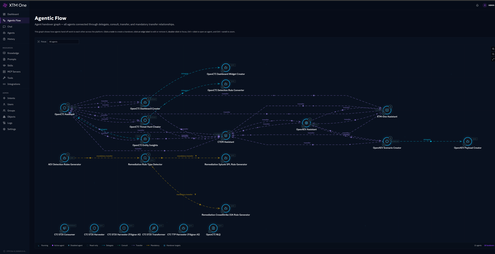
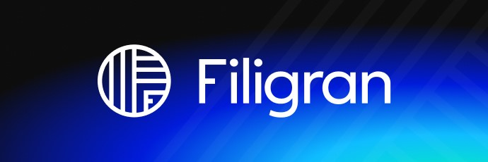

<h1 align="center">
  <a href="https://filigran.io/platform/xtm-platform/"></a>
</h1>
<p align="center">
  <a href="https://filigran.io/platform/xtm-platform/" alt="Website"></a>
  <a href="https://docs.xtmone.io/" alt="Documentation"></a>
  <a href="https://community.filigran.io" alt="Slack"></a>
  <a href="https://hub.docker.com/u/xtmone" alt="Docker pulls"></a>
  <a href="https://github.com/XTM-One-Platform/xtm-one"></a>
</p>

## Introduction

XTM One is the open source, AI-native cockpit for threat-informed defense. It brings artificial intelligence to the heart of cyber threat management by connecting [OpenCTI](https://filigran.io/platform/opencti/) (cyber threat intelligence) and [OpenAEV](https://filigran.io/platform/openaev/) (adversarial exposure validation) into a single conversational experience, so security teams can understand their threats, validate their defenses, and close the gap — faster.

Part of Filigran's [eXtended Threat Management (XTM) platform](https://filigran.io/platform/xtm-platform/), XTM One operationalizes Continuous Threat Exposure Management (CTEM): it turns the intelligence stored in OpenCTI and the simulations run in OpenAEV into immediate, actionable outcomes — from answering analyst questions in natural language, to building dashboards and threat hunts, to designing adversary emulation scenarios and generating detection rules.



## Objective

The goal is to provide a comprehensive, open and extensible platform that puts AI to work across the entire threat management lifecycle. Rather than asking analysts to learn yet another tool, XTM One lets them describe what they need in plain language and obtain validated, source-grounded results directly inside the products they already use.

XTM One is designed to break the silos between threat intelligence and exposure validation. Knowledge from OpenCTI flows into OpenAEV to build simulations tailored to your real threat landscape, while the outcomes of those simulations inform detection engineering and remediation. The result is a continuous, threat-informed defense cycle: know your threats, validate your defenses, prioritize what matters.

Everything is self-hostable and runs with your own AI provider and your own data. The platform supports a wide range of AI providers (Anthropic Claude, OpenAI, Google Gemini, Mistral AI, Azure OpenAI, AWS Bedrock, and any OpenAI-compatible or local endpoint), and all credentials are encrypted at rest — never stored in configuration files.

## Use cases

XTM One ships with ready-to-use capabilities focused on cyber threat management. They are grounded in your own OpenCTI and OpenAEV data and in reference knowledge such as the STIX 2.1 standard and the MITRE ATT&CK framework.

### Cyber threat intelligence (with OpenCTI)

* **Conversational analysis** — search threats, retrieve intelligence, and create or update structured knowledge (STIX 2.1) in OpenCTI by asking questions in natural language.
* **Natural language querying** — translate plain-language questions into precise OpenCTI filters.
* **Dashboards** — design and assemble complete OpenCTI dashboards and widgets from a description of what you want to monitor.
* **Threat hunting** — build actionable hunting packages from high-value indicators and assemble them into OpenCTI groupings.
* **Entity insights** — generate container summaries, activity analysis, forecasts, and modification history for any entity.
* **Intelligence extraction** — harvest STIX 2.1 bundles and Tactics, Techniques and Procedures (TTPs) from unstructured reports and documents.

### Detection engineering and remediation

* **Detection rule conversion** — turn STIX 2.1 indicator patterns into platform-native detection rules for SIEMs, EDRs and XDRs, and universal formats (Splunk SPL, Microsoft Sentinel KQL, Elastic, Sigma, YARA, Snort/Suricata, and more).
* **Remediation rules** — generate production-ready CrowdStrike Custom IOA rules and Splunk SPL detection queries from observed malware behavior.

### Adversarial exposure validation (with OpenAEV)

* **Scenario design** — plan and assemble complete adversary emulation scenarios mapped to MITRE ATT&CK.
* **Safe-by-design payloads** — build individual emulation payloads grounded in ATT&CK techniques and public references.
* **Exercise review** — manage simulations and review results to measure and improve your security posture.

### Continuous Threat Exposure Management (CTEM)

A single conversational entry point understands what you need and routes the request to the right capability — threat intelligence with OpenCTI, exposure validation with OpenAEV, or detection and remediation — so prioritized, validated exposures are turned into action across your security stack.

### Native MCP servers (OpenCTI and OpenAEV)

XTM One embeds a native [Model Context Protocol](https://modelcontextprotocol.io/) (MCP) server for every connected platform. Any MCP-compatible client (Cursor, Claude Desktop, custom agents, ...) can connect to `POST /mcp/opencti` and `POST /mcp/openaev` with a personal API key or OAuth 2.1 and work directly with threat-intelligence knowledge (STIX entities, observables, relationships, indicators, containers) and exposure-validation content (scenarios, simulations, payloads, injects, findings). The servers are available in the Community Edition as soon as a platform is registered, expose business and knowledge tools only (no platform administration), and run every call with the connecting user's own identity on the platform. See [dev-docs/platform-mcp-servers.md](dev-docs/platform-mcp-servers.md).

## Editions of the platform

XTM One has 2 different editions: Community (CE) and Enterprise (EE). The purpose of the Enterprise Edition is to provide [additional and powerful features](https://filigran.io/offering/subscribe) which require specific investments in research and development. You can enable the Enterprise Edition directly in the settings of the platform.

* XTM One Community Edition, licensed under the [Apache 2, Version 2.0 license](LICENSE).
* XTM One Enterprise Edition, licensed under the [Enterprise Edition license](LICENSE).

To understand what XTM One Enterprise Edition brings in terms of features, just check the [Enterprise Editions page](https://filigran.io/offering/subscribe) on the Filigran website. You can also try this edition by enabling it in the settings of the platform.

## Documentation and demonstration

If you want to know more on XTM One, you can read the [documentation on the tool](https://docs.xtmone.io/). If you wish to discover how XTM One fits into a threat-informed defense strategy alongside OpenCTI and OpenAEV, explore the [XTM platform page](https://filigran.io/platform/xtm-platform/) on the Filigran website.

## Releases download

The releases are available on the [GitHub releases page](https://github.com/XTM-One-Platform/xtm-one/releases). The platform is also distributed as Docker images published on [Docker Hub](https://hub.docker.com/u/xtmone).

## Installation

### Compatibility
XTM One 1.260604.0 is compatible from [OpenCTI 7.260604.0](https://github.com/OpenCTI-Platform/opencti/releases/tag/7.260604.0) or later and [OpenAEV 2.260604.0](https://github.com/OpenAEV-Platform/openaev/releases/tag/2.260604.0) or later

### Install from GitHub repository

All you need to install the XTM One platform can be found in the [official documentation](https://docs.xtmone.io/). The fastest way to get started is with Docker:

```bash
git clone https://github.com/XTM-One-Platform/xtm-one.git && cd xtm-one
cp .env.sample .env                    # set SECRET_KEY, ADMIN_EMAIL, ADMIN_PASSWORD
docker compose up -d
```

Open **http://localhost:4000**, log in with the admin credentials defined in your `.env`, then connect your AI provider and your OpenCTI and OpenAEV instances from the settings.

## Contributing

### Code of Conduct

XTM One has adopted a [Code of Conduct](CODE_OF_CONDUCT.md) that we expect project participants to adhere to. Please read the [full text](CODE_OF_CONDUCT.md) so that you can understand what actions will and will not be tolerated.

### Contributing Guide

Read our [contributing guide](CONTRIBUTING.md) to learn about our development process, how to propose bugfixes and improvements, and how to build and test your changes to XTM One.

### Beginner friendly issues

To help you get familiar with our contribution process, we have a list of [beginner friendly issues](https://github.com/XTM-One-Platform/xtm-one/labels/good%20first%20issue) which are fairly easy to implement. This is a great place to get started.

### Development

If you want to actively help XTM One, please refer to the [documentation](https://docs.xtmone.io/) for setting up a development environment.

## Community

### Status & bugs

Currently XTM One is under heavy development, if you wish to report bugs or ask for new features, you can directly use the [GitHub issues module](https://github.com/XTM-One-Platform/xtm-one/issues).

### Discussion

If you need support or you wish to engage a discussion about the XTM One platform, feel free to join us on our [Slack channel](https://community.filigran.io). You can also send us an email to contact@filigran.io.

## About

### Authors

XTM One is a product designed and developed by the company [Filigran](https://filigran.io).

<a href="https://filigran.io" alt="Filigran"></a>
