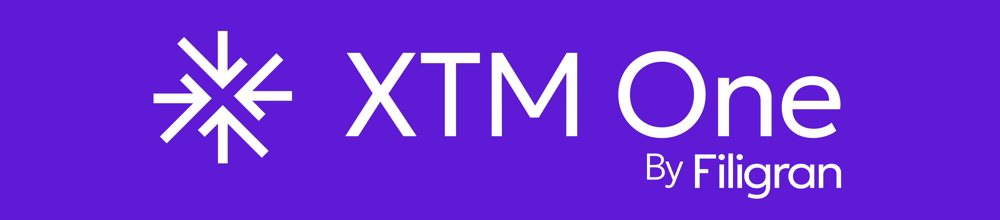
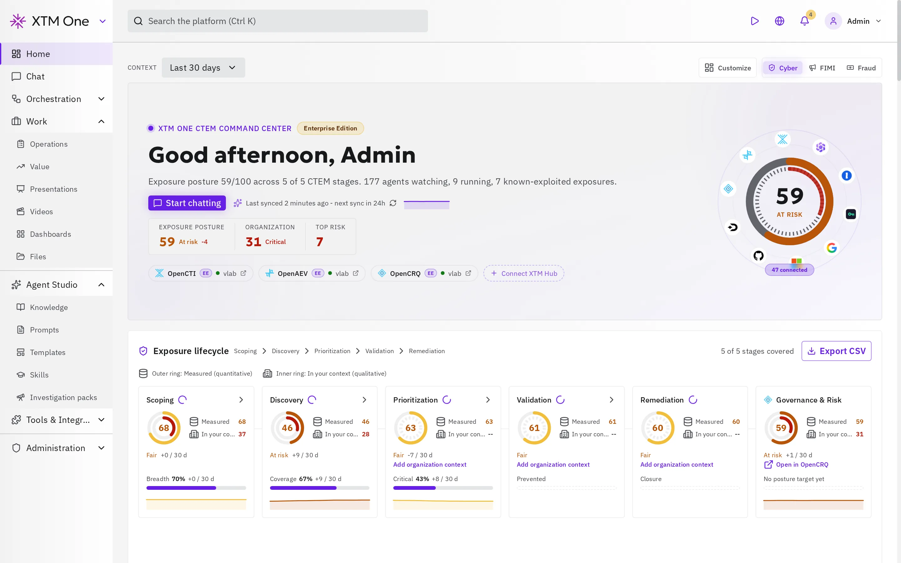
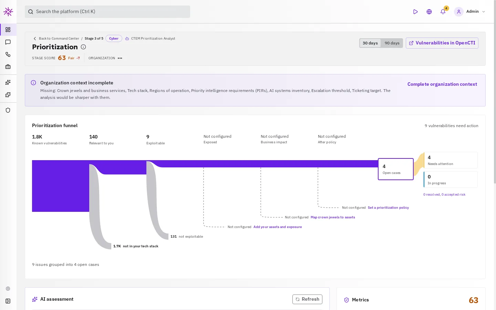
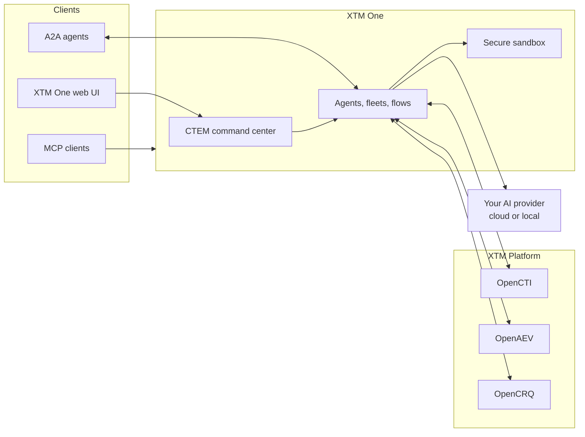

<h1 align="center">
  <a href="https://filigran.io/platform/xtm-platform/"></a>
</h1>
<p align="center">
  <a href="https://filigran.io/platform/xtm-platform/"></a>
  <a href="https://docs.xtmone.io/"></a>
  <a href="https://github.com/XTM-One-Platform/xtm-one/releases/latest"></a>
  <a href="https://hub.docker.com/u/xtmone"></a>
  <a href="LICENSE"></a>
  <a href="https://community.filigran.io"></a>
  <a href="https://github.com/XTM-One-Platform/xtm-one"></a>
</p>

<p align="center"><b>The open source agentic core of Continuous Threat Exposure Management.</b></p>

XTM One is the core of Filigran's [XTM Platform](https://filigran.io/platform/xtm-platform/). It connects [OpenCTI](https://github.com/OpenCTI-Platform/opencti) (threat intelligence), [OpenAEV](https://github.com/OpenAEV-Platform/openaev) (adversarial exposure validation) and [OpenCRQ](https://github.com/OpenCRQ-Platform/opencrq) (cyber risk quantification) into one CTEM command center, and puts security agents to work on top of them.

Proactive security, run continuously: know the adversary, map your exposure, prove your defenses against real attacker techniques, and mobilize the fix. Self-hosted, with your own AI provider and your own data.

<picture>
  <source media="(prefers-color-scheme: dark)" srcset="./.github/img/readme-command-center-dark.webp">
  <source media="(prefers-color-scheme: light)" srcset="./.github/img/readme-command-center-light.webp">
  
</picture>

## Table of contents

- [Why XTM One](#why-xtm-one)
- [The CTEM lifecycle in XTM One](#the-ctem-lifecycle-in-xtm-one)
- [Capabilities](#capabilities)
- [How it works](#how-it-works)
- [Editions](#editions)
- [Quick start](#quick-start)
- [Documentation](#documentation)
- [Contributing](#contributing)
- [Community](#community)
- [Security](#security)
- [About](#about)

## Why XTM One

- **One posture, five stages.** The command center scores your exposure across the CTEM lifecycle from the data already in OpenCTI, OpenAEV and OpenCRQ, and shows where the program is weakest.
- **Threat-informed, not vulnerability-informed.** Exposures are ranked by the adversaries that target you and by what your defenses failed to stop in validation, not by a raw severity score.
- **Agents that do the work.** Stage analysts, an exposure briefing and seeded CTEM fleets read your platforms, explain what changed and propose the next actions. Every automation is opt-in.
- **Open by default.** The command center, the stage metrics and the native MCP servers work in the Community Edition, with AI switched off if you want.

## The CTEM lifecycle in XTM One

XTM One follows the five CTEM stages as the product names them: **Scoping**, **Discovery**, **Prioritization**, **Validation** and **Remediation** (shown as Mobilization in the FIMI and fraud verticals). Each stage has its own page, its own score, its own data sources and its own AI analyst.

| Stage | What XTM One does | Built on |
|---|---|---|
| **Scoping** | Frames the attack surface and the threat landscape that matters to your organization: sectors, regions, crown jewels, tech stack, intelligence requirements. | OpenCTI, OpenAEV, organization context |
| **Discovery** | Finds the vulnerabilities, assets and threat activity relevant to that scope, and flags blind spots and connected sources that return no data. | OpenCTI |
| **Prioritization** | Ranks exposures by threat relevance: known exploited vulnerabilities, adversaries targeting you, techniques without coverage, and expected loss when OpenCRQ is connected. | OpenCTI, OpenAEV, OpenCRQ |
| **Validation** | Proves whether defenses hold against the techniques that matter, through simulations, failed expectations and detection coverage. | OpenAEV, OpenCTI |
| **Remediation** | Turns findings into tracked actions, follows them to closure and re-tests the fix. | OpenCTI, OpenAEV |

<picture>
  <source media="(prefers-color-scheme: dark)" srcset="./.github/img/readme-prioritization-dark.webp">
  <source media="(prefers-color-scheme: light)" srcset="./.github/img/readme-prioritization-light.webp">
  
</picture>

## Capabilities

### CTEM command center

- **Exposure posture** across the five stages, with history, a live activity feed and a force sync that needs no AI.
- **Exposure briefing** (Enterprise Edition): a monthly and on-demand narrative of what changed in your exposure, with next steps.
- **Stage assessments** (Enterprise Edition): a weekly and on-demand assessment per stage, written by the stage's analyst (CTEM Scoping, Discovery, Prioritization, Validation and Mobilization Analysts).
- **Organization context**: sector, regions, crown jewels, tech stack, assets and prioritization policy, read by every CTEM agent so its output is about your organization, not a generic one.
- **Value**: run counts, cost and outcome tracking for the agents and fleets, so the program can show what it delivered.

### Seeded CTEM fleets

Ready-made teams of agents for recurring CTEM work, shipped disabled until an administrator switches them on:

- **Threat-informed exposure response**: a published threat becomes a relevance verdict, a proposed OpenAEV scenario, an expected loss and three approved actions, closed by a re-test.
- **Vulnerability prioritization to verified fix**: triage against your assets, exploitability validated in OpenAEV, risk quantified, remediation coordinated and re-tested.
- **AI security**, **third-party risk**, and **CTEM posture and reporting** fleets.

Fleets react to OpenCTI and OpenAEV events (new intrusion sets, finished simulations) through triggers XTM One provisions on the platforms, and run as the administrator who enabled them.

<picture>
  <source media="(prefers-color-scheme: dark)" srcset="./.github/img/readme-fleet-dark.webp">
  <source media="(prefers-color-scheme: light)" srcset="./.github/img/readme-fleet-light.webp">
  
</picture>

### Threat intelligence (with OpenCTI)

- **Conversational analysis**: search, read and write STIX 2.1 knowledge in OpenCTI in natural language, with your own permissions on the platform.
- **Grounded STIX extraction**: extract STIX 2.1 objects and TTPs from reports, each grounded in its source text, with an evaluation that aligns objects the way OpenCTI imports them.
- **Dashboards, threat hunting packages and entity insights**: design OpenCTI dashboards, build hunting packages from high-value indicators, and summarize any entity's activity and history.

### Exposure validation (with OpenAEV)

- **Scenario design**: plan adversary emulation scenarios mapped to MITRE ATT&CK, with payloads grounded in public references.
- **Autonomous attack path** (Enterprise Edition, OpenAEV preview): an AI attack-path orchestrator in XTM One plans the path, picks the next technique and runs it through OpenAEV, which executes, enforces scope and renders the live attack graph. The operator steers from OpenAEV.
- **Results review**: read simulations, failed expectations and findings to measure and improve your defenses.

### Detection engineering

- **Rule conversion**: turn STIX 2.1 indicator patterns into rules for SIEM, EDR and XDR platforms and universal formats (Splunk SPL, Microsoft Sentinel KQL, Elastic, Sigma, YARA, Snort/Suricata and more).
- **Detection rules from simulations**: generate detection rules for the techniques OpenAEV proved undetected.

### Open interfaces

- **Native MCP servers** for OpenCTI and OpenAEV: any MCP client connects to `POST /mcp/opencti` or `POST /mcp/openaev` with a personal API key or OAuth 2.1, and works with business and knowledge tools under its own identity on the platform. Community Edition. See [dev-docs/platform-mcp-servers.md](dev-docs/platform-mcp-servers.md).
- **Agent-to-agent (A2A)**: expose an XTM One agent to other agents through a published agent card, and call remote A2A agents from XTM One. See [dev-docs/a2a-server-operations.md](dev-docs/a2a-server-operations.md).
- **Threat-intelligence and security integrations** such as MITRE ATT&CK, MITRE ATLAS, MISP and Recorded Future, listed in the [documentation](https://docs.xtmone.io/).

### The engine underneath

- **Agents, fleets and flows** with schedules, webhooks, platform events and work items, human approval where you want it, and full traces of every run.
- **Secure sandbox**: agents run code and checks in isolated containers (OpenSandbox, part of the compose stack) with closed egress.
- **Evaluations** to score agents and models against reference sets before you trust them with your program. See [dev-docs/evaluations.md](dev-docs/evaluations.md).

## How it works



- **Self-hosted.** XTM One, its PostgreSQL (with pgvector), Redis and object store run where you deploy them. Your data stays with you.
- **Bring your own model.** Anthropic, OpenAI, Google Gemini, Mistral AI, OpenRouter, or a local model through LM Studio. AI can be switched off for the whole platform or per group.
- **Credentials encrypted at rest.** Integration and provider credentials are stored Fernet-encrypted in the database and configured from the settings, never in configuration files.
- **Your permissions, not a service account.** Platform tools act with the connecting user's identity on OpenCTI and OpenAEV.

## Editions

| | Community Edition | Enterprise Edition |
|---|---|---|
| License | [Apache 2.0](LICENSE) | [XTM One Enterprise Edition License](LICENSE) |
| CTEM command center, stage pages and metrics, force sync, live activity | Yes | Yes |
| Native MCP servers for OpenCTI and OpenAEV | Yes | Yes |
| Exposure briefing and stage assessments | | Yes |
| Seeded CTEM fleets and fleet automations | | Yes |
| Autonomous attack path (with OpenAEV) | | Yes |

The Community Edition works with AI switched off: every metric that needs no model is computed and shown, and each AI or Enterprise surface shows a clear call to action instead of an empty state ([dev-docs/ctem-open-source.md](dev-docs/ctem-open-source.md)). Each source file states its license in its header. See the [Filigran offering](https://filigran.io/offering/subscribe) for the Enterprise Edition; you can start a trial from the platform settings.

## Quick start

Requirements: Docker with Docker Compose.

```bash
git clone https://github.com/XTM-One-Platform/xtm-one.git && cd xtm-one
cp .env.sample .env      # set SECRET_KEY, DB_PASSWORD, ADMIN_EMAIL and ADMIN_PASSWORD
docker compose up -d     # builds the platform image from this checkout on first start
```

Then:

1. Open **http://localhost:4000** and sign in with `ADMIN_EMAIL` and `ADMIN_PASSWORD`.
2. In **Settings**, add an AI provider and pick the default model (skip it to run without AI).
3. In **Settings**, register your OpenCTI and OpenAEV instances (URL and API key), and OpenCRQ if you run it.
4. Open the home page: the CTEM command center syncs from the registered platforms.

`.env.sample` sets `PLATFORM_MODE=xtm_one`, the CTEM experience. Everything else (SSO, integrations, AI providers) is configured from the settings, not from the environment.

### Compatibility

XTM One follows the release train of the XTM Platform. Run the current releases of OpenCTI, OpenAEV and OpenCRQ alongside the [latest XTM One release](https://github.com/XTM-One-Platform/xtm-one/releases/latest); version notes are in each [release](https://github.com/XTM-One-Platform/xtm-one/releases).

Images are published on [Docker Hub](https://hub.docker.com/u/xtmone). The full installation guide is in the [documentation](https://docs.xtmone.io/).

## Documentation

- [User and administrator documentation](https://docs.xtmone.io/)
- [Architecture](dev-docs/architecture.md) and [developer documentation](dev-docs/)
- [CTEM in Community Edition and with AI disabled](dev-docs/ctem-open-source.md)
- [Native MCP servers](dev-docs/platform-mcp-servers.md)

## Contributing

- Read the [contributing guide](CONTRIBUTING.md) to set up a development environment, propose a fix and build and test your change.
- XTM One has adopted a [Code of Conduct](CODE_OF_CONDUCT.md).
- New here: start with a [good first issue](https://github.com/XTM-One-Platform/xtm-one/labels/good%20first%20issue).

## Community

- **Bugs and feature requests**: [GitHub issues](https://github.com/XTM-One-Platform/xtm-one/issues).
- **Discussion and support**: the Filigran [community Slack](https://community.filigran.io), or contact@filigran.io.

## Security

Please report vulnerabilities privately as described in [SECURITY.md](SECURITY.md), never in a public issue.

## About

XTM One is designed and developed by [Filigran](https://filigran.io).

<a href="https://filigran.io"></a>
