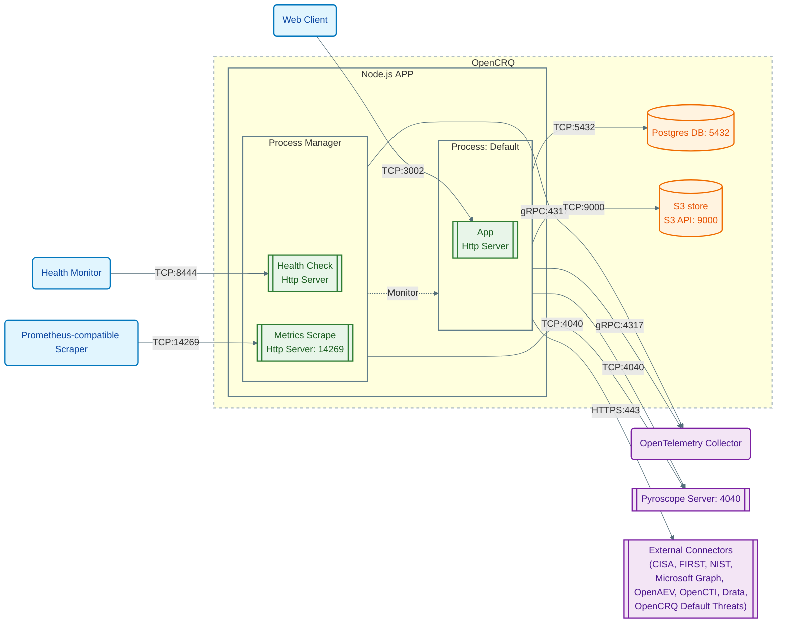

# 🏗️ Architecture

This document describes the technical architecture, network flows, and configuration of the OpenCRQ application. It serves as a reference for deploying and securing the production environment.

## 1. High-Level Architecture

The architecture consists of:
* Node.js application
* PostgreSQL database
* An S3-compatible object store for file storage, optional (RustFS in the development stack, Silo in the XTM Docker bundle)
* Pyroscope profiling service
* OpenTelemetry Collector (optional — see the note under the diagram)
* External connectors (CISA, FIRST, NIST, Microsoft Graph, OpenAEV, OpenCTI, Drata, OpenCRQ Default Threats) reached over outbound HTTPS

The push path (OTLP, through the collector) and the pull path (Prometheus scrape, direct) are independent alternatives, not a chain: a deployment may enable either, both, or neither.

## 2. Network Policies

| Source       | Destination           | Port / Protocol       | Associated Env Var                                                                                        | Description                                               |
|:-------------|:-----------------------|:----------------------|:----------------------------------------------------------------------------------------------------------|:----------------------------------------------------------|
| **App**      | **Postgres**          | TCP:5432 (PostgreSQL) | `POSTGRES__HOST`, `POSTGRES__PORT`                                                                        | Main database connection for persistence.                 |
| **App**      | **S3 store**          | TCP:9000 (S3 API)     | `FILE_STORAGE__ENDPOINT`, `FILE_STORAGE__ACCESS_KEY`, `FILE_STORAGE__SECRET_KEY`, `FILE_STORAGE__BUCKET`, `FILE_STORAGE__REGION` | Optional S3-compatible object store for uploaded files (e.g. imported STIX bundles). |
| **App**      | **Pyroscope**         | TCP:4040 (HTTP)       | `TELEMETRY__OBSERVABILITY__PYROSCOPE__SERVER_ADDRESS`                                                                    | Continuous profiling data stream (CPU, Heap).             |
| **App**      | **Otel Collector**    | TCP:4317 (gRPC)       | `TELEMETRY__OBSERVABILITY__OTLP__TRACES__EXPORTER`, `TELEMETRY__OBSERVABILITY__OTLP__METRICS__EXPORTER`, `TELEMETRY__OBSERVABILITY__OTLP__LOGS__EXPORTER` | OpenTelemetry data export (Traces, Metrics, Logs).        |
| **App**      | **External Connectors** | TCP:443 (HTTPS)    | `CONNECTORS__NIST__<tenant-uuid>__*`, `CONNECTORS__MICROSOFT_GRAPH__<tenant-uuid>__*`, `CONNECTORS__OPENAEV__<tenant-uuid>__*`, `CONNECTORS__OPENCTI__<tenant-uuid>__*`, `CONNECTORS__DRATA__<tenant-uuid>__*`, `CONNECTORS__DEFAULT_THREATS__DATASET_URL`                   | Outbound periodic sync jobs enriching assets/vulnerabilities, plus an OpenCTI Live Stream (SSE) subscription for threat intelligence. CISA, FIRST and OpenCRQ Default Threats (a daily read of a public dataset file) require no configuration; NIST, Microsoft Graph, OpenAEV, OpenCTI and Drata are optional, configured per tenant. See [Connectors](configuration.md#connectors). |
| **External** | **App**               | TCP:3002 (HTTP)       | `HTTP_SERVER__PORT`                                                                                       | Main access to the API and Frontend.                      |
| **External** | **App**               | TCP:8444 (HTTP)       | `HEALTHCHECK_HTTP_SERVER__PORT`                                                                           | Dedicated endpoint for health check (Liveness/Readiness). |
| **External** | **App**               | TCP:14269 (HTTP)      | `TELEMETRY__OBSERVABILITY__PROMETHEUS__PORT`                                                                     | Optional Prometheus scrape endpoint (see [Metrics](metrics.md)). Unauthenticated by design — expose it only on a network reachable by your monitoring system, never publicly; the bind address is controlled by `TELEMETRY__OBSERVABILITY__PROMETHEUS__HOST`. |
| **External** | **Pyroscope**         | TCP:4040 (HTTP)       | -                                                                                                          | Access to the Pyroscope web client, exposed by the operator's own Pyroscope deployment. |

## 3. Configuration

For detailed configuration options and environment variables, please refer to the [Configuration Guide](configuration.md).

## 4. Observability & Health

### Healthchecks
The application exposes a dedicated HTTP server for health checks, distinct from the main API server.
- **Internal Port**: 8444
- **Variable**: `HEALTHCHECK_HTTP_SERVER__PORT`

### Profiling
The App can stream continuous profiling data (CPU, Heap) to an operator-managed Pyroscope instance; OpenCRQ does not run or manage the Pyroscope service itself.
- **Configuration**: `TELEMETRY__OBSERVABILITY__PYROSCOPE__ENABLED`, `TELEMETRY__OBSERVABILITY__PYROSCOPE__SERVER_ADDRESS` (see [Configuration Guide](configuration.md#pyroscope))
- **UI Port**: 4040, exposed by the operator's own Pyroscope deployment

### Telemetry
The application supports OpenTelemetry for Traces, Metrics, and Logs.
- **Traces**: Configured via `TELEMETRY__OBSERVABILITY__OTLP__TRACES__ENABLED` and `TELEMETRY__OBSERVABILITY__OTLP__TRACES__EXPORTER`.
- **Metrics**: Two independent transports. The OTLP push is configured via `TELEMETRY__OBSERVABILITY__OTLP__METRICS__ENABLED` and `TELEMETRY__OBSERVABILITY__OTLP__METRICS__EXPORTER`; the Prometheus scrape endpoint via `TELEMETRY__OBSERVABILITY__PROMETHEUS__ENABLED` and its `TELEMETRY__OBSERVABILITY__PROMETHEUS__*` settings. Either or both may be enabled, and a collector is not required for the scrape path. A superseded or unknown `TELEMETRY__*` variable is not ignored: the platform fails to start, naming the configuration key it maps to. Like the rest of the configuration, an invalid value for a transport switched on fails the process at startup rather than silently disabling that transport (the settings of a transport switched off are not read, so their values are not checked) — this only covers config shape, not runtime reachability (e.g. an unresolvable OTLP host), which the telemetry SDK logs but never crashes on.
- **Logs**: Configured via `TELEMETRY__OBSERVABILITY__OTLP__LOGS__ENABLED` and `TELEMETRY__OBSERVABILITY__OTLP__LOGS__EXPORTER`.

## 5. File Storage

An S3-compatible object store holds the files the App persists (e.g. imported STIX bundles), scoped per tenant. It is optional: the app boots with the feature disabled when `FILE_STORAGE__*` variables are unset. See [File Storage configuration](configuration.md#file-storage-rustfs--s3-compatible) for details, boot behavior and bucket provisioning.
- **S3 API Port**: 9000 (`FILE_STORAGE__ENDPOINT`)

## 6. External Connectors

OpenCRQ can enrich supporting assets and vulnerabilities through outbound connectors run as periodic background jobs. See [Connectors configuration](configuration.md#connectors) for the full activation and credential reference.

| Connector           | Reached Endpoint                                                    | Configuration Required |
|:---------------------|:---------------------------------------------------------------------|:------------------------|
| **CISA** (KEV)       | `www.cisa.gov`                                                       | None — always on        |
| **FIRST** (EPSS)     | `api.first.org`                                                      | None — always on        |
| **NIST** (NVD)       | `services.nvd.nist.gov`                                              | Optional per-tenant API key (`CONNECTORS__NIST__<tenant-uuid>__API_KEY`) |
| **Microsoft Graph**  | `login.microsoftonline.com`, `graph.microsoft.com`                   | Per-tenant Azure AD app registration (`CONNECTORS__MICROSOFT_GRAPH__<tenant-uuid>__*`) |
| **OpenAEV**          | Configurable OpenAEV instance URL                                    | Per-tenant instance URL + token (`CONNECTORS__OPENAEV__<tenant-uuid>__*`) |
| **OpenCTI**          | Configurable OpenCTI instance URL (Live Stream/SSE, not periodic sync) | Per-tenant instance URL + token (`CONNECTORS__OPENCTI__<tenant-uuid>__*`) |
| **Drata**            | Configurable Drata API base URL                                      | Per-tenant API key (`CONNECTORS__DRATA__<tenant-uuid>__*`) |
| **OpenCRQ Default Threats** | `raw.githubusercontent.com` (the dataset URL, configurable)    | None — on by default for every tenant. An air-gapped platform points `CONNECTORS__DEFAULT_THREATS__DATASET_URL` to a mirror, or empties it to turn the connector off |

## 7. Resource Estimation

Below is a basic estimation of the resources required to start the internal instances for a standard deployment.

| Service         | CPU (vCPU)     | RAM (Minimum) | RAM (Recommended) |
|:----------------|:---------------|:--------------|:------------------|
| **PostgreSQL**  | 0.5 - 1        | 256 MB        | 1 GB              |
| **S3 store**    | 0.2 - 0.5      | 128 MB        | 256 MB            |
| **Node.js App** | 0.5 - 1        | 512 MB        | 1 GB              |
| **Total**       | **~1.2 - 2.5** | **~0.9 GB**   | **~2.3 GB**       |
