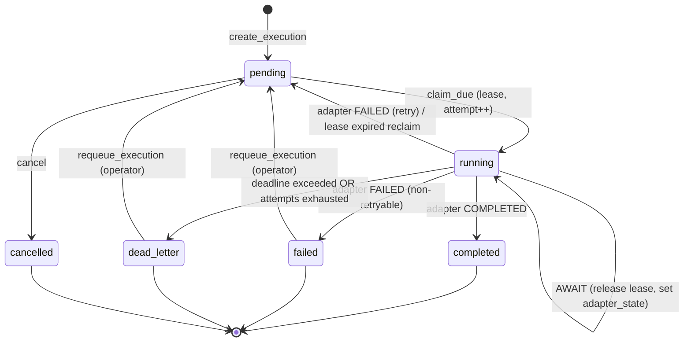
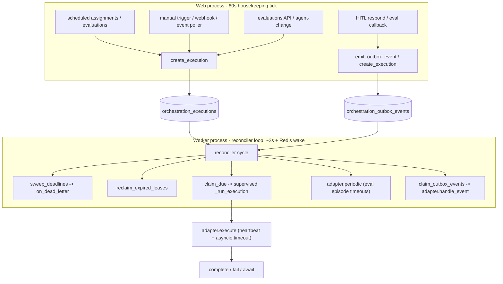

# Flow Diagrams

## Execution lifecycle

## Dispatch + recovery

## HITL resume (assignment)

1. `execute_assignment_run` pauses → run `awaiting_human` → adapter returns
   AWAIT → execution stays `running` (lease released), no deadline.
2. User responds → `resume_assignment_run` emits a `resume` outbox event on the
   execution (found by `dedup_key=assignment_run:<run_id>`).
3. Reconciler claims the event → `AssignmentAdapter.handle_event` re-arms the
   execution (`running → pending`).
4. `claim_due` re-runs `execute_assignment_run` under a fresh lease; it resumes
   from the pause and completes (or AWAITs again).
