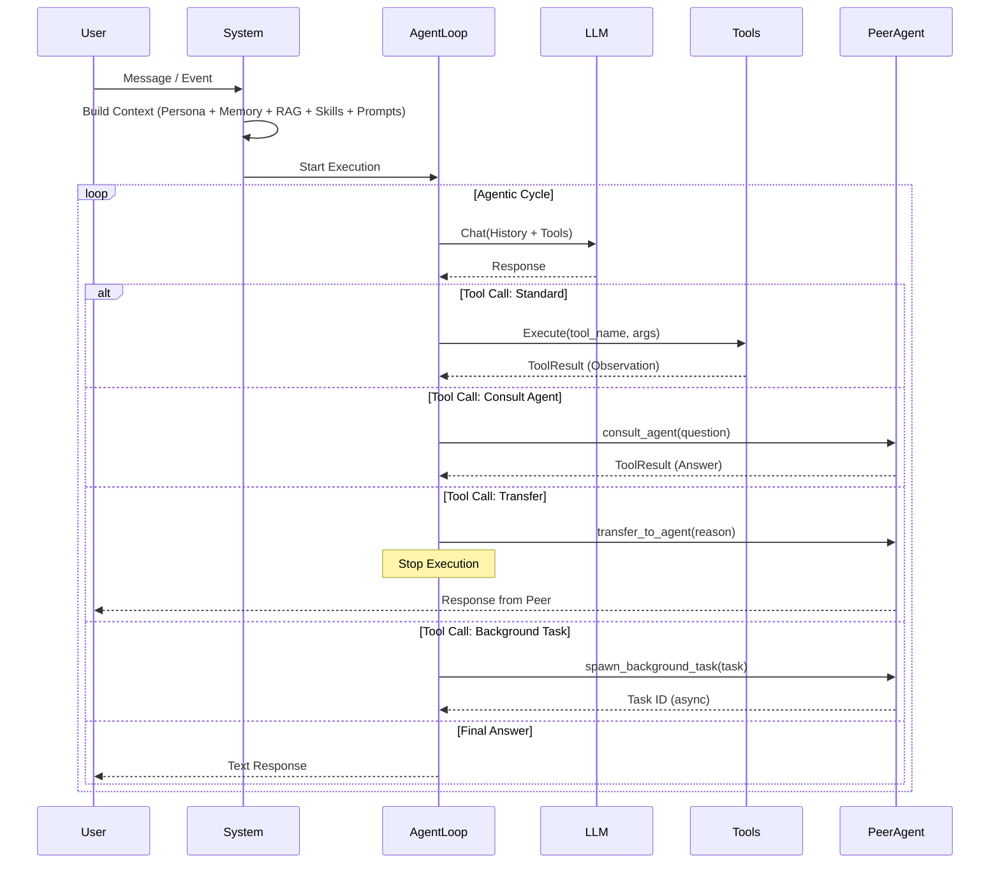
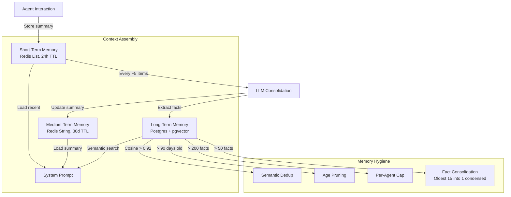
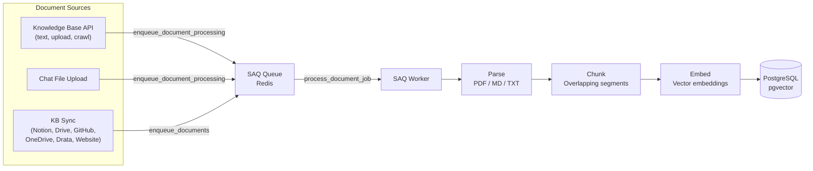

# XTM One Architecture

This document provides a comprehensive technical overview of the XTM One platform. It is designed to help engineers understand the system's structure, core components, data flows, and design principles.

## 1. Overview

XTM One is an **autonomous agentic assistant platform**. Unlike traditional chatbots that simply respond to user queries, Copilot is built around **autonomous agents** that can proactively execute tasks based on triggers (schedules, webhooks, external events).

The system is designed to be:
- **Generic**: Not tied to a specific domain; behavior is defined by agent configuration.
- **Extensible**: Supports custom tools (Docker-preferred JS/Python sandbox), MCP servers, agent skills, and external integrations.
- **Multi-Model**: Works with any LLM provider (Anthropic, OpenAI, Google, Mistral, OpenRouter, Ollama, Azure, Bedrock, LiteLLM, Custom OpenAI-compatible).
- **Secure**: All credentials are Fernet-encrypted; no sensitive data in environment variables.
- **Event-Driven**: Assignments are triggered by events, not just user chat.
- **Observable**: Integrated Langfuse tracing for LLM calls, tool usage, and assignment runs.

## 2. High-Level Architecture

The platform is containerized via Docker Compose with five services. A single **unified platform container** (built from the root `Dockerfile`) runs FastAPI on port 4000 and serves both the API and the built frontend static files (plus the Office Add-in at `/office/`) -- there is no nginx and no separate frontend container. A separate **worker container** (built from `Dockerfile.worker`) runs the SAQ worker and the durable orchestration reconciler.

```mermaid
graph TD
    subgraph Client Layer
        Browser[Browser / Web App]
        External[External Apps / Webhooks]
        Widget[Public Chat Widget]
        LLMClient[LLM Client / API Key]
        MCPClient[MCP Client]
    end

    subgraph Service Layer
        subgraph Platform["Platform Container (Port 4000)"]
            API["FastAPI Server\n(API + SSE + static frontend)"]
            React[React 19 SPA\nbuilt into the image]
            Scheduler["Autonomous Scheduler\n(in-process asyncio task)"]
        end

        Worker["Worker Container\n(SAQ jobs + orchestration reconciler)"]
    end

    subgraph Data Layer
        PG[(PostgreSQL 17 + pgvector)]
        Redis[(Redis 8)]
        MinIO[(Silo / S3 Storage)]
    end

    subgraph "External Ecosystem"
        LLM[LLM Providers\nAnthropic, OpenAI, Google, etc.]
        MCP[MCP Servers\nGitHub, Notion, etc.]
        Integrations[Integrations\nMicrosoft, Google, Slack]
        Channels[Channel Platforms\nSlack, Teams, WhatsApp,\nTelegram, Discord, Google Chat]
        Langfuse[Langfuse\nObservability]
    end

    Browser -->|HTTP/SSE| API
    External -->|Webhooks| API
    Widget -->|HTTP| API
    LLMClient -->|OpenAI-compat /v1| API
    MCPClient -->|Streamable HTTP /mcp| API
    API -->|catch-all /| React

    API -->|Read/Write| PG
    API -->|Cache/PubSub| Redis
    API -->|Files| MinIO

    Worker -->|SAQ Jobs| Redis
    Worker -->|Orchestration executions| PG

    API <-->|LLM Calls| LLM
    API <-->|Tool Exec| MCP
    API <-->|Events/OAuth| Integrations
    API <-->|Bot Messages| Channels
    API -->|Traces| Langfuse
```



### Key Components

| Component | Technology | Responsibilities |
|-----------|------------|------------------|
| **Platform** | Python 3.14, FastAPI + React 19, Vite 8, Tailwind CSS 4 | Unified container: REST API, SSE streams (chat, activity), the runner and relay WebSockets, authentication (JWT + OIDC + SAML), LLM proxy, MCP agent endpoint, agentic loop execution, the autonomous scheduler, and static serving of the built frontend (FastAPI catch-all) and Office Add-in. Listens on port 4000. |
| **Autonomous Scheduler** | Python (in-process asyncio task) | Runs every 60s inside the platform process. Handles cron-triggered assignments, integration event polling, OAuth token refresh, KB sync, memory maintenance, skill auto-refresh, API key stats flush, quota flush, and AI adoption metrics collection. |
| **Worker** | Python, SAQ | Separate container running SAQ jobs (document processing, agent task jobs) plus the durable orchestration reconciler that drives assignment dispatch, evaluation runs, and sub-agent tasks. See [Section 8](#8-background-processing--execution-model). |
| **PostgreSQL** | PostgreSQL 17 + pgvector | Primary persistent store. Relational data (Users, Agents, Assignments, orchestration executions) and vector embeddings (Agent Memory, Knowledge Base chunks). |
| **Redis** | Redis 8 | SAQ job queue, pub/sub for chat turn fan-out, caching, short/medium-term agent and user memory. |
| **Silo** | Silo (S3-compatible, community-maintained MinIO fork) | Object storage for chat file attachments, AI-generated images, and code interpreter charts. Swappable with AWS S3. |

## 3. Core Concepts & Data Models

The platform's logic revolves around several central entities. Understanding these is key to understanding the codebase.

### 3.1 Agents (`Agent`)
The primary actor. An agent is more than a chatbot; it is a configured entity with:
- **Persona**: System prompt that defines the agent's identity and behavior.
- **Tools**: Capabilities granted via MCP servers, custom tools, integrations, and built-in tools.
- **Knowledge Bases**: Access to specific RAG corpora (read and/or write).
- **Assignments**: Automation rules triggered by events.
- **Memory**: 3-tier memory system (Short-term, Summary, Persistent).
- **Skills**: Reusable instruction sets injected into system prompts at runtime.
- **Prompts**: Reusable prompt templates injected into system prompts.
- **Handover Agents**: Peer agents for delegation (consult, transfer, or background task).
- **Channel Config**: Per-channel settings (receive/publish channels, anonymous access, private conversations, mention-only mode).
- **LLM Override**: Optional per-agent model override.
- **Output Format**: Configurable response format (`markdown`, `html`, `json`, `plain_text`). Auto-overridden per channel to match the platform's native formatting (e.g., Slack mrkdwn, Teams Markdown).
- **`disable_chat`**: Hide from chat/proxy while keeping assignments active.

### 3.2 Assignments (`Assignment`)
The automation engine. An assignment defines **when** an agent acts and **what** it does.
- **Trigger**: Schedule (CRON), Webhook, Integration Event, or Manual.
- **Prompt**: The instruction given to the LLM for this specific execution.
- **Delay**: Optional wait period before execution (e.g., `10m`, `1h`).
- **Tool Scoping**: Allow/deny lists for which tools the assignment can use.
- **KB Access**: Split into explicit read (`read_knowledge_base_ids`, NULL/[] = all agent KBs) and write (`write_knowledge_base_ids`, refining the agent's writable KBs from `knowledge_base_permissions`) controls.
- **Custom Prompts**: Override activation gate, AI label, and human-in-the-loop prompts.
- **Chaining**: Optional `next_assignment_id` to trigger another assignment on completion.
- **Retry Policy**: Configurable `retry_on_failure` with `max_retries`.

### 3.3 Supporting Entities

| Entity | What it is |
|--------|------------|
| **Integration** | OAuth-connected or API-key-based external service (Microsoft, Google, GitHub, Slack, Notion, Jira, HubSpot, Figma, LinkedIn, X, Facebook, Bluesky, OpenCTI, OpenAEV, Metabase, Planhat, Perk, Drata, HiBob, Ashby, Carta, NewsAPI, RSS, Google Search, Credly, Concord, n8n, and more). All credentials stored encrypted in DB. Optional `description` field surfaced to agents as tool context. |
| **Channel Bot** | Standalone messaging platform bot (Slack, Teams, WhatsApp, Telegram, Discord, Google Chat) with encrypted credentials. Separate from integrations — uses bot tokens, not OAuth. Has `allow_anonymous`, `allow_private`, and `only_mention` flags with bot-enforced resolution (the bot-level setting is a hard constraint; the agent override applies only when the bot allows it). |
| **Knowledge Base** | Vectorized document collection for RAG. Documents are chunked, embedded, and stored in pgvector. Supports sync sources (Notion, Google Drive, OneDrive/SharePoint, GitHub, Drata, website crawl). Tracks `query_count` for usage analytics. |
| **MCP Server** | External tool server via Model Context Protocol. Agents use MCP tools during chat and assignment execution. Supports `hide_from_chat` and `is_public_catalog`. Supports OAuth 2.1 authentication for secured MCP servers. |
| **Custom Tool** | User-defined tool with input variables and a JavaScript or Python function. Executed in a hardened Docker sandbox when available (`CUSTOM_TOOL_SANDBOX`, default `auto`) with a sandboxed subprocess fallback. Supports `hide_from_chat` and `is_public_catalog`. |
| **Agent Skill** | Reusable instruction set following the [Agent Skills spec](https://agentskills.io). URL to a SKILL.md file, fetched and cached in DB, injected into agent system prompts at runtime. Auto-refreshed every 24 hours by the scheduler. |
| **Prompt** | Reusable prompt template. Can be attached to agents (injected into system prompts) or used directly from chat. Supports `hide_from_chat` and `is_public_catalog`. |
| **Variable** | User-defined named variable with an encrypted value. Variables can be referenced in assignment prompts and resolved at execution time by the `variable_resolver` service. |
| **Agent Template** | DB-backed reusable agent config. 9 built-in templates seeded at startup: Mail Desk, Support Relay, Channel Monitor, News Monitor, GitHub Sentinel, Social Media Manager, Deal Desk, HR Operations, Compliance Watchdog. Admin-editable. Users create agents from templates or from scratch. |
| **General Assistant** | Platform-wide chat config (LLM model + system prompt + channel routing via `channel_config`). Admin-set, users can override model. |
| **Audit Log** | Immutable record of user actions (CRUD, config changes, auth events). Admin-only. |
| **Group** | Admin-managed user group for entity sharing via `shared_group_ids`. |
| **Public Catalog** | The Filigran AI Catalog of published entities. Company-managed entities with `is_public_catalog = True` are browsable by anyone (no auth required). Authenticated users can one-click clone catalog items into their own account. Supported types: Agents, Prompts, Skills, MCP Servers, Custom Tools. |
| **MCP Agent Endpoint** | Exposes Copilot agents as MCP tools via Streamable HTTP (JSON-RPC 2.0). Two modes: **User** (`POST /mcp/user`, API key auth `fcp-...`, user-selected agents) and **Global** (`POST /mcp/global`, MCP key auth `mcp-...`, admin-selected agents). Each agent becomes a tool (slug = tool name, persona = description). |
| **AI Adoption Dashboard** | Admin dashboard for tracking agentic AI adoption on the platform across the organization (Overview and Adoption Gaps), from the platform's own daily metrics. |

### 3.4 Entity Visibility (Three-Tier Model)

Entity visibility follows three tiers: **own + group-shared + company-managed**.

| Tier | Column | Visibility | Permissions |
|------|--------|------------|-------------|
| **Own** | `user_id = current_user.id` | Private to the creator | Full read/write |
| **Group-shared** | `shared_group_ids` overlaps user's groups | Visible to group members | Full read/write (violet "Shared" badge) |
| **Company-managed** | `is_company_managed = True` | Visible to all users | Read-only for non-admins (amber "Read-only" badge), full read/write for admins |

All main entities (Agents, Integrations, Knowledge Bases, MCP Servers, Custom Tools, Channel Bots, Prompts) support this model. Toggling from company-managed → private auto-cleans references from other users' agents.

## 4. The Agentic Loop

The **Agentic Loop** is the core engine that drives autonomous behavior. It is a recursive "Think → Act → Observe" cycle that allows the LLM to use tools iteratively until a goal is achieved.

It is implemented in `backend/app/tools/agent_loop.py` and orchestrated by:
- `agent_chat.py` — real-time chat with agents
- `general_chat.py` — General Assistant chat
- `assignment_engine.py` — background assignment automation
- `public_chat.py` — public embeddable widget

### 4.1 Execution Flow



### 4.2 Context Assembly

Before the loop starts, the system gathers all necessary context:

1. **System Prompt**: Agent persona + identity context (date/time, user profile, timezone).
2. **Agent Skills**: SKILL.md content injected into the system prompt.
3. **Agent Prompts**: Reusable prompt templates injected into the system prompt.
4. **Output Format**: Channel-aware formatting instructions (Slack mrkdwn, Teams Markdown, WhatsApp, Telegram, Discord, Google Chat).
5. **Memory**: Short-term history + medium-term summary + semantic search from long-term memory (agent memory) + user memory (cross-agent).
6. **Knowledge**: Relevant chunks from the agent's Knowledge Bases (RAG).
7. **Tools**: Definitions for all available capabilities (MCP, Integrations, Custom Tools, Built-in).
8. **Peer Agents**: Profiles of *specifically configured* handover agents injected into context. The agent only knows about explicitly linked peers, not all platform agents.

### 4.3 Tools & Capabilities

The loop supports a heterogeneous mix of tools:

| Type | Source | Execution |
|------|--------|-----------|
| **Built-in Tools** | Python functions in the backend | `search_memory`, `store_memory`, `invalidate_memory`, `search_knowledge`, `generate_image`, `code_interpreter` (sandboxed Python subprocess with matplotlib chart capture), `web_fetch`, `browser` (Playwright headless) |
| **MCP Tools** | External servers via Model Context Protocol | Managed by MCP runtime, loaded at execution time |
| **Custom Tools** | User-defined JavaScript/Python | Docker container preferred when available (`CUSTOM_TOOL_SANDBOX`, default `auto`; `--network=none`, `--read-only`, `--cap-drop=ALL`, 128MB limit) with subprocess fallback |
| **Integration Tools** | Auto-generated from connected accounts | `outlook_send_email`, `github_create_issue`, etc. Scoped by element bindings. |
| **Delegation Tools** | `consult_agent`, `transfer_to_agent`, `spawn_background_task`, `check_task_status`, `get_task_result` | Injected when `handover_agent_ids` are configured |
| **Timer** | `wait` — the loop's own primitive (`app/tools/wait_policy.py`) | Pauses the run for a chosen duration (`wait("5m", until=<task or run ids>)`), ending early when one of the named background tasks or assignment runs finishes. Executed *inside* the loop, so it is bounded by the platform wait policy and the run deadline, cancellable by the user, and **exempt from the iteration limit** |
| **Meta Tools** | Agent builder | 45+ tools spanning agents, assignments, runs (`list_runs`/`get_run`), knowledge bases, integrations, prompts, skills, and variables (e.g. `list_agent_templates`, `list_available_resources`, `create_agent`, `create_assignment`) — build and manage agents via chat |

### 4.4 Safety & Robustness Mechanisms

To prevent infinite loops and context overflows, the engine enforces strict controls:

- **Iteration Limit**: Configurable cap (default 25 steps) to prevent runaway agents. It bounds *reasoning and acting*: a round that only waited (the `wait` primitive, or a `check_task_status` poll that actually paused) is refunded, so a 10-minute background task can no longer consume the whole budget in short polls. Refunds are capped at one budget's worth per run, and tokens are never refunded.
- **Wait Bounds**: A pause is bounded instead by `maximum_wait_time` (longest single wait, default 5 min) and `maximum_total_wait_time` (total per run, default 30 min) from Settings → General Assistant, plus the run's own wall-clock deadline (a wait always leaves room for the final answer). A user can cancel the run or skip just the pause; the agent wakes itself early via `until`.
- **Three-Stage Wind-Down**:
    1. **Nudge**: 4 steps before the limit, a system message warns the agent to wrap up.
    2. **Tool Stripping**: 2 steps before the limit, tools are removed — the LLM must rely on existing information.
    3. **Forced Final Answer**: If the limit is hit, a final "answer now" prompt forces a text response.
- **Session Pruning**: If total context exceeds 60% of the model's context window (dynamically calculated per model), older tool results are compressed into summaries (keeping the last 6 intact).
- **Result Truncation**: Individual tool outputs are capped at 15% of the model's context window (dynamically calculated per model) to prevent a single large response from crashing the context window.
- **Repeated Failure Detection**: If a tool fails consecutively with the same error, a hint advises the agent to try a different approach.

### 4.5 Agent Delegation (Handover)

Agents can collaborate using the **Handover Protocol**. The system injects descriptions of available peer agents into the system prompt, and the LLM decides whether to delegate. Each handover target has a typed relationship configured via `handover_types` (maps agent UUID → type):

| Type | Tool | Behavior |
|------|------|----------|
| `delegate` (default) | `spawn_background_task` | Asynchronous — spawns a background task on the target agent. Parent continues. |
| `consult` | `consult_agent` | Synchronous — asks the target agent a question and receives the answer. Parent stays in control. |
| `transfer` | `transfer_to_agent` | Permanent — hands the conversation to the target agent (chat only). |

Tools are conditionally injected based on the configured types — if no agents use `consult`, the `consult_agent` tool is omitted (and similarly for `transfer` and `delegate`). Sub-agent tasks (delegate type) run in isolated sessions (no history, `allow_handover=False`) and persist results in the `sub_agent_tasks` table. All inter-agent interactions are tracked in the `agent_delegations` table.

## 5. Memory System

The platform implements a **dual-stream, three-tier memory system** to ensure agents improve over time while maintaining context window efficiency.

### 5.1 Dual Streams

| Stream | Scope | Key | Purpose |
|--------|-------|-----|---------|
| **Agent Memory** | Per-agent | Agent ID | What the agent knows about its tasks and interactions |
| **User Memory** | Per-user; the profile cross-agent, each note per agent | User ID (or visitor ID) | The user's profile (role, language, style, key contacts) read by every agent, and the notes each agent's work left about the user, read by that agent only (`dev-docs/reference/agents-and-assignments.md` > "Cross-Agent User Memory") |

### 5.2 The Three Tiers

| Tier | Purpose | Storage | TTL | Trigger |
|:-----|:--------|:--------|:----|:--------|
| **Short-Term** | Immediate context. Rolling list of recent interactions. | Redis (List) | 24h | Every interaction (10 entries for agents, 15 for users) |
| **Medium-Term** | Working summary. Consolidated patterns, preferences, and current state. | Redis (String) | 30d | LLM consolidation after ~5 agent / ~6 user interactions |
| **Long-Term** | Durable facts. Extracted insights with vector embeddings for semantic search. | PostgreSQL (`agent_memory_entries` + pgvector) | ∞ (with hygiene) | Persisted during medium-term consolidation and context compaction |

### 5.3 Memory Lifecycle



### 5.4 Retrieval Logic

Access to Long-Term Memory is a hybrid process:

| Method | Trigger | Purpose |
|:-------|:--------|:--------|
| **Passive Injection** | Automatic (start of every loop) | The system loads the most relevant long-term facts that still hold into the prompt; a superseded entry never, a state entry dated |
| **Active Search (RAG)** | Agent decision (tool call) | The agent explicitly calls `search_memory(query="...")` for older or specific facts; superseded entries are listed last, flagged |

### 5.5 Context Compaction with Memory Auto-Flush

When conversations exceed 30 messages, a sliding window summarizer compacts old messages. Before summarization:
1. **Extract key facts** from the messages being compacted (via LLM).
2. **Persist each fact** to the agent's durable memory with vector embedding.
3. **Summarize and replace** old messages with a compact summary (keeping the last 15 messages verbatim).

The re-compaction interval is the gap between the trigger threshold and the keep-window plus one (16 new messages per cycle with the strict `>` trigger) — the summarizer runs once per full batch of new messages, never every few turns.

This ensures important information is never lost when context is compacted.

### 5.6 Memory Hygiene

Long-running agents accumulate facts. The system performs automated maintenance (hourly via the autonomous scheduler):

- **Semantic Deduplication**: Cosine similarity check (threshold: 0.92) before persisting new facts.
- **Age-Based Pruning**: Facts older than 90 days are automatically removed.
- **Per-Agent Cap**: Maximum 200 facts per agent; oldest evicted when exceeded.
- **Fact Consolidation**: When 50+ facts accumulate, the oldest 15 are merged into a single condensed entry by the LLM.
- **On-Demand**: `POST /agents/{id}/memory/maintain` triggers all hygiene tasks immediately.
- **Health Monitoring**: `GET /agents/{id}/memory/health` returns entry counts, staleness indicators, cap status, and configuration values.

## 6. LLM Architecture

### 6.1 Multi-Provider Support

The platform supports multiple LLM providers simultaneously through a custom router (`backend/app/llm/router.py`):

| Provider | SDK | Notes |
|----------|-----|-------|
| Anthropic | Native SDK | Claude models |
| OpenAI | Native SDK | GPT models |
| Google | Native SDK | Gemini models |
| Mistral | OpenAI-compatible | Via `openai_compat` |
| OpenRouter | OpenAI-compatible | Multi-model gateway |
| Ollama | OpenAI-compatible | Local models |
| Azure OpenAI | OpenAI SDK | Enterprise Azure |
| AWS Bedrock | Boto3 | Anthropic/other on AWS |
| LiteLLM | OpenAI-compatible | Universal proxy |
| Custom OpenAI | OpenAI-compatible | vLLM, TGI, LocalAI, LM Studio, any OpenAI-compatible endpoint |

All providers implement a common `BaseLLMProvider` interface: `chat()`, `chat_stream()`, `embed()`, `list_models()`, `list_embedding_models()`, `list_image_models()`, and `generate_image()` (optional). All LLM calls use a shared retry helper (`retry_llm_call()`) with exponential back-off + jitter for transient errors (429, 529, 5xx).

### 6.2 Model Resolution Chain

When the system needs to select an LLM model, it follows this priority:
1. **Agent override** — `Agent.llm_model` (if the agent has a specific model set)
2. **Agent default** — `PlatformSettings.agent_default_model` (admin-set default for all agents)
3. **User preference** — `User.preferred_llm_model` (from profile settings)
4. **Platform default** — `GeneralAssistantConfig.llm_model` (admin-set, also used by General Assistant)
5. **Any configured provider** — fallback to the first of `implicit_chat_configs()`: a config listing a chat model, or, while none does, one listing no model

Each tier only considers the providers the run's user may use: an admin can restrict a provider to groups and users, and a provider granted to the user wins over an unrestricted one, or exclude groups and users from it whatever it grants (see `dev-docs/reference/entities.md` > "Multi-Model Support").

### 6.3 OpenAI-Compatible LLM Proxy

The platform exposes an **OpenAI-compatible API** at `/v1`:
- `GET /v1/models` — lists available agents as "models"
- `POST /v1/chat/completions` — proxies requests through the agentic loop

Authentication uses platform API keys (`fcp-...` prefix). When `model: "agent:<slug>"` is specified, the request routes through the full agentic loop with the agent's persona, tools, and knowledge bases. Supports streaming and non-streaming responses. Agents with `disable_chat` are excluded from `/v1/models`.

### 6.4 MCP Agent Endpoint

The platform can expose agents as MCP-compatible tools via Streamable HTTP (`/mcp`), enabling external MCP clients to invoke Copilot agents as tools. Two modes are supported:

| Mode | Endpoint | Auth | Scope |
|------|----------|------|-------|
| **User** | `POST /mcp/user` | API key (`fcp-...`) | User-selected agents (or all visible) |
| **Global** | `POST /mcp/global` | MCP key (`mcp-...`) | Admin-selected agents |

Each agent becomes a tool where the slug is the tool name and the persona is the tool description. Tool execution runs the full agentic loop. Users configure exposed agents in their profile (`mcp_exposed_agent_ids`); admins configure the global endpoint in Settings.

The MCP endpoint also supports **OAuth 2.1** authorization (`/mcp/oauth/*`) with dynamic client registration, token revocation (RFC 7009), and well-known metadata discovery (`/.well-known/oauth-authorization-server` per RFC 8414, `/.well-known/oauth-protected-resource` per RFC 9728). The same server is an OpenID Connect provider for product sign-in: `/.well-known/openid-configuration`, and an `id_token` (EdDSA, the `/xtm/auth/jwks` key, `aud` = the client id, claims per granted scope: `email`, `profile` (`name`, `xtm_title`), `xtm_role` (`xtm_role`, `xtm_super_admin`)) on the code exchange, only for a platform's sign-in client (created through platform registration, `sign_in_redirect_uris`) whose registration is active and that asked for `openid`; dynamically registered clients get none, and nothing changes for them. Such a product sign-in has no consent page: on a first-hand XTM One session (never an impersonation) the authorization page authorizes at once, the grant is audited with `"consent": false`, and the token response carries no refresh token and an access token bound to the client (`aud` = the client id), which no `/mcp/*` endpoint accepts. Under the opt-in `CREDENTIAL_TRANSPORT_STRICT`, registration and the token endpoint refuse a request the platform cannot confirm arrived over HTTPS through `api/deps.refuses_credential_transport`, like runner enrollment.

## 7. Channels & External Messaging

### 7.1 Channel Types

| Channel | Adapter | Auth |
|---------|---------|------|
| **Web** | Built-in | JWT (logged-in) |
| **Web Embed** | Built-in | Per-agent `web_token` (public widget) |
| **Slack** | Channel Bot | Bot token + signing secret |
| **Teams** | Channel Bot | Bot Framework (App ID + secret) |
| **WhatsApp** | Channel Bot | Cloud API (token + verify) |
| **Telegram** | Channel Bot | Bot token |
| **Discord** | Channel Bot | Bot token + public key |
| **Google Chat** | Channel Bot | Service account |

### 7.2 Message Routing

`backend/app/channels/router.py` handles incoming messages from all platforms:

1. **Identify channel** and extract message metadata.
2. **Resolve agent** based on channel config (receive-enabled agents for that channel).
3. **Check access**: `allow_anonymous`, `allow_private`, `only_mention` flags (bot-enforced resolution: the bot-level setting cannot be defeated by the agent override).
4. **Route to agentic loop** (streaming or non-streaming).
5. **Deliver response** back through the channel adapter.

Private conversations (DMs) can bypass channel restrictions via the `allow_private` flag. Mention-only mode restricts bots to only respond when explicitly @mentioned in group channels.

### 7.3 Public Chat Widget

Agents can be exposed via an embeddable JavaScript widget (`/api/v1/public/widget.js`). The widget uses Shadow DOM for style isolation and authenticates via a per-agent `web_token`. Visitors get a unique visitor ID for user memory continuity.

### 7.4 Public Catalog

The platform includes a **Filigran AI Catalog** (`/api/v1/public/catalog`) that allows publishing and sharing entities across the community:

- **No auth for reads**: Anyone can browse published agents, prompts, skills, MCP servers, and custom tools without authentication.
- **One-click clone**: Authenticated users can clone catalog items into their own account.
- **Publishing**: Company-managed entities with `is_public_catalog = True` are automatically published to the catalog.
- **Frontend**: Dedicated public catalog pages (`/public/*`) with a separate layout, supporting list and detail views for all entity types.

## 8. Background Processing & Execution Model

The platform has three distinct execution paths:

1. **In-process async tasks** in the platform container for real-time chat (streaming requires it).
2. The **durable orchestration FSM** (driven by the reconciler in the worker) for assignment runs, evaluation runs, and sub-agent tasks.
3. The **SAQ worker** for document processing and agent task jobs.

### 8.1 The Worker Container

The worker container (`saq app.worker.settings`) runs two things in one process:

- **SAQ jobs** - two registered jobs in `backend/app/worker.py`:

| Job | Enqueued | Purpose |
|-----|----------|---------|
| `process_document_job` | Via `enqueue_document_processing()` | Parse -> chunk -> embed documents for knowledge bases |
| `run_agent_task_job` | Via the execution service | Agent task execution (task <-> assignment bridge) |

- **The orchestration reconciler** (`orchestration_reconciler.py`) - a background asyncio task started in the worker's `startup()` hook. It is the single drive loop for the durable FSM engine (see 8.3).

Concurrency and job timeout are configurable (`WORKER_CONCURRENCY`, default 20; `WORKER_JOB_TIMEOUT`, default 600s).

### 8.2 Document Processing Pipeline

When documents enter the system, they are enqueued as SAQ jobs via the `enqueue_document_processing()` helper in `api/v1/helpers.py`:



**Trigger points** (all go through `enqueue_document_processing()`):

| Source | File | When |
|--------|------|------|
| Add text document | `knowledge_bases.py` | `POST /knowledge-bases/{id}/documents/text` |
| Upload file | `knowledge_bases.py` | `POST /knowledge-bases/{id}/documents/upload` |
| Crawl URL | `knowledge_bases.py` | `POST /knowledge-bases/{id}/documents/crawl` |
| Reprocess all docs | `knowledge_bases.py` | `POST /knowledge-bases/{id}/documents/reprocess` |
| Chat file attachment | `chat.py` | `POST /chat/conversations/{id}/files` |
| Notion sync | `kb_sync.py` | Scheduled or manual |
| Google Drive sync | `kb_sync.py` | Scheduled or manual |
| OneDrive/SharePoint sync | `kb_sync.py` | Scheduled or manual |
| GitHub repo sync | `kb_sync.py` | Scheduled or manual |
| Drata sync | `kb_sync.py` | Scheduled or manual |
| Website crawl sync | `kb_sync.py` | Scheduled or manual |

Each job has a 600-second timeout. If the worker is not running, documents remain in `pending` status and can be reprocessed later.

### 8.3 Assignment Execution - Durable Orchestration FSM

Assignment runs, evaluation runs (+ episode callbacks), and sub-agent tasks execute through a **durable orchestration engine** documented in detail in [dev-docs/FSM/](FSM/README.md). In short:

- One table - `orchestration_executions` - is the single source of truth for scheduling (`run_at`, which also implements assignment delays), in-flight ownership (`lease_owner` / `lease_expires_at`), hard timeouts (`deadline_at`), and retries (`attempt_count` / `max_attempts`). There are no Redis `delayed_run:*` keys.
- Producers (cron scheduler, manual trigger, webhooks, evaluation API) create an execution via `orchestration_engine.create_execution(...)` and commit - nothing executes in the web process.
- The **reconciler** (`orchestration_reconciler.py`, running in the worker) sweeps deadlines, reclaims expired leases, claims due executions with `FOR UPDATE SKIP LOCKED`, and runs each via its adapter under a heartbeated lease, then drives the transactional outbox for resume events (e.g. HITL responses).
- Crash recovery is intrinsic: a dead worker's leases expire and executions are reclaimed (re-run) or dead-lettered automatically.

Real-time chat (agent, general, public) does **not** go through the FSM - token-by-token streaming over SSE requires in-process execution in the platform container.

### 8.4 Autonomous Scheduler

The autonomous scheduler runs as an asyncio background task inside the platform process (started in `main.py` lifespan). It ticks every 60 seconds and handles:

| Task | Frequency | What it does |
|------|-----------|-------------|
| **OAuth token refresh** | Every tick | Refreshes expiring OAuth tokens for integrations |
| **Scheduled assignments** | Every tick | Checks cron expressions for enabled assignments and creates orchestration executions for overdue ones |
| **Work-item inbox assignments** | Every tick | Autonomous pickup of pending work items by inbox-triggered assignments |
| **Integration event polling** | Every tick | Polls connected integrations for new events (emails, messages, etc.) |
| **KB sync scheduling** | Every tick | Checks sync source intervals and triggers overdue syncs |
| **Stuck/failed embedding recovery** | Every tick | Recovers stuck KB document embeddings, auto-retries failed ones, re-embeds stale documents |
| **Orchestration recovery backstop** | Every tick | Worker-down safety net: reclaims stale orchestration executions if the worker's reconciler is not running |
| **Scheduled evaluations** | Every tick | Triggers evaluation runs whose schedule is due |
| **Trace storage maintenance** | Every tick | Retention purge and daily-stats backfill for the native trace store |
| **Memory maintenance and retention sweeps** | Hourly (wall clock) | Runs memory hygiene (dedup, pruning, cap enforcement, fact consolidation) across all agents, the file, check file and Video Studio retention sweeps and the purges below. The hourly jobs run on a wall-clock schedule shared by every process (`services/wall_clock_schedule.py`, #768): due when their last completed pass, in Redis, is an hour old, one process at a time under a lock, a pass cut by a deploy retried once its lock expires. A retention sweep stopped at its per-tick cap drains on the next ticks |
| **Teams private channel monitoring** | Hourly | Renews Microsoft Teams private channel webhook subscriptions before expiry |
| **Shared state / work-item cleanup** | Hourly | Purges resolved shared state past retention, drops archived shared-state items past `shared_state_archive_retention_days`, and reaps the work-item queue |
| **Assignment run retention** | Hourly, drains on `RETENTION_DRAIN` | `services/run_retention.py`: deletes finished runs (`TERMINAL_RUN_STATUSES`) whose `completed_at` (else `created_at`) is older than `coordination_retention.assignment_run_days` (else `ASSIGNMENT_RUN_RETENTION_DAYS`, 90; 0 keeps all), 2,000 per pass, oldest first. Kept: a run holding a non-terminal work item claim or a shared-state lease, with a pending or running background task, or the parent of a kept run (a parent goes only with its children, so `parent_run_id ON DELETE SET NULL` never reaches a kept run). One shared cascade (`delete_runs_cascade`: A2A task locks, file attachments, orchestration executions, background tasks) serves the retention and the admin purges; execution counters are untouched; one `system:run_retention` audit entry per pass that deleted runs |
| **Skill auto-refresh** | Hourly | Re-fetches URL-based agent skills whose content is older than 24 hours |
| **API key stats flush** | Every 5 min | Flushes Redis-buffered API key usage statistics (request counts) to PostgreSQL |
| **Quota usage flush** | Every 5 min | Flushes Redis-buffered quota usage counters to PostgreSQL |
| **AI adoption metrics sync** | Hourly | Aggregates the platform's own agentic AI usage into `ai_adoption_metrics` |
| **Usage telemetry export** | Every tick (one export per install every 6 h) | Takes the telemetry window lease; the process that gets it recomputes the usage telemetry snapshot from the database and exports it |

Implementation: `backend/app/services/autonomous.py` -> `run_autonomous_tick()`.

### 8.5 Scaling

The worker scales horizontally (`docker compose up --scale worker=N`): SAQ jobs are distributed via Redis, and orchestration executions are claimed with `FOR UPDATE SKIP LOCKED` so multiple reconcilers never double-run the same execution. See [dev-docs/FSM/05-failure-and-recovery.md](FSM/05-failure-and-recovery.md) for failure semantics.

## 9. Knowledge Bases (RAG)

1. **Ingestion**: Documents (PDF, Markdown, plain text, file uploads) are submitted via API.
2. **Processing**: The SAQ worker chunks documents and generates vector embeddings (see [Section 8.2](#82-document-processing-pipeline)).
3. **Storage**: Chunks are stored in PostgreSQL with pgvector embeddings.
4. **Retrieval**: During execution, the `search_knowledge` tool performs **hybrid search** (vector similarity + keyword matching) to find relevant chunks and augments the agent's context.

Embedding model is configurable per platform (default: OpenAI `text-embedding-3-large`).

Knowledge bases also support **sync sources** for automatic content updates from external platforms: Notion, Google Drive, OneDrive/SharePoint, GitHub repositories, Drata, and website crawling. Sync intervals are configurable per source.

## 10. Custom Tool Sandbox

Custom tools allow users to write JavaScript or Python that agents can invoke:

1. **Definition**: User provides input variables (JSON schema) and a JavaScript or Python function body.
2. **Execution**: When called, input variables are injected as `$variable_name` constants (JS) or `variable_name` assignments (Python).
3. **Sandboxing** (`CUSTOM_TOOL_SANDBOX`, default `auto`):
   - **auto** (default): probes Docker availability lazily (single-flight; a positive result is cached for the process lifetime, a negative result is re-probed after 60s) and prefers the hardened Docker sandbox; falls back to a plain subprocess with a one-time WARNING when Docker is unavailable.
   - **docker**: requires Docker; tool execution fails with a clear error when Docker is unavailable (no silent fallback). The legacy `CUSTOM_TOOL_DOCKER=true` env var is deprecated and treated as `docker` only when `CUSTOM_TOOL_SANDBOX` is not set.
   - **subprocess**: always runs in a plain subprocess with a sanitized environment and timeout enforcement (default 300s); Python additionally gets a best-effort module-blocklist sandbox.
   - **opensandbox**: delegates execution to an [OpenSandbox](https://github.com/opensandbox-group/OpenSandbox)-managed container via the `opensandbox` Python SDK. Requires `OPENSANDBOX_DOMAIN`, `OPENSANDBOX_PROTOCOL`, and `OPENSANDBOX_API_KEY`. Container images are set via `OPENSANDBOX_IMAGES` (comma-separated `key:image` pairs, defaulting to `python:sandbox-python:0.4,nodejs:sandbox-nodejs:0.4`; overrides merge on top of the defaults, so overriding one key leaves the other on its default). `OPENSANDBOX_USE_SERVER_PROXY` (default `false`) routes sandbox traffic through the server instead of this process connecting directly to each sandbox's endpoint — useful for any topology where this process can reach the OpenSandbox server but not the individual sandbox endpoints it hands back, e.g. a native backend against a containerized server (which then advertises endpoints via a hostname only resolvable from inside other containers), or a production/k8s deployment where sandbox pods aren't directly routable from this process. Also used by the built-in code interpreter when this mode is active. `OPENSANDBOX_K8S_POOL_NAMES` is a k8s only env. variable (empty by default) that drives the sandbox pooling (pre-warming mechanism), as comma-separated `key:pool-name` pairs (e.g. `python:my-python-pool,nodejs:my-js-pool`) — a `Pool`'s warm pods run one fixed image, so each sandbox kind needs its own pool name. A key missing from the mapping, or the whole variable unset, cold starts (BatchSandbox) for that key.
   - **Docker sandbox**: disposable `node:24-slim` / `python:3.14-slim` container with `--network=none`, `--read-only`, `--cap-drop=ALL`, and a 128MB memory limit (swap disabled).
4. **I/O**: Input/output passed via stdio. Results returned as tool observations to the agentic loop.

## 11. Technology Stack

### Backend
- **Framework**: FastAPI (Async Python 3.14)
- **Database ORM**: SQLAlchemy 2.0 (Async) + Alembic for migrations
- **Validation**: Pydantic 2.13
- **Task Queue**: SAQ (Simple Async Queue) on Redis
- **LLM Abstraction**: Custom multi-provider router (Anthropic, OpenAI, Google, Mistral, OpenRouter, Ollama, Azure, Bedrock, LiteLLM, Custom OpenAI-compatible)
- **MCP**: Model Context Protocol SDK for tool server communication
- **Security**: Fernet encryption for secrets, JWT + OIDC + SAML for auth
- **Observability**: Langfuse tracing for LLM calls and assignment runs
- **File Storage**: Silo (S3-compatible)
- **Browser Automation**: Playwright (headless) for the `browser` built-in tool

### Frontend
- **Framework**: React 19 + TypeScript 7
- **Build Tool**: Vite 8
- **Routing**: React Router DOM 7
- **State Management**: TanStack Query 5 (server state)
- **Styling**: Tailwind CSS 4 + Radix UI primitives
- **Animations**: Tailwind CSS keyframes + Radix UI transitions
- **Icons**: Lucide React
- **Markdown**: React Markdown with GFM support

## 12. Authentication & Authorization

### 12.1 Auth Methods

| Method | Flow | Use Case |
|--------|------|----------|
| **Local** | Email + password → JWT | Default registration/login |
| **OIDC** | IdP redirect → callback → JWT | Enterprise SSO (Google, Azure AD, Okta, etc.) |
| **SAML 2.0** | AuthnRequest → ACS → JWT | Enterprise SSO with automatic group mapping |
| **API Key** | `fcp-...` Bearer token | LLM proxy, MCP endpoint, programmatic access |

SSO configuration is DB-backed (`SSOConfig` model) and admin-managed via the UI. SSO users are linked by email to existing local accounts. SAML 2.0 supports automatic group mapping from IdP group claims — groups are synced on each login (added if present in the assertion, removed if absent).

### 12.2 Authorization

- All API endpoints require JWT auth (except public/webhook endpoints).
- Admin flag (`is_admin`) gates admin-only operations (user management, SSO config, audit logs, platform settings).
- Entity-level access uses the three-tier visibility model (own + group-shared + company-managed).
- Company-managed entities are admin-only for edits; readable by all users.

## 13. API Routes

| Prefix | Purpose |
|--------|---------|
| `/api/v1/agents` | Agent CRUD, templates, chats, memory |
| `/api/v1/assignments` | Assignment CRUD, trigger, execution logs, HITL respond/dismiss/followup, bulk operations |
| `/api/v1/knowledge-bases` | Knowledge base CRUD, document management, sync sources |
| `/api/v1/integrations` | Integration CRUD, catalog, OAuth, test, elements, notifications |
| `/api/v1/mcp-servers` | MCP server CRUD, test, OAuth |
| `/api/v1/custom-tools` | Custom tool CRUD, test execution |
| `/api/v1/channel-bots` | Channel bot CRUD, catalog, tools (Slack, Teams, WhatsApp, Telegram, Discord, Google Chat) |
| `/api/v1/skills` | Agent skill CRUD, refresh from URL |
| `/api/v1/prompts` | Prompt CRUD, company-managed toggle |
| `/api/v1/variables` | Variable CRUD (encrypted key-value pairs for assignments) |
| `/api/v1/intents`, `/api/v1/verticals` | Intent + vertical CRUD and agent bindings (AI capability routing) |
| `/api/v1/platform` | External platform registration + embedded chat proxy (OpenCTI / OpenAEV), with the embedded chat's quota (`/chat/quota`), prompt picker (`/chat/prompts`) and answer ratings (`/chat/conversations/{id}/messages/{id}/feedback`) |
| `/api/v1/invitations` | Admin-generated, email-bound, single-use invitation links |
| `/api/v1/traces` | Native LLM trace storage API (list, detail, stats) |
| `/api/v1/work-items` | Durable work-item queue (list, create, complete, delete) |
| `/api/v1/shared-state` | Cross-run shared state store (list, upsert, delete) |
| `/api/v1/datasets` | Evaluation dataset CRUD |
| `/api/v1/evaluations` | Agent evaluation runs and scoring |
| `/api/v1/extension` | Browser extension execute-task proxy |
| `/api/v1/ctem-metrics` | CTEM metrics (continuous threat exposure management) |
| `/api/v1/chat` | Conversations, messages (the REST send), files |
| `/api/v1/web` | The streamed web chat (HTTP + SSE): send, steer, approve, cancel, follow a conversation (`api/v1/chat_web_stream.py`) |
| `/api/v1/public` | Public chat widget (web-embedded agents) |
| `/api/v1/public/catalog` | Filigran AI Catalog — browse & clone published entities (no auth for reads) |
| `/api/hooks/{agent_id}/{path}` | Webhook receiver for assignments |
| `/api/v1/settings` | LLM providers, general assistant config, user preferences, SSO, OAuth defaults, Langfuse, disabled providers, tags, memory purge |
| `/api/v1/auth` | Register, login, me, auth config |
| `/api/v1/users` | User management (admin) |
| `/api/v1/groups` | Group CRUD, membership management (admin) |
| `/api/v1/api-keys` | User API key CRUD (for LLM proxy and MCP endpoint) |
| `/api/v1/audit-logs` | Audit trail with search and filtering (admin) |
| `/api/v1/hooks` | Platform event hook registration (admin) |
| `/api/v1/security-audit` | Security configuration audit (admin), shown in Settings > Security |
| `/api/v1/tasks` | Task history |
| `/api/v1/activity` | Activity feed, SSE stream |
| `/api/v1/learning` | Document ingestion, style learning |
| `/api/v1/ai` | AI utilities |
| `/api/v1/ai-adoption` | AI Adoption dashboard (agentic AI only): overview, gaps (admin) |
| `/api/v1/admin/objects` | Admin object browser |
| `/v1` | OpenAI-compatible LLM proxy (API key auth) |
| `/mcp/user`, `/mcp/global` | MCP agent endpoint — expose agents as MCP tools (Streamable HTTP) |
| `/mcp/oauth/*` | MCP OAuth 2.1 authorization flow |
| `/.well-known/*` | MCP OAuth well-known metadata |
| `/xtm/auth/jwks` | JWKS public keys for cross-platform JWT verification (public) |
| `/xtm/auth/metadata` | XTM One's cross-platform identity: the `issuer` and `audience` of its tokens, its `jwks_uri` (public - see `dev-docs/cross-platform-identity.md`) |
| `/api/auth/oidc/*`, `/api/auth/saml/*` | SSO flows (OIDC + SAML 2.0) |
| `/api/oauth/callback` | OAuth redirect callback (unified) |
| `/api/channels/slack/*` | Slack webhook |
| `/api/channels/teams/*` | Teams webhook |
| `/api/channels/whatsapp/*` | WhatsApp webhook |
| `/api/channels/telegram/*` | Telegram webhook |
| `/api/channels/discord/*` | Discord webhook |
| `/api/channels/googlechat/*` | Google Chat webhook |
| `/api/health` | Health check — liveness (public) |
| `/api/health/ready` | Health check — readiness with DB + Redis + S3 verification (public) |
| `/metrics` | Prometheus metrics endpoint (token-protected) |

## 14. Project Structure

```bash
xtm-one/
├── backend/
│   ├── app/
│   │   ├── api/            # API route handlers (v1 endpoints, webhooks, SSO, OAuth callbacks)
│   │   ├── agents/         # Agent template definitions (seeded at startup)
│   │   ├── channels/       # Channel adapters (Slack, Teams, WhatsApp, Telegram, Discord, Google Chat)
│   │   ├── core/           # Config, logging, security utils, Redis, SSO helpers
│   │   ├── integrations/   # Integration providers (Microsoft, Google, GitHub, Slack, etc.)
│   │   ├── llm/            # LLM provider implementations + router
│   │   ├── models/         # SQLAlchemy database models
│   │   ├── services/       # Business logic (chat, assignments, RAG, memory, audit, file storage, AI metrics)
│   │   ├── static/         # Static assets (embeddable widget.js, logo.svg)
│   │   ├── tools/          # Agentic loop + MCP client
│   │   ├── main.py         # FastAPI app + lifespan (startup, scheduler, shutdown)
│   │   └── worker.py       # SAQ worker configuration + job definitions
│   └── alembic/            # Database migrations
├── frontend/
│   ├── src/
│   │   ├── components/     # Reusable UI components (ui/, chat, layout)
│   │   ├── hooks/          # React hooks (API hooks, state hooks)
│   │   ├── pages/          # Route page components
│   │   ├── lib/            # Utilities, constants, API client, graph helpers
│   │   └── types/          # Centralized TypeScript type definitions
├── apps/                   # Office Add-in, XTM One Desktop runner, XTM One Relay, agent-core (their shared Rust core)
├── dev-docs/               # Developer/architecture documentation (this folder)
├── docs/                   # MkDocs product/user documentation
├── Dockerfile              # Unified platform image (backend + built frontend, port 4000)
├── Dockerfile.worker       # Worker image (SAQ + orchestration reconciler)
├── docker-compose.yml      # Full stack: Silo, Postgres, Redis, Platform, Worker
└── docker-compose.dev.yml  # Dev override of docker-compose.yml: hot-reloading platform, worker and Vite frontend
```

## 15. Security Design

- **Encryption at Rest**: Fernet (symmetric encryption) for all integration tokens, API keys, and bot credentials in the database. Managed via `encrypt_value()` / `decrypt_value()` in `core/security.py`.
- **Zero-Trust for Tools**: Custom tools run in isolated processes (subprocess or Docker). MCP servers are external processes accessed via protocol.
- **Access Control**:
    - **Company-Managed**: Entities shared with all users, admin-only edits.
    - **Group-Shared**: Entities shared with specific user groups via `shared_group_ids`.
    - **Private**: Entities visible only to the owner.
- **Audit Logging**: All critical actions (create, update, delete, auth events, config changes) are logged to the `audit_logs` table. Admin-only visibility.
- **No Credentials in Env Vars**: Integration and bot credentials are always stored in the DB via the UI. `.env` only contains infrastructure config (DB connection, Redis, S3, encryption key).
- **Prompt Injection Protection**: `prompt_guard.py` provides defense-in-depth via `scan_user_input()` for prompt injection detection and identity-override reinforcement. Applied in both agent chat and General Assistant chat.
- **Webhook Verification**: GitHub (`verify_github_signature`) and Slack (`verify_slack_signature`) webhooks are cryptographically verified.

## 16. Observability

### Native Trace Storage

The platform ships its own LLM trace store, independent of any external service:

- **Traces**: Agentic loop executions record traces natively; they are browsable via the `/api/v1/traces` API and the Traces UI.
- **Storage backend**: Configurable via `TRACING_STORE_PROVIDER` - `postgres` (default) or `clickhouse`.
- **Maintenance**: Retention purge and daily-stats backfill run from the autonomous scheduler.

### Langfuse Integration

The platform integrates with [Langfuse](https://langfuse.com) for LLM observability:

- **Traces**: Every agentic loop execution (chat, assignment, public widget, LLM proxy) creates a Langfuse trace.
- **Spans**: LLM calls, tool executions, and assignment steps are tracked as spans within traces.
- **Configuration**: Admin-managed via `PUT /api/v1/settings/langfuse` (host, public/secret keys, enable/disable).
- **Implementation**: `backend/app/services/langfuse_tracing.py` — `trace_llm_call()`, `end_trace()`.

### AI Adoption Dashboard

The platform includes an admin-only AI Adoption dashboard for tracking AI tool usage across the organization:

- **Metrics Sources**: GitHub Copilot, Cursor, and the Filigran Copilot platform.
- **Collection**: Hourly sync via the autonomous scheduler (when enabled).
- **User Mapping**: Maps external service users (GitHub, Cursor accounts) to Copilot users for unified reporting.
- **Dashboards**: Overview, usage metrics, adoption trends, and gap analysis.

## 17. Deployment

The system is designed for Docker Compose deployment.

- **Production**: `docker-compose.yml` runs five containers (Silo, PostgreSQL, Redis, Platform, Worker). The platform container serves everything on port 4000: FastAPI handles `/api`, `/v1`, `/mcp`, and WebSockets directly, and a catch-all route serves the built React SPA (plus the Office Add-in under `/office/`). There is no nginx and no separate frontend container.
- **Development**: `docker-compose.dev.yml` overrides `docker-compose.yml` (`make up`, which wraps `docker compose -f docker-compose.yml -f docker-compose.dev.yml up --build`): the platform (port 8100) and worker run the checkout's backend sources with hot reload, a Vite dev server (port 3100) replaces the built frontend, and PostgreSQL, Redis and Silo are published on the host. Opt-in profiles add RedisInsight (`tools`) and a Redis Sentinel topology (`ha`).

### Container Architecture

| Container | Image | Command | Port |
|-----------|-------|---------|------|
| **minio** | `pgsty/silo:latest` (Silo, the community-maintained MinIO fork; the Docker Hub `minio/minio` repository was removed) | `server /data` | 9000, 9001 |
| **postgres** | `pgvector/pgvector:pg17` | Default | 5432 |
| **redis** | `redis:8-alpine` | Default | 6379 |
| **platform** | Root `Dockerfile` (Python 3.14 + built frontend) | `start-uvicorn.sh 4000` (uvicorn `app.main:application`) | 4000 |
| **worker** | `Dockerfile.worker` (Python 3.14) | `saq app.worker.settings` | — |

### Health Checks

| Endpoint | Purpose | Auth |
|----------|---------|------|
| `GET /api/health` | Liveness check | Public (no auth) |
| `GET /api/health/ready` | Readiness check (DB + Redis + S3 verification) | Public (no auth) |
