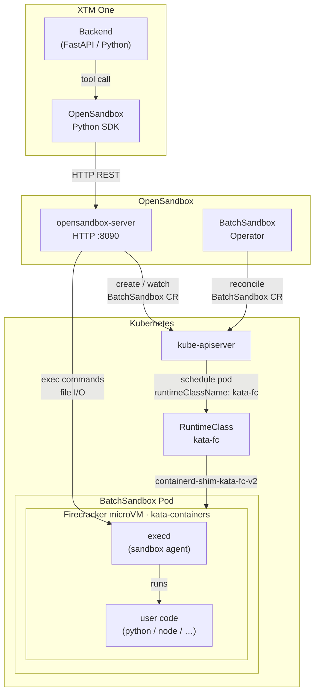

# Why OpenSandbox — Technical Advocacy

## Summary

This document makes the case for adopting **OpenSandbox** as XTM One's code
execution sandbox. It covers why OpenSandbox was chosen over alternatives,
how it fits into the platform's architecture, the key capabilities it unlocks
(network isolation, file sharing, prebuilt images), and what the operational
trade-offs look like across different deployment environments.

---

## Why OpenSandbox

### 1. Genuinely open source

OpenSandbox is Apache 2.0-licensed software published by Alibaba under the
[opensandbox-group](https://github.com/opensandbox-group/OpenSandbox) GitHub
organisation. There is no enterprise tier, no usage-based billing, and no
cloud-provider dependency. The entire control plane — server, controller,
execd, egress — can be self-hosted with standard container tooling. This is a
hard requirement for XTM One, which must be deployable on-premises with no
external SaaS dependencies.

By contrast:
- **E2B** requires AWS/GCP/Azure even in self-hosted mode; full on-premises is
  not supported.
- **Daytona** is open-source for the compute plane but the managed service
  introduces provider coupling for snapshots and billing.
- **Modal / Replicate / etc.** are fully managed and cannot be self-hosted at
  all.
- **Monty** (Pydantic's restricted Python evaluator) is in-process and
  Python-only. It cannot sandbox arbitrary agent-generated code: there is no
  OS-level process boundary, no network or filesystem isolation, and no support
  for JavaScript or shell commands. It is a good fit for safe expression
  evaluation or input validation inside a trusted codebase, but not for
  executing untrusted LLM output.

### 2. Versatility — one SDK, three isolation levels

OpenSandbox exposes a single Python (and REST) API regardless of the underlying
runtime. Switching between runc, gVisor, and Firecracker requires only a config
change in `sandbox.k8s.toml`; the application code is identical.

| Mode | How it is selected |
|------|--------------------|
| Plain container (runc) | omit `[secure_runtime]` section |
| gVisor (runsc) | `[secure_runtime] type = "gvisor"` |
| Firecracker microVM | `[secure_runtime] type = "firecracker"` |

This lets the team start with plain containers for development speed, switch
to gVisor for a middle ground on shared infrastructure, and move to Firecracker
for production workloads that handle untrusted agent-generated code — without
touching a single line of application code.


### 3. Ease of use

The SDK is a thin async Python client. Creating and using a sandbox is four
lines of code:

```python
sandbox = await Sandbox.create(image="python:3.14-slim", connection_config=config,
                               timeout=timedelta(minutes=5))
async with sandbox:
    result = await sandbox.commands.run("python -c 'print(\"hello\")'")
```

The server manages pod lifecycle, networking (egress proxy, DNS filtering),
image pulls, and cleanup. There is no Kubernetes YAML to write per invocation
and no direct Docker API call. Any OCI-compliant image can be used as the
sandbox environment, including custom images with pre-installed dependencies.

### 4. Per-run network profiles

OpenSandbox's built-in egress proxy lets each sandbox receive a different
network policy at creation time, with no changes to application code. Three
profiles cover the full range of XTM One use cases:

| Profile | Egress config | Use case |
|---------|--------------|----------|
| **Air-gapped** | egress disabled / mode `none` | Sandboxes that must only manipulate data in memory — no outbound packets allowed at all; strongest isolation guarantee |
| **Internet-only** | egress enabled, RFC-1918 ranges blocked at the proxy level | Web-fetch agents that need unrestricted public internet but must never reach internal services (databases, Redis, metadata endpoint) |
| **Allow-listed** | egress enabled, explicit domain allow-list | Agents allowed to call a fixed set of APIs (e.g. `api.openai.com`, `cdn.example.com`); all other DNS queries are blocked by the DNS-mode egress proxy |

The allow-listed profile also supports rate limiting at the domain level —
the number of outbound connections to a given domain can be capped per sandbox
lifetime, which prevents runaway agents from hammering an external API inside a
single execution. This is configured via the `egress` section of the
`sandbox.k8s.toml` server config or passed per-call in the SDK's
`SandboxConfig`.

---

### 5. File sharing between XTM One and a sandbox

`sandbox.files` exposes a first-class async filesystem API — no `scp`, no
volume mounts, no exec-pipe hacks. The platform can push data into a sandbox
before execution and pull results out afterwards through direct SDK calls.

**Sending files into a sandbox (platform → sandbox)**

```python
# Push a CSV dataset before running analysis code
await sandbox.files.write_file("/data/input.csv", csv_bytes)

# Push multiple files at once
from opensandbox.models.filesystem import WriteEntry
await sandbox.files.write_files([
    WriteEntry(path="/data/input.csv",  data=csv_bytes),
    WriteEntry(path="/data/config.json", data=json_str.encode()),
])
```

**Reading files out of a sandbox (sandbox → platform)**

```python
# Read a plot generated by the agent's code
png_bytes: bytes = await sandbox.files.read_bytes("/output/chart.png")

# Read a text file (returns str)
report: str = await sandbox.files.read_file("/output/report.md")

# Stream a large file without loading it fully into memory
async for chunk in sandbox.files.read_bytes_stream("/output/large.parquet"):
    buffer.write(chunk)
```

**Other useful operations**

```python
# List what the sandbox produced
entries = await sandbox.files.list_directory(
    DirectoryListEntry(path="/output", depth=2)
)

# Search for any PNG the agent may have saved anywhere
pngs = await sandbox.files.search(SearchEntry(path="/", pattern="*.png"))

# Clean up intermediate files inside the sandbox
await sandbox.files.delete_files(["/tmp/scratch.csv"])
```

**Typical XTM One patterns**

| Scenario | Direction | API used |
|----------|-----------|----------|
| Agent analyses a user-uploaded CSV | platform → sandbox | `write_file` / `write_files` |
| Agent generates a matplotlib chart | sandbox → platform | `read_bytes` + base64-encode for chat response |
| Agent produces a PDF / DOCX report | sandbox → platform | `read_bytes` + attach to message as a file |
| Code interpreter runs on a large dataset | platform → sandbox | `write_files` (batch upload before execution) |
| Agent saves multiple artefacts | sandbox → platform | `search("*.png")` then `read_bytes` each |

All `sandbox.files` calls go through the opensandbox-server HTTP API and are
subject to the same sandbox lifetime — the sandbox must be alive (not yet
closed or timed out) for file operations to succeed.

---

## Pros and cons

### Pros

- **Zero vendor lock-in** — fully self-hostable, Apache 2.0, no billing hooks
- **One API, three isolation levels** — runc / gVisor / Firecracker selected
  in config; application code unchanged
- **Standard OCI images** — no custom base image required; use any public or
  private image
- **Prebuilt execution images** — common runtimes can be packaged as custom
  images with their full dependency stack pre-installed, eliminating cold-pip
  install time on every run:
  - **Python**: `numpy`, `pandas`, `matplotlib` (already used by the platform's
    code-interpreter tool) plus the platform's sandbox helper module
    (`_sandbox_utils`) can be baked in so the security wrapper and matplotlib
    capture harness are already available inside every sandbox — removing the
    need for `code_interpreter.py` to inject and write those helpers at runtime,
    and simplifying the base service code
  - **Node.js**: `lodash`, `axios`, chart/data libraries (e.g. `chart.js`,
    `d3`) or whatever the typical agent workload requires
- **Kubernetes-native** — workloads are standard pods with full observability
  (kubectl, Prometheus, etc.) on any conformant cluster
- **Per-sandbox egress control** — built-in DNS-mode egress proxy; network
  access is off by default and can be allow-listed per sandbox
- **Language-agnostic** — any runtime that can be put in a container is
  supported; not limited to Python or Node.js
- **Stateless by default, stateful on demand** — ephemeral sandboxes are the
  default; persistent storage can be attached via PVCs when needed
- **Snapshotting** — the BatchSandbox controller supports pool pre-warming and
  snapshots, reducing cold-start latency for repeated invocations
- **Graduated deployment model** — the Docker provider requires nothing beyond
  a running Docker daemon, so the full SDK/API surface is usable locally with
  zero Kubernetes overhead during development (the stronger Firecracker/gvisor
  isolation runtimes below are Kubernetes-only); switching to the Kubernetes
  provider with Firecracker or gvisor for production is a single config change
  with no application code changes — the same SDK calls
  work unchanged across both environments

### Cons

- **Operational complexity — production (bare-metal / cloud Linux)** —
  Firecracker on Kubernetes requires a non-trivial one-time setup: devmapper
  thin pool, kata-containers installation, shim alias
  (`containerd-shim-kata-fc-v2`), and a `kata-fc` RuntimeClass. On a standard
  Linux node this is straightforward and fully scriptable; once in place the
  stack is stable across reboots with no further intervention.
- **Cold-start latency** — a Firecracker microVM must boot a guest kernel on
  first use; without pre-warming, this adds several seconds to the first
  sandbox creation in a pool
- **Additional service to operate** — `opensandbox-server` is a separate
  long-running process (or systemd service) that must be deployed, configured,
  and kept healthy alongside the main application stack; it is not bundled into
  the backend
- **Kubernetes required** — the Kubernetes provider (which enables gVisor and
  Firecracker) needs a running cluster; the Docker provider is lighter but
  loses access to the advanced runtimes
- **Younger project** — OpenSandbox is newer and less battle-tested than E2B
  or Daytona in large-scale production deployments; community and documentation
  are still growing
- **No built-in UI** — observability is through standard Kubernetes tooling
  (kubectl, logs, events); there is no dashboard included
- **API key required for non-interactive deployments** — the server refuses to
  start without `OPENSANDBOX_INSECURE_SERVER=YES` or a configured API key when
  running without a TTY

---

## Architecture overview



| Layer | Component | Role |
|-------|-----------|------|
| XTM One | Backend + SDK | Calls the sandbox API; receives results and artefacts |
| OpenSandbox | `opensandbox-server` | Lifecycle gateway — creates pods, proxies exec and file ops |
| OpenSandbox | BatchSandbox Operator | Kubernetes controller that reconciles `BatchSandbox` CRs into pods |
| Kubernetes | `kube-apiserver` | Schedules pods with the correct `runtimeClassName` |
| Kubernetes | RuntimeClass `kata-fc` | Binds pods to the `containerd-shim-kata-fc-v2` shim |
| kata-containers | `containerd-shim-kata-fc-v2` | Boots a Firecracker microVM per pod |
| Firecracker | microVM | Hardware-isolated guest: dedicated kernel, no shared host kernel |
| execd | sandbox agent | Accepts commands and file I/O from `opensandbox-server` inside the VM |

---

## Runtime comparison: runc vs gVisor vs Firecracker

These figures are indicative based on published benchmarks and our own
observations. Real numbers depend heavily on workload characteristics, host
hardware, and image size.

The diagram below (source: [katacontainers.io/learn](https://katacontainers.io/learn/))
illustrates the isolation boundary difference between a traditional container
runtime and Kata Containers running inside a dedicated VM:


### CPU overhead

| Runtime | Overhead vs native | Notes |
|---------|-------------------|-------|
| **runc** | ~0 % | Namespace + cgroup isolation only; no syscall interception |
| **gVisor** | 10–30 % for syscall-heavy workloads | All syscalls are intercepted and re-implemented in Go user-space; compute-bound pure-Python is nearly unaffected but heavy I/O or native extension calls pay a large penalty |
| **Firecracker** | 3–8 % | Thin VMM; near-native vCPU performance; overhead mainly from virtio device emulation on I/O paths |

### Memory overhead

| Runtime | Base overhead | Notes |
|---------|--------------|-------|
| **runc** | ~5–10 MB | Shared kernel; only process memory is isolated |
| **gVisor** | ~20–40 MB per sandbox | Gofer process + Sentry in-process kernel per sandbox |
| **Firecracker** | ~100–150 MB per VM | Guest kernel + initrd + virtio drivers; Firecracker VMM itself uses ~5 MB |

### Time to first execution (cold start)

| Runtime | Typical cold start | Notes |
|---------|--------------------|-------|
| **runc** | 0.5–2 s | Image pull aside; container creation + network setup |
| **gVisor** | 1–3 s | Same as runc plus Sentry initialisation |
| **Firecracker** | 3–10 s | Guest kernel boot + container start inside VM; can be reduced to < 1 s with pre-warmed snapshots |

> **Pre-warming:** OpenSandbox's BatchSandbox pool controller can keep a
> configurable number of warm sandboxes ready. With pre-warming, Firecracker
> cold-start cost is paid once per pool slot, not per user request.

---

## Required host tooling per runtime

These are all **Kubernetes provider** setups (the Docker provider needs
nothing beyond a running Docker daemon, per the Pros section above).

### runc (plain container)

Minimum viable setup — works on any Kubernetes cluster.

| Component | Purpose | Install |
|-----------|---------|---------|
| Kubernetes cluster | Container orchestration | any conformant distribution |
| opensandbox-controller | BatchSandbox CRD + operator | Helm chart (opensandbox-group) |
| opensandbox-server | API gateway + lifecycle | `uvx opensandbox-server` |

No additional kernel modules or privileged configuration needed beyond a
standard Kubernetes install.

---

### gVisor (runsc)

Adds a user-space kernel between the application and the host kernel.

| Component | Purpose | Install |
|-----------|---------|---------|
| All runc components | (see above) | — |
| gVisor (`runsc`) | User-space kernel binary | `apt install runsc` or from [gvisor.dev](https://gvisor.dev/docs/user_guide/install/) |
| containerd `runsc` shim | Tells containerd how to start gVisor containers | Configured via containerd config (see your distribution's docs) |
| `gvisor` RuntimeClass | Kubernetes object binding pods to `runsc` handler | `kubectl apply -f runtimeclass-gvisor.yaml` |

Key constraint: gVisor requires the host kernel to support `ptrace` or KVM;
on most Linux hosts this works out of the box. On WSL2, the `ptrace` backend
is available but KVM is not; performance is lower than on bare metal.

---

### Firecracker microVM (kata-fc)

Full hardware virtualisation; strongest isolation boundary.

| Component | Purpose | Install |
|-----------|---------|---------|
| All runc components | (see above) | — |
| `dm-thin-pool` kernel module | devmapper snapshotter backend for containerd | `modprobe dm-thin-pool` (+ persistent systemd service for WSL2) |
| devmapper thin pool | Block device pool for container layer snapshots inside VMs | sparse files + `dmsetup create` (see setup guide) |
| kata-containers | Kata runtime framework + guest kernel + initrd | `kata-manager.sh` → installs into `/opt/kata/` |
| Firecracker binary | Lightweight VMM | bundled in `/opt/kata/bin/firecracker` via kata install |
| `containerd-shim-kata-fc-v2` | Shim alias: containerd calls this name; kata reads it to select `configuration-fc.toml` | `ln -sf /opt/kata/bin/containerd-shim-kata-v2 /usr/local/bin/containerd-shim-kata-fc-v2` |
| `kata-fc` RuntimeClass | Kubernetes object binding pods to `kata-fc` handler | `kubectl apply -f runtimeclass-kata-fc.yaml` |
| containerd devmapper config | Tells containerd's CRI plugin to use devmapper for kata-fc pods | add `[plugins."io.containerd.snapshotter.v1.devmapper"]` block to containerd config |

Additional WSL2-specific tooling (not needed on bare-metal Linux):

| Component | Purpose |
|-----------|----------|
| mount-namespace wrapper + systemd drop-in | Hides Docker Desktop's malformed 9p mount from Kubernetes's `/proc/mounts` parser |
| `containerd-devmapper.service` | Recreates the devmapper thin pool on every WSL2 restart (loop devices are ephemeral) |

---

## References

| Product / Tool | Description | Link |
|----------------|-------------|------|
| **OpenSandbox** | Sandbox orchestration platform (Apache 2.0, Alibaba) | [github.com/opensandbox-group/OpenSandbox](https://github.com/opensandbox-group/OpenSandbox) |
| **opensandbox-server** | HTTP gateway — lifecycle, exec, file I/O | [opensandbox-group/opensandbox-server](https://github.com/opensandbox-group/opensandbox-server) |
| **BatchSandbox controller** | Kubernetes operator for BatchSandbox CRDs | [opensandbox-group/opensandbox-controller](https://github.com/opensandbox-group/opensandbox-controller) |
| **kata-containers** | OCI-compatible lightweight VM runtime | [katacontainers.io](https://katacontainers.io) · [github.com/kata-containers](https://github.com/kata-containers/kata-containers) |
| **Firecracker** | Minimalist microVM hypervisor (Amazon) | [firecracker-microvm.github.io](https://firecracker-microvm.github.io) · [github.com/firecracker-microvm](https://github.com/firecracker-microvm/firecracker) |
| **gVisor** | User-space application kernel (Google) | [gvisor.dev](https://gvisor.dev) · [github.com/google/gvisor](https://github.com/google/gvisor) |
| **E2B** | Managed sandbox platform (Firecracker-based) | [e2b.dev](https://e2b.dev) |
| **Daytona** | Stateful sandbox platform (open-source compute plane) | [daytona.io](https://daytona.io) · [github.com/daytonaio/daytona](https://github.com/daytonaio/daytona) |
| **Monty** | Pydantic restricted Python evaluator (in-process) | [github.com/pydantic/pydantic](https://github.com/pydantic/pydantic) |
