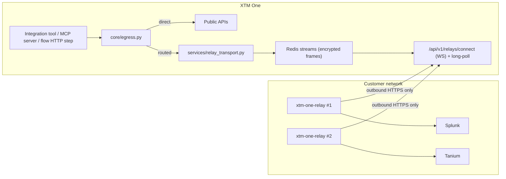

# XTM One Relay

A relay lets a SaaS deployment reach the tools inside a customer network -
Splunk, Tanium, an internal API, an on-premises OpenCTI - without any inbound
flow toward that network. It is a separate Rust binary
(`apps/relay/`) the customer installs in the network. It connects **out** to
the platform and pulls the HTTP requests the platform routes through it.

User documentation: `docs/docs/usage/resources/relays.md`. Configuration:
`docs/docs/deployment/configuration.md` > "Relays". Entity contract:
`dev-docs/reference/entities.md` > "Relay Group / Relay".

## Shape

- A **relay group** is the routing target: one network (zone). Resources bind to
  a group, never to one relay. Every relay of a group pulls from the same queue,
  which gives load balancing and failover with nothing else to configure.
- **Fail closed.** A routed request never falls back to a direct connection: no
  relay online, a refused destination, a relay that drops mid-request - each is
  an error the caller reads (`RELAY_ERROR_MESSAGES` in `relay_transport.py`,
  formatted for tools by `integrations/http.format_network_error`).
- **The route is configuration**, never chosen by a model (invariant 16). Not
  licence-gated: flows and integrations run with AI off, and so does routing.
- v1 carries HTTP at layer 7. The relay terminates TLS, so it trusts the
  customer's internal CA (`ca_bundle`), which the SaaS never could.

## Data model (`app/models/relay.py`, migration `r5140relay01`)

| Table | What it holds |
|---|---|
| `relay_groups` | name, slug, zone, description, tags, optional platform-side `allowed_destinations`, the full three-tier visibility column set (in `CompanyManagedEntity`). Only admins create one. |
| `relays` | one enrolled instance: `rly-` credential (prefix + bcrypt hash), machine id, host facts, version, protocol version, capabilities, the destinations it declared, transport, last seen, active flag. |
| `relay_enrollment_keys` | `rlenr-` keys bound to a group: single-use or reusable (Kubernetes replicas), with a TTL. |
| `relay_request_logs` | one row per relayed request, metadata only (host, path without query, method, status, sizes, duration, relay, source); retention `RELAY_REQUEST_LOG_RETENTION_DAYS`, swept by the scheduler. |

`integrations.relay_group_id` and `mcp_servers.relay_group_id` are nullable FKs
with `ON DELETE RESTRICT`: `SET NULL` would quietly turn a routed resource into
a direct one. Deleting a group in use is a 409 naming what is routed through it.
A flow's `action.http_request` node carries `relay_group_id` in its config
(catalog source `relay_groups`), validated at save by `flow_references`.

Who may bind: a write naming a group must name one the writer can see
(`binding_access.checked_relay_group_id`); what a row already holds is never
re-judged. A stdio MCP server cannot be routed (it runs on the platform).

## The egress funnel (`core/egress.py`)

Every outbound HTTP client in the routable trees is `egress_client()`, a
drop-in for `httpx.AsyncClient` that is identical with no route. The route is
ambient (`with egress_route(route):`, a ContextVar inherited by spawned tasks)
or pinned on a client (`route=`; `None` = always direct). The decision is made
per request in `_transport_for_url`, after the proxy mounts the environment
adds: a routed request goes to `RelayTransport` whatever `HTTPS_PROXY` says,
every redirect hop included. Under a route, `validate_outbound_url` skips the
public-address check (reaching private addresses is the point) but still
refuses non-http(s) schemes and userinfo. `tests/test_egress_funnel.py`
refuses a bare `httpx.AsyncClient(` in those trees.

Routes are built by `services/relays.py` (`load_egress_routes`,
`egress_route_for`, `integration_egress_route`, `mcp_server_egress_route`). A
group id that is set but cannot be read raises instead of returning "direct".

### What is routed

Under the integration's route: its tools (`_route_through_relay` at the
builder call sites in `integration_tools.py`), the connectivity test, the
event and flow-trigger pollers, OAuth sign-in callback and token refresh,
element pickers, webhook registration calls, notification subscriptions, KB
sync and skill sources bound to it. A remote MCP server: the SDK transports
(through a routed `httpx_client_factory`), discovery, OAuth discovery and token
exchange. The flow `action.http_request` node: its request.

The LM Studio LLM provider (`llm/lmstudio_provider.py`), fed by an LM Studio
integration: its OpenAI client's one transport
(`services/lmstudio_llm_provider.IntegrationTransport`) reads the server
URL, token and relay group of the integration feeding its config on every
request (kept 30 s per process, dropped on an edit or an unlink) and sends the
request on that route - directly when the integration has no relay group; an
integration that cannot carry it answers a 424 the SDK never retries. Like any
integration, an LM Studio integration without a relay group is reached directly
by its console and its connection test.

Not routed (platform-internal by design): every other LLM provider, channel
bot webhooks, the platform's own registration calls. Later phases may route
some of them (below).

## The bus (`services/relay_transport.py`)

A routed request is written to the group's Redis stream as an `open` frame,
claimed by ONE connected relay (whichever replica holds its WebSocket or
answers its long poll), sent on the customer's network, and answered frame by
frame on a per-request stream. Frames are `[u32 BE header length][JSON
header][payload]` - the same bytes on the WebSocket, in long-poll bodies and in
Redis, where each frame is Fernet-encrypted with the platform key and expires
with its stream. Nothing of a request reaches PostgreSQL but its metadata.

| Direction | Frame types |
|---|---|
| relay -> platform | `hello`, `heartbeat`, `response_head`, `data`, `end`, `error` |
| platform -> relay | `hello_ack`, `open`, `data`, `end`, `window`, `cancel`, `update_required` |

- **At most once.** An `open` is acknowledged the moment a relay claims it; a
  relay that drops mid-request fails it with `relay_disconnected`; nothing is
  retried behind the caller's back - a POST must never run twice.
- **Backpressure**: a credit window per request (1 MiB initial, `window`
  grants as the caller consumes), enforced on the platform as well as on the
  relay. Request bodies over 1 MiB follow the `open` as `data` frames.
- **Cancellation and timeouts** propagate: the caller's httpx timeout becomes
  the relay's request timeout, and a caller that gives up sends `cancel`.
- Keys and their meaning are listed in the module docstring
  (`relay:group:{gid}:open`, `:online`, `relay:s:{sid}:up|down|owner|credit`,
  `relay:r:{rid}:inflight|open`, `relay:w:*` wake-ups).

The `hello` negotiates `RELAY_PROTOCOL_VERSION` and `capabilities` (`http` in
v1; `tcp`, `process`, `secrets` reserved in `RELAY_RESERVED_CAPABILITIES`), and
reports the relay's own allow-list. A relay under `RELAY_MIN_SUPPORTED_VERSION`
is refused (HTTP 426 / WebSocket close 4426) with `update_required`.

## The relay binary (`apps/relay/`, crate `xtm-one-relay`)

- Shares enrollment, the credential store, the API client, the WS + long-poll
  supervisor, host facts and the minisign self-update with the runner through
  `apps/agent-core/`. The relay builds agent-core WITHOUT the `keychain`
  feature: its credential is a file in an owner-only directory, and the binary
  links no libdbus (checked in CI). The runner's behaviour and artifacts are
  unchanged.
- CLI: `enroll`, `run`, `status`, `check-config`, `test-destination <url>`,
  `service install|uninstall|start|stop`, `reset`.
- Configuration: a few keys in `relay.toml` at the OS path (`config.rs`), each
  overridable by `XTM_RELAY_<KEY>` (how a container is configured), reloaded on
  change. The server URL must be `https://` (plain `http://` only to a
  loopback host).
- `policy.rs` is the hard boundary, on the customer's machine: destinations are
  checked on the ADDRESSES the relay is about to connect to, after DNS (so
  rebinding is caught); cloud metadata endpoints are refused whatever the list
  says; `*` excludes loopback and link-local. `forward.rs` never follows
  redirects - each hop is a new request through the platform, checked again.
- Services: a systemd unit, a launchd daemon, a Windows service (`service.rs`).
  A container never self-updates: the image is the unit of update.

## Distribution

- `apps/relay/scripts/release-build.sh`, run by the `relay-build` job of
  `release.yml` in XTM-One-Platform/release, builds Linux / macOS / Windows archives,
  `release-sign.sh` signs them in a step of its own (the only one given the key)
  with the runner's release keys (`sign-release-archive.mjs`), and the
  platform image embeds them under `/app/relay_dist/`, served version-matched
  at `/api/v1/relays/dist/{asset}` with `/update-manifest`. The relay version is
  the `MAJOR.YYMMDD.SEQ` triple of `APP_VERSION`. The Linux archives build on
  `ubuntu-22.04` for the glibc floor (2.35), like the runner's.
- `apps/relay/dist/install.sh` / `install.ps1` (served from the same place,
  release key embedded at image build) download, verify the SHA-256 and the
  minisign signature, install the system service and enroll - headless, so
  they run under MDM.
- Container image `xtmone/relay` (`apps/relay/Dockerfile`: distroless,
  non-root uid 65532, cross-compiled multi-arch); Kubernetes example in
  `k8s/relay/`.

## Observability

- Prometheus: `xtm_one_relay_requests_total{group_id,outcome}`,
  `xtm_one_relay_request_duration_seconds{group_id,outcome}`,
  `xtm_one_relay_bytes_total{group_id,direction}` (per process), and at scrape
  time from the database `xtmone_relay_group_relays{group_id,state}` (online /
  enrolled) and `xtmone_relay_group_routed_resources{group_id}`. Labelled by
  group id, never by name.
- Traces: a tool call whose request went through a relay carries
  `egress.relay_group` (and `egress.relay_group_name`) on its tool span
  (`langfuse_tracing.annotate_current_tool_span`).
- Audit log: group CRUD, enrollment keys, enrollment, revoke, destination
  tests; an integration's or MCP server's create / update entry records its
  `relay_group_id`.
- Security Audit (`_check_relays`): relays allowing every destination, relays
  under the version floor (control `network.relay_version_floor`), groups in
  use with no relay online, single-relay groups.

## Tests

- Backend: `test_relay_frames.py` (codec), `test_relay_bus_redis.py` (the bus
  against Redis: streaming, backpressure, cancel, timeout, fail-closed, two
  relays), `test_relay_routing.py` (every routed surface), `test_egress.py` /
  `test_egress_funnel.py`, `test_relay_security_audit.py`,
  `test_relay_metrics.py`, `test_relay_install_scripts.py`, plus the
  visibility suites run as a non-admin.
- Rust: `cargo test` in `apps/relay` and `apps/agent-core` on every shipped
  OS / architecture (`relay-ci.yml`).
- End to end (`relay-e2e.yml`, `apps/relay/e2e/run.sh`,
  `docker-compose.relay-e2e.yml`): the platform on one network, a Splunk
  stand-in with an internal-CA certificate on an internal network the platform
  has no route to, the relay between them. A routed Splunk integration's
  connectivity test and a tool pass only through the relay; the same
  integration set back to direct fails; the relay refuses a destination off its
  list; every request is in the group's log. Integrations need Enterprise
  Edition: without `ENTERPRISE_LICENSE` the integration checks are skipped and
  the run says so. The relay reaches the plain-HTTP e2e platform through a
  loopback forwarder (`apps/relay/e2e/forward.py`), so its own rule (`https://`,
  or `http://` to loopback only) is exercised as shipped.

## Later phases (the ground is prepared)

- **TCP tunnels** (`open` kind `tcp`) and a platform-local forward proxy, to
  route anything that honours `HTTP_PROXY`: custom tools, the browser, stdio MCP
  servers, database / LDAP / syslog connectors.
- **Local secrets**: references resolved on the relay, so the SaaS never holds
  the Splunk or Tanium token.
- **stdio MCP servers on the relay host** (`open` kind `process`), limited to
  commands the relay's configuration allows.
- **Other targets**: registered OpenCTI / OpenAEV reached through a relay, other
  on-prem LLM endpoints (LM Studio already can be, through its integration).
