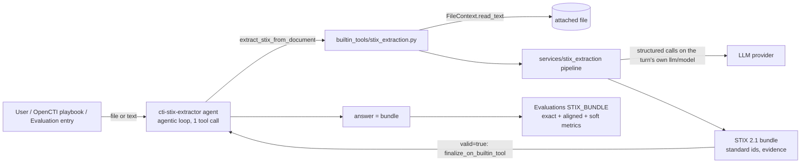

# Grounded STIX extraction — a built-in agent that turns threat reports into STIX for OpenCTI

Design, evidence and plan of the grounded STIX extraction engine
(`app/services/stix_extraction/`), its built-in tool (`extract_stix_from_document`) and
agent (`cti-stix-extractor`), and of the object-aligned evaluation that scores it.

- **What exists:** the extraction engine, the tool and the agent, three `STIX_BUNDLE`
  evaluation metrics (object-aligned entity and relationship F1, soft entity F1), a
  benchmark harness (`scripts/stix_extraction_benchmark.py`) and the fixes to existing code
  found on the way (§9).
- **What is measured:** every comparison on held-out data was registered in this document
  before any run on its data, and is reported whether it held or failed (§8.8).
- **Where the evaluation data lives:** the report texts and gold sets are third-party
  material and the evaluation scripts read them; neither is in this repository. Each held-out
  set is identified by its public source and the sha256 of its files, each system by the git
  tree of `app/services/stix_extraction`.

---

## 1. Origin of the method

The method follows a multi-step annotation workflow for named-entity and relation
extraction from CTI reports: detection, disambiguation and validation, first for
entities and then for relations.

```
NER  1 Detection      sentence-wise (512-char chunks), mention clusters, multi-label, more labels than needed
     2 Disambiguation per cluster: web search + label selection if several labels; "unknown" → sector check
     3 Validation     per cluster, per label prompt (location, sector, tool, malware, intrusion set, organization): verify + clean
RE   4 Detection      chunk-wise, raw source/target surface texts (not NER entities), "generic" label for "they"
     5 Disambiguation match source/target to entities; resolve generics in context; recover missed entities
     6 Validation     valid-relation matrix, remap understandable mistakes, keep closest pair
```

This engine keeps the stages and changes the representation: the output is STIX objects and
relationships, not character spans (§2), and the scores align objects, not mentions (§7).

## 2. Diagnosis: the problems are in the representation, not only in the prompts

1. **The output is a STIX bundle; the score is about character spans.** OpenCTI stores
   objects and relationships. A span score rewards the right *mention* of the right object.
   Measured on our own run (§8.1): the same object-level relationships score 82.5 RE
   strict-strict in one run and 68.9 in the next, because each technique object gained a
   second mention ("phishing" beside "[T1566]") and the span metric must pick one mention
   pair per relationship. The ground truth annotated the id. The object answer was the same.
2. **The "set" metric is surface-text based**, case-sensitive and alias-blind:
   `WalkerShell` / `walkerShell` are two objects, `U.S.` / `United States` two countries, and
   a ground-truth relationship annotated on two mentions counts twice.
3. **Relationships between surface strings make offsets arbitrary.** A workflow that asks the
   RE step for raw source/target texts pairs them back to offsets by sentence-segment
   heuristics and keeps the closest pair. A name read twice in a window has no right answer.
4. **Over-splitting is created by matching**: a source span mapped to *every* entity
   inside it makes one "U.S. state government" target fan out into four relationships.
5. **Per-cluster LLM calls** (two to three per entity plus a web search) are where the cost
   goes; the decisions they make (label choice, cleaning) can be made per *family* in one
   call with the same guidance.
6. **The guidelines disagree with themselves**: the pipeline maps intrusion-set
   `located-at` location to `originates-from`, the MAR ground truth
   keeps `located-at`. One rule must apply to both sides (§7.3).

## 3. What the literature says (summary; full report with sources in §12)

- Document-level extraction is scored on **entities (mention clusters) and triples between
  entities**: DocRED / Re-DocRED, JEREX, DWIE; for KG construction Text2KGBench; in CTI
  CTINexus, aCTIon, TACTIC-KG. Offsets are an audit trail, not the key.
- **Identifiers decide most matches**: ATT&CK ids, CVEs, ISO country codes, MITRE / MISP /
  OpenCTI aliases. Soft (fuzzy or embedding) matching only for what cannot be linked, and
  never on identifier-like names (`APT28` / `APT29` are near-identical in embedding space;
  CTINexus blocks IOC merges with regexes).
- **One-to-one alignment** (Hungarian) over a similarity matrix, the triple score computed
  through the *same* entity alignment (no double counting).
- **Partial credit by ontology**: sibling types half credit (malware/tool), location
  containment, ATT&CK technique / sub-technique.
- **Extraction**: ask for entities with all their surface forms and verbatim evidence
  quotes, ground the quotes in code (LangExtract's `char_interval`), relationships between
  entity ids, generic mentions (nominal / pronominal, ACE levels) only resolve to named
  entities, a recall pass (GraphRAG "gleaning") and a verifier pass restore recall and
  precision.
- **Gold noise is large**: Re-DocRED found +13 F1 of missed triples; Han et al. found
  11-48% of LLM "errors" were correct but unannotated. Keep an adjudication bucket.
- **Report** document-macro and corpus-micro, a document bootstrap CI (B=10k), ≥3 runs per
  configuration (Mezzi et al. found large run-to-run variance in CTI extraction).

## 4. Architecture in XTM One



| Concern | Where | Notes |
| --- | --- | --- |
| Pipeline | `backend/app/services/stix_extraction/` (`pipeline.py`, `grounding.py`, `iocs.py`, `ontology.py`, `prompts.py`, `llm.py`, `bundle.py`) | Pure code around structured calls; no LangChain / LangGraph |
| Tool | `backend/app/services/builtin_tools/stix_extraction.py` (`build_stix_extraction_tool(llm, model)`) | Built with the turn's resolved provider and model |
| Wiring | `agent_chat.py` (after the validator block), `assignment_engine.py` (same), `builtin_tool_catalog.py`, `builtin_tool_aliases.py` (`stix_extractor` → group `cti`), `builtin_tool_groups.py`, `hitl_whitelist_default.py` | Flows and the General Assistant are not wired (phase 5) |
| Agent | `backend/app/agents/builtin_agents.py` (`cti-stix-extractor`), persona `seed_data/agent_persona/cti-stix-extractor.md` | Scoped to `extract_stix_from_document`; `config.finalize_on_builtin_tool`; not bound to `cti.stix_harvester` yet |
| Metrics | `backend/app/evaluation_metrics/quality/families/stix_bundle/alignment.py`, routed in `families/routing.py` | Suite version 15.1.0, additive; 16.0.0 identifies objects as OpenCTI's import does |
| Harness | `backend/scripts/stix_extraction_benchmark.py`, `scripts/stix_benchmark_doccano.py` | Scores through the platform seam (`run_quality`) |

Invariants respected:

- **7 (agentic loop)**: the agent decides to call the tool; the fixed steps live in a tool,
  the documented place for them. The loop ends on the tool's valid bundle without re-typing
  20-30k characters of JSON (`finalize_on_builtin_tool`, the harvester's existing
  mechanism).
- **16 (no prompt inflation)**: the persona is 6 lines; the method is code and internal
  step prompts, never the agent's system prompt.
- **17 (licence/quota)**: every call happens inside an agent turn, so the turn's quota and
  edition gate apply; the tool never schedules background work.
- **18 (no workarounds)**: no vendor, tool or keyword logic in a generic layer; the
  ontology is one module, the metric is pure and versioned.
- **Model selection**: the tool runs every step on the turn's own `llm` / model (the agent's,
  or the evaluation's model override), so an evaluation comparing models compares the whole
  pipeline on each, and team provider rules apply.

## 5. The tool and the agent

`extract_stix_from_document(file_ids?, text?, document_name?, include_observables=true)`:

- Reads `file_ids` through the injected `FileContext` (PDF, DOCX, text: the platform's
  `extract_text_from_file_async`), every attached file when none is named, or `text`.
  Several reports give one STIX `report` each in one bundle, an object they share once (its
  `x_xtm_mentions` are the first report's offsets).
- Returns `{"valid", "errors", "warnings", "stats", "bundle"}`. `valid` is false when the
  bundle fails `stix2.parse`, no model call answered, or every detection or every relation
  call of a report failed (an answer without its entities or relationships must not become
  final); a partial failure, a failed resolution batch or a truncated text is a `warning`.
  `stats` reports the counters of §6 per report and the token usage per step.
- Writes nothing, calls no other service: whitelisted for unattended runs
  (`hitl_whitelist_default.py`).

`cti-stix-extractor`: `builtin_tool_ids: ["stix_extractor"]` (stored as group `cti` with
`builtin_allowed_tools: {"cti": ["extract_stix_from_document"]}`), `max_iterations: 4`
(documented bound: the extraction is the tool's own bounded pipeline), temperature 0, memory
off, `output_format: json`, `finalize_on_builtin_tool` on `extract_stix_from_document`.

## 6. The pipeline, stage by stage

Calls: 1 detection per chunk (2,000 chars), 1 resolution per family batch (≤40 entities,
≤5 families), 1 relationship call per chunk (3,000 chars) and 1 candidate-pair call per
chunk that has unlinked pairs (§6.13). A 3,700-character report = about 10 calls; cost
scales with length, not with the number of entities.

### 6.1 Patterns (no model)

`iocs.find_pattern_entities`: ATT&CK ids (`T1059.001`), CVEs, URLs, e-mail addresses,
SHA-512/256/1, MD5, IPv4, IPv6, file names (executables, scripts, documents, archives; an
extension that is also a common TLD, `.com` `.pl` `.so`, is left to the domain pattern),
registry keys, domains. Tolerates a line break inside a token
(PDF-wrapped hashes, `outlook-\nweb.ddns.ne\nt`), reads defanged forms (`hxxp`, `[.]`,
`[@]`) and refangs them, rejects file extensions as TLDs and sentence breaks
(`actors.\nTechnical`). Longest match wins on overlap. These objects are *anchored*: model
mentions overlapping them are dropped.

Matching stays permissive; each kind's validation decides, in context (iocsearcher's design;
GoodFATR, 2208.00042: context filtering takes IOC precision from 0.31 to 0.83 where static
blocklists stay low):

- a domain ends on a top-level domain of the public suffix list (`tld`, offline):
  `document.write` and `window.location` are not domains; a TLD that is also a file
  extension (`README.md`, `invoice.one`) is a file unless defanged (`evil[.]one`);
- an IPv4 read after `version`, `build`, `release`, `rev` is a version number;
- a digest of the empty file, a mixed-case hex run, and a hex run labelled `imphash`, `JA3`,
  `JARM`, `serial`, `thumbprint`, `GUID`, `token` or `key` is no file's digest;
- CVE ids typeset with any dash (`CVE‑2021‑44228`), and more defanged forms (`{.}`, `(at)`,
  `{@}`, `hxtp`, `h**p`, `fxp`) are read;
- in a report that defangs its indicators, a live link or address is a citation, and so is
  a Markdown or HTML link target: citations go to the report's `external_references`
  (`source_name: cited`), not among its indicators. A bare domain is never a citation:
  reports list indicators as bare domains while defanging only some of them;
- a URL names a real host (no `http://[url]/...` placeholder), an IPv4 `A.0.0.0` is a
  network, a templated file name (`<NUM>\-2024.xlsx`) is no file;
- **a line break joins two pieces only when it cuts a token** (`iocs._wraps`): the line ends
  on `-`, `/`, `_` (or a `.` after a non-token), or the next line does not start with a
  complete token, or two hex runs make a digest's length; a short line ending on a complete
  token is not continued. Before, an IOC list (`hive.bat` / `shadow.bat` / `asq.r77vh0.pw`,
  one per line) became one domain, `roothive.batshadow.batasq.r77vh0.pw`, and two SHA-256
  lines one "SHA-512".

Measured alone against AZERG's annotated observables (`scratchpad` script, no model): 300
found, 11 spurious, 18 missed (P 96.5, R 94.3); the residue is mostly annotation slips (a
file annotated as a domain, `192.225.226.21` for `.217`, a parent domain for a subdomain).

### 6.2 Detection (model, per chunk)

The chunk is shown as numbered segments `[S12] ...` (sentence or line, ≤600 chars, global
numbering), quarantined as untrusted external content (`content_safety.wrap_untrusted`,
stable boundary so prompts stay cacheable): a report is data, never instructions. Output per entity: `name`, `kinds` (1-2 of 16 kinds, `unknown` allowed), and
`mentions` = verbatim `text` + `segment` + `level` (`named` / `nominal`). Guidance carries
the research prompts' definitions (sector, channel, tool vs software, organization vs
sector, adjectival locations, acronym vs expansion, enumeration splitting, ignore headings).

**Enumerations are read whole** (`complete_enumerations`, code). A model returns a varying
subset of a long list: the same 70 process names gave 60 tools on one DEV run and 33 on the
next. A list is a run of at least four short items (comma or semicolon separated on a line,
after a colon, or one per line, bulleted or not); when at least three of its items were
detected and two thirds of them share a kind, its other items become candidates of that
kind, grounded by construction, and resolution judges each one like any detected entity.

**Several readings per chunk** (`detection_samples`, default 1; benchmark
`--detection-samples N`). A model that cannot run at temperature 0 detects a different
subset each run (10 entities one run, 46 the next). With N > 1 each chunk is read N times
with the same prompt; the extra calls run as steps `detection_2`... so a recorded answer
is not replayed for them (`calls_by_step` counts them apart; `--step-model detection=...`
routes them too). Every reading is grounded as above and the union goes through
consolidation (§6.4), which merges what several readings found; resolution then judges
the merged candidates and drops what it judges wrong. `stats.detection_samples`,
`stats.detection_sample_additions` (entities the extra readings found that the first did
not, distinct by family and folded name) and `stats.failed_detection_samples`; a chunk
counts in `failed_detection_chunks` only when none of its readings answered.

### 6.3 Grounding (code)

`grounding.find_occurrences(text, quote)` builds a tolerant pattern: any whitespace run for a
space, an optional line break / soft hyphen between the letters of a word, typographic quote
and dash variants, case-insensitive, whole words at alphanumeric edges. A mention is searched
in its cited segment first, then anywhere. Rules:

- an ungrounded mention is dropped (`stats.ungrounded_mentions`);
- a nominal mention ("the group") is a coreference clue, never a name, except for sectors;
- an entity without a grounded named mention is dropped
  (`stats.dropped_unnamed_or_ungrounded`) — the anti-hallucination rule in code.

### 6.4 Consolidation and propagation (code)

Union-find over `(family, folded surface)` and `(family, core key)` (the folded name
without qualifying words: `The APT-K-47 (Advanced Persistent Threat) group`, `APT-K-47
group` and `APT-K-47` are one candidate; `APT 41` stays `apt41`): an entity read in two
chunks or written two ways is one candidate before any model call.
Every occurrence of its names becomes a mention (locations case-exact: `US` is never `us`).

### 6.5 Resolution (model, per family batch)

Families: actor (intrusion-set, threat-actor, campaign), software (malware, tool, channel,
infrastructure), location, identity (sector, organization, individual), technique, and
*other* for `unknown` candidates, judged against every kind with a sector check first (the
research pipeline's "unknown → sector binary detection"). The kind may change across
families (a group detected as malware); a duplicate named in `merge_into` is merged even
when the answer also says not to keep it; an `unknown` candidate the model skips is dropped. One call
judges a whole batch with family guidance (the research validation prompts, merged). Per
candidate: `keep`, single `kind`, canonical `name` (verbatim, trimmed of generic words),
`aliases`, `merge_into` (duplicate in the batch), `code` (ISO 3166-1 for countries and
cities, STIX `region-ov` for regions). Code then:

- adopts the name only when it is in the text, and narrows every mention to it ("defense
  sector" → "defense");
- keeps an alias only when grounded and when it is another name, not the name plus words
  ("APT-K-47 group" is not an alias of APT-K-47);
- maps a near-miss region code to the vocabulary (`south-asia` → `southern-asia`).

### 6.6 Technique naming (code)

A technique written in words beside its id ("the scripting attack pattern [T1064]") becomes
that id's name; one-to-one pairing, an id *after* its name preferred, closest first. The
attack pattern's standard id comes from `x_mitre_id`, so the name never changes identity.

### 6.7 Relationships (model, per chunk) and validation (code)

The prompt gets the numbered chunk and the whole inventory `E7 [malware] WalkerShell | ...`.
Relationships are between **inventory ids**, with the evidence segment and a verbatim quote;
a generic mention is resolved to the entity it refers to while reading; an entity missing
from the inventory may be declared (`new_entities`) and is grounded and merged (recovered
recall, the decoupling goal of §1's workflow), then goes through resolution like a detected one
(§1's workflow verified them too): a dropped one takes its relationships with it, one renamed
onto an existing object is merged into it. Validation:

- `ontology.resolve_triple`, in four steps: allowed (the class matrix) → kept; known
  mistake → remapped (intrusion set `located-at` → `originates-from`, malware `targets` CVE
  → `exploits`, malware `uses` a domain → `communicates-with`, malware `communicates-with`
  an infrastructure → `beacons-to`...); a threat "using" a hash, an address or a file it is
  not said to drop → read the other way as `indicates` (the observable indicates the
  threat); a triple allowed only the other way round → swapped (`stats.relationships_swapped`);
  else dropped (`stats.relationships_off_ontology`, the triples in
  `stages.relations_off_ontology`). The verb is then the one **OpenCTI's schema** takes
  between the two *kinds*, where it is narrower than the class matrix: a malware is
  `authored-by` its actor, a threat actor (an individual) is `located-at` its country, a
  place is `located-at` a larger one only, only a domain `resolves-to` an address, no group
  is `attributed-to` another group;
- the matrix covers observables (STIX 2.1): a malware or an infrastructure
  `communicates-with` an address, a domain or a URL; a malware `drops` / `downloads` a file,
  a malware or a tool; a domain `resolves-to` an address; a malware is a `variant-of`
  another; an observable `indicates` an actor, a campaign, a malware, a tool or an
  infrastructure. Before, a relationship to an observable was always off-ontology (37 of 124
  proposals on 25 AZERG passages were dropped for that alone);
- every relationship the ontology can produce is checked against a snapshot of OpenCTI's
  schema (`stix.ts` `stixCoreRelationshipsMapping` plus the organization, channel and
  threat-actor-individual modules), `tests/fixtures/extraction/opencti_relationship_schema.json`,
  by `tests/test_stix_extraction_ontology_conformance.py`; regenerate it with
  `scripts/stix_opencti_relationship_schema.py` when OpenCTI's schema changes. OpenCTI's
  import connectors drop a relationship the schema refuses without a word;
- evidence must ground in the chunk, or one endpoint must be mentioned in the cited segment;
- duplicates collapse on `(source object, type, target object)`, evidence quotes merged.

### 6.8 Bundle

SDO ids by pycti standard id (`builtin_tools.stix.stix_standard_id`), SCO ids by the STIX 2.1
deterministic UUIDv5 (`stix2`); `identity_class: class` for sectors,
`x_opencti_location_type` + `country` / `region` for locations, `x_mitre_id` + external
reference for ATT&CK ids, `aliases` / `x_opencti_aliases`; `x_xtm_mentions: [[start, end]]`
on each object and the evidence quotes in each relationship's `description`; one `report`
referring to everything. Re-running converges on the same ids, and OpenCTI merges into what
it already holds.

- **Indicators.** An observable tied to a threat (its C2, its sample, a file it drops, or
  one the text says indicates it) gets an `indicator` (STIX pattern, `pattern_type: stix`,
  `x_opencti_main_observable_type`, pycti standard id from the pattern) `based-on` it, which
  `indicates` the threat with the relationship's evidence and confidence: OpenCTI detects
  with indicators, and links an observable to a threat through one (txt2stix, doc-to-stix
  and Gleaner do the same). `indicates` is never written from the observable itself.
- **Threat actors** are individuals (a group is an intrusion set): `resource_level:
  individual` and `x_opencti_type: Threat-Actor-Individual`, so OpenCTI imports them as
  individuals under the individual's standard id, not as groups.
- **The report's id** is its name and `published` date (pycti): `published` is the date the
  document states ("Published: March 5, 2024", an update date only without one), else the
  day of the extraction, never the instant: before, every run created a new report. A file
  with no title given is named after the file and a digest of its text (`report.pdf
  (3f2a9c1b7d0e)`), a pasted text "Extracted report" and the digest: two different
  `report.pdf` of one day are two reports, the same file run again keeps its own.
- **Citations** found in §6.1 are the report's `external_references`.
- **Countries and regions take OpenCTI's names** (its geography dataset, Apache-2.0,
  shipped as `stix_extraction/data/opencti_geography.json`, regenerated by
  `scripts/stix_opencti_geography.py`): a location's standard id is its name and type, and
  the dataset's country aliases are only ISO codes, so "Russia" never merged into OpenCTI's
  "Russian Federation". A country with its ISO code is named as the dataset names it, the
  text's name ("Russia", "Russian") and the alpha-2 / alpha-3 codes as `x_opencti_aliases`;
  a region-ov code takes the dataset's region name ("Southeast Asia" → "South-eastern
  Asia", "Western Asia" → "Middle East"). `country` is always the alpha-2 code (an alpha-3
  code or the dataset's name is read as it); a country or city whose country cannot be told
  is left out, never given its own name as a country. Sectors need no table of ours: OpenCTI's sectors
  carry 241 aliases it matches on import ("healthcare" is "Health").
- **Every SDO carries `confidence: 75`.** An object without one upserts at the importing
  user's maximum (`input ?? 100`), and an alias match could then rename a curated object.

## 6.9 Coverage of the original workflow

Every node of the workflow of §1 maps to a stage here: its pattern entities (§6.1), detection
(§6.2), grounding of mention clusters (§6.3), merges (§6.4), disambiguation and validation
(§6.5, batched per family instead of per cluster), and relation detection, disambiguation and
validation (§6.7, on inventory ids instead of surface strings). Web search is replaced by
knowledge-base linking (§6.11). The fixes the audit found are listed in §9.

## 6.11 Knowledge-base linking (ATT&CK)

`extract_stix(..., knowledge=)` takes a lookup; the tool passes
`stix_extraction.knowledge.attack_knowledge`, which reads the MITRE ATT&CK
integration's own cached store (`mitre_attack.lookup_attack_names`: the STIX bundles
through the platform's egress client, from the source of the deployment's company-managed
MITRE ATT&CK integration - its mirror for an air-gapped deployment, its pinned release -
else the official latest; a failed load is not retried for 10 minutes and the extraction
goes on unlinked). A
candidate is linked only to an unambiguous match of a type its family allows:

- a technique in words gets its ATT&CK id (merged with the id when the text writes it too);
- a group, software or campaign gets its ATT&CK name (OpenCTI's MITRE connector uses the
  same) and external id; software takes ATT&CK's malware / tool typing (Cobalt Strike is
  ATT&CK malware S0154: a "tool Cobalt Strike" would be a second OpenCTI object);
- a name ATT&CK does not know is looked up by its bare form, without an antivirus
  detection prefix or a version suffix (`Backdoor.PowerExchange`, `BunnyLoader 3.0`), and
  only then: ATT&CK itself names `Trojan.Karagany` and `LockBit 3.0`;
- a malware or tool still unlinked after that, written under an antivirus detection name,
  is named by its family with the detection name as an alias (`Backdoor.Winnkit` is
  Winnkit; `Infostealer.Graphiron` and `Downloader.Graphiron` are one Graphiron): the
  vendor's prefix names its detection, not the family (found on DEV: T3 +3.2, T4 +5.7);
- "PowerShell" the tool never becomes T1059.001; "Spearphishing Attachment" (two
  techniques) is never linked.

**Never merge on a catalogue's aliases.** OpenCTI computes an id for every alias of an
object and matches incoming objects on them (`identifier.js` `generateAliasesId`,
`middleware.ts` `getInputIds`); with `update: true` an object matching several is merged
into them. Catalogues lump groups: ATT&CK files FIN12, UNC1878, DEV-0237 under Wizard
Spider; the MISP threat-actor galaxy files Andariel and APT38 under Lazarus; HiP's
cross-vendor graph has a 520-name cluster held by one bad edge (2512.00857). So:

- the bundle carries only the aliases the text gives, never ATT&CK's list;
- names the resolver kept apart that ATT&CK files under one id stay two objects: the one
  ATT&CK names so (else the most mentioned) takes the link, the other keeps its name
  (`stats.knowledge_kept_apart`). A platform whose MITRE connector holds FIN12 as an alias
  of Wizard Spider still resolves "FIN12" there: that is the platform's choice, the bundle
  stays faithful to the text;
- Malpedia (CC BY-NC-SA) and ETDA threat group cards (CC BY-NC-SA) are not shipped; the
  MISP galaxies (CC0 / BSD-2) and Microsoft's `MicrosoftMapping.json` (CC-BY-4.0) are hints
  for a later resolver, never merge keys.

**The platform's names** (`extract_stix(..., platform_names=)`, the `PlatformNames` lookup).
The bundle goes to a platform that already holds objects; one it names otherwise is a
near-duplicate there ("Russia" beside "Russian Federation", "finance" beside "Finance",
"Fancy Bear" beside the intrusion set "APT28" that holds it as an alias). When the agent
has exactly one bound OpenCTI integration, the last step before the bundle names each
object of a kind identified by its name (intrusion set, threat actor, campaign, malware,
tool, sector, organization, country, region, city; never an ATT&CK technique, never an
observable) as the platform does, the text's names kept as aliases:

- a rename only when every name of the object the platform answers points to one object
  of its kind that holds that name as its name or an alias (case-folded): two objects
  for a name, or two names for two objects, rename nothing;
- the platform's other aliases are not taken (each would be a merge key, as above);
- it runs last, after the steps that read a name in the text (a vendor before a product,
  "X ransomware", the relevance review) and with the relationship step's own entities;
  two objects named alike end as one bundle object carrying both one's names;
- a platform that cannot be read changes nothing (`stats.platform_names_unavailable`, a
  warning of the tool); `stats.platform_renamed` counts the renames.

The OpenCTI lookup (`providers/opencti/naming.py`) is handed over by the provider's
`build_tools` (`platform_names_sink`), on its tools' own connection: the bound credential
as `build_integration_tools` resolves it (per-user holder, platform JWT re-mint), the run's
draft header, the unattended capability probe and the integration's relay route. It asks
`stixDomainObjects` per entity type with exact `eq` filters on `name` or the type's
aliases attribute (`aliases`, `x_opencti_aliases`), at most 25 names a query, 3 queries at
once, 300 names and 30 s a lookup; a page that does not hold every match answers nothing.
A run collects the lookups in its integration build context
(`integration_tools.PLATFORM_NAMES_CONTEXT_KEY`) and the tool reads that list at call time.
An evaluation, which builds its integration tools once for all its runs, extracts with
the text's names.

## 6.12 Relationship verification (v2) and relationship gleaning (options)

**Why v1 lost 17 recall points on held-out data.** 42% of AZERG's gold relationships have
their endpoint names more than one sentence apart (measured): the extractor resolves "the
attackers" with the whole chunk and the inventory, but v1 judged 30 candidates at a time on
two sentences, under a stricter rule ("unavoidable") than the extractor's own (implied
relationships kept), with a boolean. CTIForge measured the same: a validation layer removed
31-47% correct relationships even on hosted models; CTI2TTP's verifier gains only because it
selects among deliberately over-generated candidates, scored on a rubric with a threshold.

**v2** (`ExtractionOptions(verify_relations=True)`, `pipeline.verify`):

1. Only the doubtful are checked, decided in code: implied, without grounded evidence,
   remapped verb, added by gleaning, touching a recovered entity, or an endpoint not named
   where it was read (a generic mention). An explicit relationship between two entities
   named in its grounded sentence is taken as read.
2. Context per candidate: the cited segment and its neighbours, and where each endpoint is
   named nearest to it (at most 5 segments, CTI2TTP's window), plus the extractor's generic
   readings ("a generic mention in S14 read as Crambus") to judge too; 10 per call.
3. `supported | not_supported | unsure` (AZERG's "not sure"), implicit support accepted
   (TACTIC-KG), and a graded score on CTI2TTP's rubric bands.
4. Recall-preserving decision: dropped only when not supported AND scored below
   `verify_drop_below` (0.3); unsure or mid-scored kept with the score as STIX confidence; a
   re-typing only from a supported verdict scored ≥ 0.7.
5. `verify_score_only=True` drops nothing and writes every score to the bundle's
   `confidence`, so the harness sweeps thresholds offline (`--rescore --min-confidence`).

**Relationship gleaning** (`relation_gleaning=True`): a second call per chunk with what the
first found ("Relationships were missed…", GraphRAG's gleaning applied to relationships), its
additions tagged and always verified. Measured in §8.6.

## 6.13 Relationship recall: the page's layout and candidate pairs

**Victim locations (code).** "PingPull has been used to target telecommunications companies
... in Afghanistan, Australia, Belgium" gives the sector and its location (the original
workflow's guideline: sector `located-at` country), and the threat now also `targets` each country,
implied, with the location's evidence: OpenCTI builds victimology from `targets` a
location, and a sector is a class, not a place (found on DEV, §8.8).

**Layout (`structural_indicators`, on, no model call).** The densest passages of AZERG
(≥21 gold relationships, 19% of all) are IOC tables and lists, where a reader takes the
link from the page and a model reading prose misses it (10% recall; the under-generation
curve of 2504.04083). Code ties an observable to a threat when:

- a line holds observables and names exactly one threat (malware, tool, intrusion set,
  threat actor, campaign, infrastructure) with little else (`<sha256> – Backdoor.Tokel`,
  `Remote Access (AnyDesk)  <sha256>`): `indicates`, stated, the row as evidence;
- lines hold only observables under a short heading naming exactly one threat (`V3G4
  Sample`, kept across a sub-heading such as `July Campaign`): `indicates`, implied, the
  heading as evidence.

Each goes through `resolve_triple` like any relationship, and becomes an indicator in the
bundle (§6.8). A row naming no threat ("PowerShell script") ties nothing.

**Candidate pairs (`relation_pairs`, on).** BEACON's propose-then-confirm: entities named in
the same or neighbouring segments, which the ontology lets relate and no relationship links
yet, are listed (same segment first, ≤40 per chunk); one call per chunk decides each pair,
evidence first (`PAIRS_SCHEMA`), "none" when in doubt; a decision counts only when its quote
grounds in the chunk. On AZERG test it lowered strict precision (§8.7) while 73% of its
additions were supported by the text (adjudicated); on DEV (§8.8) it raised T3 by +2.4
[+0.9, +4.7] and T4 by +2.6 [+0.9, +6.1] at relatedness precision 97.3, for one more call
per chunk (~12% more tokens): on by default since commit after 4a16b452b. The pair step may also answer
`related-to`, STIX's fallback (OpenCTI accepts it between any two objects), for a link the
chunk states that no typed relationship expresses ("Graphiron checks for Wireshark"); the
relationship step's own vocabulary has no fallback. DEV: relatedness +8.5 at precision 97.8,
labelling unchanged. Candidate pairs are decided in batches of 40 per call, never cut (a malware
beside a 70-item list is 70 pairs), and a relationship the text applies to a list reaches
every item of it (two or more items sharing a verb to one entity: the list's other items of
that kind get it, implied). DEV comparisons leave out passage `train:0768`, a 70-item list
whose gold annotates "checks for" as `uses` and whose detection varies from 10 to 46
entities between runs: with it, one passage moves every DEV score by up to 20 points. The report's
main subject (its most-mentioned actors or campaigns, else its most-mentioned malware) is a
candidate pair with every entity of each chunk, however far, and a generic mention of it
("the actor", "the malware") counts as naming it (BEACON's central subject; on by default):
on DEV, on the pairs both systems extracted, relatedness F1 93.9 against the AZERG
pipeline's 89.5; on DEV-C +6.8 [−0.1, +13.7].

**Cross-chunk relationships (`cross_chunk_relations`, off).** 12.5% of MAR's relationships
join two entities named in different relationship chunks, which no per-chunk step sees
together. After `relate`, on a report of two or more relationship chunks, the pairs of
entities (actors, campaigns, malware, tools, infrastructure, identities, locations,
vulnerabilities; no observable, no ATT&CK id) that no chunk names together, that the
ontology lets relate, that nothing links yet and that the pair pass has not decided (the main
subject's pairs) are decided in calls of 40 pairs (at most 400 per report, a threat at one end
first). Each call shows the entities of its pairs, each with its names and the first two
sentences naming it (cut to 300 characters around the name), and answers the pair step's
shape without `related-to` (`CROSS_CHUNK_SCHEMA`). A decision is kept only when its quote
grounds in the report, in a sentence naming one of the two, and its triple passes
`resolve_triple`; it is implied unless the quote names both, tagged `cross-chunk`, and
always verified when verification is on. Stats: `cross_chunk_pairs`,
`relationships_cross_chunk`, `cross_chunk_unconfirmed`; usage step `cross_chunk`; benchmark
flag `--cross-chunk-relations`. Not measured yet.

## 6.14 ATT&CK techniques from described behaviour (option `behaviour_techniques`)

Linking (§6.6, §6.11) finds a technique only by its id or its exact ATT&CK name; reports
mostly describe behaviour ("the macro calls URLDownloadToFileA and runs the DLL with
rundll32"). On DEV-T (a development set of vendor reports with technique tables) that left recall at 23.9 and behaviour-only recall at 5.0. The
stage follows CTI2TTP's diverge-then-converge (2605.25836), reshaped around the pipeline's
chunks and grounding:

1. **Propose (model, per chunk, the live ATT&CK catalogue in the cached system prompt).** Each
   adversary behaviour of the chunk, an action of an adversary or its malware or tool (not of
   defenders, researchers or victims), as a verbatim quote, the actor the chunk names, and one
   to three candidate techniques, a sub-technique when the action shows which. Quotes are
   grounded (§6.3); ids outside the live catalogue are dropped.
2. **Check (model, per chunk, 30 candidates per call).** Each candidate with its quote and the
   first 700 characters of its official definition, judged on the quote and its chunk only:
   explicit (1.0), strong (0.8), weak (0.4), none (0). One action is often several techniques,
   so each candidate is judged on its own definition, not against the others. Kept at 0.7
   (`technique_threshold`, CTI2TTP's "strong support" bound); all scores are kept in the
   stages for offline operating points.
3. **Objects and links (code).** A kept technique becomes an attack pattern named and
   identified by ATT&CK (merged with the one its id or name already made), with its quotes as
   mentions, and `uses` from the actor the quote names; with no named actor, from the
   report's main subject when there is one (implied).

The catalogue comes from the MITRE ATT&CK integration's cached store
(`mitre_attack.attack_techniques`, `knowledge.attack_catalogue`). Cost on DEV-T: one propose and
about 0.65 check calls per chunk, about +35% calls over the pipeline.

**DEV-T (86 reports, Claude Sonnet 5.5), parent techniques.** The table compares the
raw AnnoCTR gold with the pooled adjudicated gold (§8.8):

| System | P / R / F1, raw gold | P / R / F1, adjudicated |
| --- | --- | --- |
| T0, this extraction without the stage | 70.9 / 23.9 / 35.8 | — |
| T1, one prompt per report (SoK baseline) | 53.8 / 65.4 / 59.0 | 86.6 / 64.9 / 74.2 |
| T3, CTI2TTP reimplemented (its prompts and settings) | 67.8 / 44.5 / 53.7 | 97.5 / 39.4 / 56.1 |
| **T2, this stage** | 53.1 / 73.1 / **61.5** | 89.2 / 75.5 / **81.8** |

T2 minus T1: raw +2.5 [−1.3, +6.9] (recall +7.7 [+1.8, +13.8]); adjudicated +7.6 [+3.9,
+11.2]. T2 minus T3: raw +7.8 [+2.5, +13.1]; adjudicated +25.7 [+21.7, +29.7]. Thresholds 0.4
and 1.0 both lower F1 (56.2 and 53.9 raw). A second proposal view over 60,000-character
windows of the report added nothing (+0.7 [−0.8, +2.0] adjudicated) and was removed. On DEV,
a third of the raw "false positives" read are techniques the report does show but AnnoCTR did
not annotate (browser data discovery, native API, reflective loading), and many misses are
annotation conventions (".NET" as Command and Scripting Interpreter, every mention of
ransomware as Data Encrypted for Impact). These were left alone, because matching them would
fit AnnoCTR's guideline, not ATT&CK.

## 7. Evaluation

### 7.1 Metrics (suite 15.1.0, `STIX_BUNDLE`)

| Key | Definition |
| --- | --- |
| `stix.entity_prf` (existing) | Set F1 over canonical ids (pycti / stix2 after `OpenCtiCanonicalizer`): what OpenCTI would merge |
| `stix.relationship_prf` (existing) | Set F1 over canonical `(source_id, type, target_id)` |
| `stix.entity_prf.aligned` (new) | One-to-one Hungarian pairing of reference and predicted objects; a pair counts when they share an ontology class and their names agree (below). Containers excluded |
| `stix.relationship_prf.aligned` (new) | Triples with predicted endpoints read through the entity pairing, completed by a name-only pairing of the objects it left unpaired (an endpoint typed differently is scored once, by the entity metrics), exact type and direction |
| `stix.entity_prf.soft` (new) | Same pairing with credit = name credit × type credit; pooled `2·Σcredit / (|pred| + |ref|)` |

**Names of an object**: `name`, `value`, `x_mitre_id`, `aliases`, `x_opencti_aliases`,
digests, external ids; folded by `name_key` (NFKC, casefold, accents, dashes and quotes,
possessive, leading `the`, non-alphanumerics: `The U.S.` = `US` = `us`); country synonyms
(`us` → `unitedstates`, `russianfederation` → `russia`, `dprk` → `northkorea`...).

**Name credit**: 1 for a shared folded name; 0.9 for a shared *core* name (generic words
dropped and plurals folded: `Lazarus Group` / `Lazarus`, `Technology Sector` /
`technologies`); else the best `difflib` ratio ≥ 0.85 between names ≥5 chars that are not
identifiers (`T\d{4}`, CVE, hashes) and carry the same digits (`APT28` never meets `APT29`);
else 0. The soft score adds 0.5 for an ATT&CK technique against its sub-technique.

**Ontology class**: intrusion-set = threat-actor = *actor*; `location:<type>` from
`x_opencti_location_type`, else from `city` / `region` / `country`; `identity:<class>`.
Compatible pairs (soft only, 0.5): malware/tool, actor/campaign, sector/organization,
country/region, region/city, country/administrative area, untyped location or identity with
its typed forms, domain/URL, IPv4/IPv6.

**Diagnostics** in each entry's detail: `missing`, `spurious` (readable names / triples),
`fragments` (an unpaired prediction whose words all belong to a reference name: the
over-split pieces), `partial` (soft pairs below 1).

Pure, deterministic, no model or I/O (package rule); bounded by the pairing's
`MAX_ENTRY_PRODUCT`; not default contributors to Overall Quality (opt-in, catalog rule).

### 7.2 Why aligned and exact both matter

Exact ids measure what OpenCTI will *merge* (a "Defense Sector" object duplicates the
existing "defense" sector); aligned measures what an analyst would call *found*. The
single-pass harvester scores 97.6 aligned but 39.5 exact on entities (§8.2): it finds the
objects and names them so OpenCTI cannot merge them.

### 7.3 Ground truth normalisation (one rule for both sides)

`scripts/stix_benchmark_doccano.py`: one object per (kind, folded name), case variants are
one object, a value cut by a line break is one token, both label vocabularies of the
datasets read, and the relationship matrix's remaps applied (intrusion set `located-at` →
`originates-from`). The reference bundle carries no report.

### 7.4 Harness

`scripts/stix_extraction_benchmark.py --ground-truth <doccano.jsonl> --provider openai
--model gpt-4.1 --out <dir>`: per document, the pipeline's bundle and the reference; span
metrics as the research repo computed them (NER strict / type / within-exact after overlap
resolution, RE strict-strict on the closest mention pair, RE set strict-strict on raw
surface text) and the platform metrics through `run_quality`; pooled micro, document macro,
document bootstrap 95% CI (B=10,000) when there are ≥2 documents; usage and wall time.

## 8. Evidence (GPT-4.1, MAR document `test_618`, APT-K-47, 3,700 characters)

### 8.1 Offline harness, 3 runs

| Metric | Run 1 | Run 2 | Run 3 |
| --- | --- | --- | --- |
| `stix.entity_prf.aligned` | 98.2 | 98.2 | 98.2 |
| `stix.relationship_prf.aligned` | 98.2 | 96.4 | 94.7 |
| `stix.entity_prf` (exact) | 96.4 | 96.4 | 96.4 |
| span NER strict F1 | 95.1 | 92.9 | 92.9 |
| span RE strict-strict F1 | 78.0 | 70.0 | 68.9 |
| span RE set strict-strict F1 | 82.1 | 73.7 | 72.4 |
| calls / input / output tokens | 9 / 12.8k / 3.3k | 9 / 13.0k / 3.3k | 9 / 12.9k / 3.2k |
| wall time | 15 s | 15 s | 13 s |

After the audit fixes (§6.9: qualifier-free consolidation, merge over keep, unknown and
cross-family reclassification, recovered-entity resolution, quarantined report text, IPv6
and file names), 3 more runs: entity aligned F1 98.2 / 100.0 / 98.2, relationship aligned
F1 93.1 / 96.4 / 98.2, exact entity F1 96.4 / 98.2 / 96.4, span NER strict F1 95.1 / 96.3 /
95.1, 10 calls, 13.5-13.8k input / 3.1-3.3k output tokens, 14-15 s. Over 10 runs across
revisions, the only relationship misses were one run skipping the inference in "compromised
these sectors by leveraging malware like ..." (model variance in the relation step: phase 3's
verifier and gleaning target it).

No reference object or relationship missed in any run. Remaining "errors": `ORPCBackdoor
targets {defense, technologies, government administration}` (the sentence lists five malware;
the ground truth links three of them, a known annotation ambiguity) and an extra
`national security` sector.

### 8.2 Head to head, same model, offline single pass

The harvester's persona and its bound skill as system prompt, the document as user message,
3 runs:

| | Grounded pipeline | Single-pass harvester |
| --- | --- | --- |
| Entity F1 aligned | 98.2 ± 0.0 | 97.6 ± 0.9 |
| Entity F1 exact ids | 96.4 | 39.5 |
| Relationship F1 aligned | 96.4 ± 1.4 | 56.7 ± 40.1 (one run: no relationships) |
| Valid STIX 2.1 (raw) | 100 | 0 (invented ids such as `location--russia-0000-…`) |
| Output tokens / time | ~3.3k / ~15 s | 8.8-14.5k / 56-79 s |

### 8.3 In the platform, end to end

Measured on the revision before the audit fixes of §6.9 (the tool then took one `file_id`).

Isolated stack on this branch (API + worker, PostgreSQL, Redis, MinIO), dev mode with
`ENABLED_FEATURES=EVALUATION`: a `STIX_BUNDLE` dataset, one entry with the report attached
as a file and the reference bundle as expected answer; one evaluation, both built-in agents,
`full_loop`, judge off, 3 independent runs (`reuse: off`):

| Metric (mean ± sd, n=3) | `cti-stix-extractor` | `cti-stix-harvester` |
| --- | --- | --- |
| Overall Quality | 95.9 ± 0.4 | 16.5 ± 2.2 |
| `stix.entity_prf` | 97.0 ± 0.8 | 33.0 ± 4.3 |
| `stix.entity_prf.aligned` | 98.8 ± 0.9 | 90.9 ± 11.6 |
| `stix.relationship_prf.aligned` | 94.7 ± 0.0 | 0.0 ± 0.0 |
| `stix.semantic_validity` | 100 | 100 (after its validator) |
| Latency | 17.9 ± 1.3 s | 45.3 ± 8.9 s |
| Tokens / cost | 19.9k / $0.050 | 87.1k / $0.168 |
| Model calls / tool calls | 10 / 1 | 1.7 / 1 |

The harvester's stored answers contain no `relationship` object in any of the three runs
(checked in `agent_output`). Its input is ~45k tokens per call (the 190 KB output schema
and the skill).

**Reading**: on this document the grounded extractor is better on every axis, mainly on
relationships and on ids OpenCTI can merge, at a third of the cost. n=1 document, a
development document: phase 1 decides.

### 8.4 Held-out benchmark: AZERG test (108 passages, never seen)

**Data.** AZERG (QCRI, RAID 2025, Apache-2.0): CTI report passages labelled with STIX 2.1
entity and relationship types by name (`scripts/stix_benchmark_azerg.py` converts them).
1,271 reference objects and 270 relationships are scored; courses of action, indicators
that are no observable and relationships the extraction did not produce then (indicates,
variant-of, has, communicates-with...) are left out; §8.6 scores them. 192,522 characters.

**Protocol** (same for every system, rescored offline from saved bundles with
`--rescore`): `coarse` profile (AZERG tells no sector from an organization nor a country
from a region; a STIX `indicator` is read as the observable its pattern names),
`--no-sectors` (AZERG annotates none), `--closed-world` (Text2KGBench's locally closed
evaluation: only object types and relationship signatures the dataset annotates at least
once are scored; AZERG never annotates a relationship to an attack pattern, so a correct
"Royal uses T1021.001" cannot count either way). Relationship endpoints are paired by the
entity alignment completed by name (§7.1). Paired document bootstrap for differences.

**Guideline differences that cap every system** (from the error analysis, not fixable by
extraction): AZERG labels "C2" / "C&C" (36) and "Windows" (17) infrastructure, adjectives
locations ("Iranian", "Chinese"), security vendors identities, ransomware brands malware
(MAR: intrusion sets), aliases as separate entities (Crambus / OilRig / APT34), and annotates
no technique relationships.

**Results (GPT-4.1, micro P / R / F1; doc-macro F1):**

| System | Entity F1, exact ids | Entity F1, aligned | Relationship F1, aligned | s / doc |
| --- | --- | --- | --- | --- |
| Grounded pipeline | 64.7 | 78.7 / 65.4 / **71.4**; 70.1 | 34.6 / 42.6 / **38.2**; 54.1 | 7.7 |
| + ATT&CK linking | 63.7 | 70.9; 70.4 | 39.6; 56.3 | 8.0 |
| + linking + verification | 63.5 | 70.4; 70.7 | 41.0 / 25.2 / 31.2; 53.0 | 8.8 |
| Built-in harvester (its persona + skill, one pass) | 36.0 | 65.7 / 45.1 / 53.5; 48.2 | 30.5 / 9.3 / 14.2; 43.5 | 22.1 |

Paired differences vs the pipeline (doc-level F1, 95% CI): harvester entity aligned
−21.9 [−26.9, −16.6], relationships −10.6 [−19.2, −1.4]; ATT&CK linking +2.2 [−2.6, +7.4]
(neutral here: AZERG's techniques are ids already and it splits aliases; its value is
OpenCTI deduplication); verification −1.1 [−7.3, +5.1]. Pipeline cost: $2.62 for the 108
passages (~$0.024 each, 577 calls).

**Adjudication** (`scripts/stix_extraction_adjudicate.py`, judge Claude Sonnet 5.5, another
family than the extractor; not yet validated on human labels, so an upper bound): of the
pipeline's (+linking) 220 spurious entities, 138 are supported by the passage (precision
78.5 strict → 92.0 adjudicated); of its 212 spurious relationships, 95 (36.0 → 64.7). The
harvester: entities 65.7 → 89.3, relationships 30.5 → 81.7 on far fewer relationships
(recall 9.3). Most of the gap to the reference is incomplete or differently-guided
annotation, not hallucination.

**Models.** The pipeline runs on the turn's model (no model is pinned on the agent):
GPT-4.1 above is the earlier workflow's baseline model; the same benchmark on current models is in
§8.5.

### 8.5 Current models (same held-out protocol, pipeline + ATT&CK linking)

No model is pinned on the agent: it runs on whatever the deployment configures. Measured:

| Model | Entity F1, exact ids | Entity F1, aligned | Relationship F1, aligned | Tokens in / out (108 passages) | s / doc |
| --- | --- | --- | --- | --- | --- |
| GPT-4.1 | 63.8 | 78.2 / 64.8 / 70.9 | 35.9 / 43.7 / 39.4 | 818k / 125k | 7.9 |
| Claude Sonnet 5.5 | 64.4 | 79.4 / 65.0 / **71.5** | 43.0 / 41.9 / **42.4** | 1,352k / 153k | 9.7 |
| gpt-5.4-mini | 59.6 | 72.0 / 61.9 / 66.6 | 40.6 / 40.7 / 40.7 | 942k / 161k | 6.3 |

Paired differences vs GPT-4.1: Claude Sonnet 5.5 entity −0.1 [−3.0, +2.2], relationships
+1.0 [−5.0, +7.2] (within noise, higher relationship precision); gpt-5.4-mini entity −4.2
[−6.9, −1.7] (significant), relationships −1.8 [−9.2, +5.4]. The method carries the gain
over the harvester on every model; a frontier model is the default to recommend, a small
one costs ~4 entity points. gpt-5.5 (core relationships, §8.6 reference): entity aligned
69.8 (−2.1 [−4.9, +0.4] vs GPT-4.1), relationships 36.1, at 76.6 s per passage and 807k
output tokens: it does not honour `disable_thinking` here, and its reasoning does not pay
on this task. Not recommended for this pipeline.

**Sampling caveat (found in the fourth research round).** Claude Sonnet 5.5 refuses a
`temperature` (`model_capabilities`: `omit_temperature`), so it samples at its default, and
the OpenAI gpt-5.x models run at their default reasoning effort (the pipeline asks for
`disable_thinking`, which the OpenAI provider does not read; gpt-5.5's 807k output tokens
are reasoning). Only GPT-4.1 runs at temperature 0. Single runs of Claude are therefore
noisy (ATOM measured a run-to-run Jaccard of 0.21 for paragraph-level extraction with
GPT-4.1): §8.7 repeats runs before drawing a conclusion.

### 8.6 Ontology round: observables, indicators, OpenCTI's schema (AZERG, 108 passages)

**Reference.** AZERG annotates 566 relationships; the first benchmark scored the 270 of the
six core types. Its largest class, `INDICATOR indicates MALWARE` (161), and `variant-of`
(36), `communicates-with` (23), `exfiltrates-to` (18) were left out because the
extraction could not produce them. The converter now reads every type the extraction
produces through the same `resolve_triple` and bundle builder as the extraction (an
observable that indicates a malware becomes an indicator based on it):
`azerg_test_ext` scores 464 relationships (`--relations all`); `azerg_test_core_v2` the
core types (253: off-ontology triples the old converter kept with their raw verb, mostly
"malware targets tool", are left out on both sides now).

**Results** (`coarse`, `--no-sectors`, `--closed-world`; micro P / R / F1; old = §8.5 bundles
rescored against the new references, new = this branch's ontology and indicators):

| Model | Reference | Entity F1, aligned (old → new) | Relationship F1, aligned (old → new) |
| --- | --- | --- | --- |
| Claude Sonnet 5.5 | extended | 71.5 → 72.2 | 43.0 / 24.4 / 31.1 → 46.0 / 35.6 / **40.1** |
| Claude Sonnet 5.5 | core | 71.5 → 72.3 | 43.0 / 44.7 / 43.8 → 49.8 / 45.1 / **47.3** |
| GPT-4.1 | extended | 70.9 → 71.4 | 35.9 / 25.4 / 29.8 → 29.6 / 31.0 / 30.3 |
| GPT-4.1 | core | 70.9 → 71.5 | 35.9 / 46.6 / 40.5 → 36.5 / 44.7 / 40.1 |

Paired differences (doc-level F1, 95% CI): Claude Sonnet 5.5 relationships +7.3 [+1.5,
+12.8] on the extended reference (significant), +4.9 [−1.0, +10.7] on the core one; GPT-4.1
+0.3 [−5.1, +5.7] and +0.3 [−4.2, +4.9]. Entities unchanged within noise.

A confirmation run with the whole round (adding §6.1's validation in context, cited links
and the stated publication date), Claude Sonnet 5.5, extended reference: entity aligned
81.3 / 65.1 / **72.3**, relationship aligned 47.5 / 35.3 / **40.5**, same tokens (1,417k in /
161k out) and 9.8 s per passage; against §8.5's bundles, relationships +9.5 [+4.3, +14.9],
entities +1.2 [−0.2, +2.6].

**Ontology conformance** (relationships kept / proposed, off-ontology and unknown
endpoints included): Claude Sonnet 5.5 86% → 94%, GPT-4.1 64% → 77%. GPT-4.1 proposes
many triples outside the matrix and in the wrong direction (62 swapped, 158 still dropped)
and spends its new `indicates` on noise (117 spurious for 20 found): the gain needs a model
that follows the matrix.

**What remains** (Claude Sonnet 5.5, extended): `indicates` 35 of 137 found, mostly hashes
annotated as indicating a *generic* tool ("PowerShell script") and generic C2 servers
("C&C", "C2": all 41 `beacons-to` / `exfiltrates-to` misses), which the extraction leaves
out by design (a generic term is no OpenCTI object); a type disagreement (V3G4 is a
campaign in the text, a malware in AZERG: 9 `exploits` read as `targets`).

**Gleaning and Verifier v2** (§6.12, core reference, score-only verifier, then a confidence
floor): Claude Sonnet 5.5 relationships 42.4 (§8.5) → 41.0 with gleaning (recall +4.8,
precision −6.4), 43.6 at a floor of 70; GPT-4.1 39.4 → 35.9, 38.3 at 70. Entities +1.1 to
+1.9 (significant, from the recovered entities). Both stay off by default; a confidence
floor per model is phase 3.

### 8.8 Held-out evaluation

**Protocol.** Every comparison below was registered in this document, in a commit made
before any system ran on its data: the data (source and sha256), the systems (git trees and
blobs), the scorer (sha256), the primary claim and the statistics. One run per system on the
same model (Claude Sonnet 5.5 unless noted); paired bootstrap over documents, 10,000
resamples, 95% intervals; secondary claims Holm-corrected. A claim holds only when its
interval excludes 0. A scored set is spent: error analysis happens only then, and a change it
motivates is claimed only on a later set. Development replays use a call cache, so two
variants differ by their change, not by sampling.

Baselines: **H**, the built-in harvester (`cti-stix-harvester`: its persona and skill, one
model call); **one prompt** (T1, B1, I1), a single frontier-model prompt asking for the same
output; published systems where available (CTINexus 0.2.1, the AZERG paper's prompted
pipeline and its fine-tuned model).

**Scorecard.** Differences are this extraction minus the baseline, in points.

| Held-out set (annotators) | Task | Result, primary (95% CI) | Verdict |
| --- | --- | --- | --- |
| AZERG FROZEN, 300 train passages (AZERG authors) | entities, typing, relatedness, labels (T1–T4) | vs CTINexus (GPT-4.1): T1 **+14.8**, T2 **+24.1**, T3 **+17.8**, T4 **+23.5**; vs H: T1 **+3.3**, T2 **+16.6**, T3 **+22.0**, T4 **+22.6**; vs the AZERG pipeline end to end: T2 **+5.3**, T1 +0.8, T3 −2.1, T4 +0.9 | better, relatedness at parity with AZERG's own pipeline |
| AZERG FROZEN-B, 386 passages (AZERG authors) | same | vs the AZERG pipeline, two runs: T1 **+4.5 / +3.8**, T2 **+7.3 / +6.8**, T4 **+5.2** / +3.5, T3 −0.9 / −1.3 | better, relatedness at parity |
| FROZEN-D, TACTIC-KG (its authors' guideline) | relatedness | vs the AZERG pipeline **+12.0** | better |
| FROZEN-C, CTINexus annotation | entities, relatedness | vs the AZERG fine-tuned model: entities +0.7 [−1.2, +2.5]; relatedness, official scorer −2.7 [−9.9, +4.6] | parity |
| FROZEN-E, 249 ATT&CK `uses` descriptions (MITRE) | relatedness, labels | vs the AZERG pipeline: related **+16.5 [+11.6, +21.3]**, labelled **+12.0**; vs the fine-tuned model **+18.5**, **+16.1** | better |
| FROZEN-M, MAR, 10 reports (human) | entities, relationships | vs one prompt: entity recall **+35.8 [+16.7, +53.0]**, relationship recall **+12.0 [+6.4, +25.0]** | better |
| FROZEN-S, STIXnet (human) | entities, relationships | vs one prompt: entity F1 **+6.4 [+3.6, +9.5]**, relationship F1 **+9.4 [+5.2, +13.3]** | better |
| FROZEN-A, AnnoCTR test (human) | entities | vs H **+10.0 [+3.7, +15.1]** (recall +25.7, precision −14.4) | better |
| FROZEN-C, CTINexus expert entities | entities | vs H +1.7 [−0.9, +4.3] (recall +7.6, precision −11.8) | not shown |
| FROZEN-X, XTM One golden dataset, 15 reports (XTM One team) | entities, relationships, techniques | vs one prompt: relationships **+25.0 [+10.1, +41.3]**, entities **−23.7 [−44.5, −5.3]**, techniques −3.6 [−11.6, +8.8] | failed (entity precision) |
| FROZEN-H3, TRAM (human) | ATT&CK techniques | vs one prompt **+5.4 [+3.4, +7.5]** | better |
| FROZEN-H2, CTI-HAL (human) | ATT&CK techniques | vs one prompt +2.2 [−0.5, +4.9] | not shown |
| FROZEN-T to T5, vendor technique tables (model labellers) | ATT&CK techniques | vs one prompt: T +7.0 [−0.4, +14.8], T3 −8.4 [−16.9, +0.1], T4 +1.6 [−1.9, +5.6], T5 **+16.7 [+7.3, +28.0]** | mixed |
| FROZEN-K, 52 reports ATT&CK 20.1 cites from 2026 (MITRE) | techniques, relationships | vs one prompt: techniques +2.6 [−1.4, +6.6], relationships +2.2 [−4.0, +9.0]; vs H **+29.0**, **+19.6** | not shown against one prompt |
| FROZEN-K2, 306 reports ATT&CK 20.1 cites from 2022–2024 (MITRE) | techniques, relationships | vs one prompt: techniques **+2.8 [+1.8, +3.9]**, relationships (vs T1R) **+3.7 [+1.4, +6.0]**; vs T1R techniques **+1.9**, entities **+1.1 [+0.0, +2.1]**; vs H **+31.7**, **+28.8** | better (FROZEN-K's claims, shown at six times the size) |
| FROZEN-F2, F3, F4, fresh reports (Fable 5.2 gold) | entities, relationships | vs H: F2 entities −30.2 [−44.3, +1.1]; F3 +44.3 [−7.5, +67.4]; F4 macro entities −0.6 [−9.2, +9.4] | failed |
| FROZEN-I, CIRCL OSINT, 272 reports (CIRCL analysts) | IOCs | vs H **+4.6 [+1.5, +7.8]**; vs one prompt −2.1 [−4.3, +0.1] | better than H, level with one prompt |
| FROZEN-B, botvrij.eu OSINT, 221 reports (botvrij analysts) | IOCs | vs H **+8.5 [+5.0, +12.2]**; vs one prompt **−1.7 [−2.9, −0.6]** | better than H, behind one prompt |

**What the evidence says.** Against every published system and against the built-in
harvester, the extraction is better wherever the difference is detectable. Against one
frontier prompt on the same model (the harvester's single call is one) it is better on four
human golds (MAR, STIXnet, AnnoCTR, TRAM) and on MITRE's citations at scale (FROZEN-K2, 306
reports; FROZEN-K's 52 could not tell its lead from 0), not shown better on CTINexus and
CTI-HAL, and behind on the XTM One golden dataset's entities (it extracts many more objects
than that convention keeps) and slightly on IOCs. Its gains are recall; its open problem is precision.

**IOCs after FROZEN-B.** FROZEN-B's reports showed generic pattern defects, fixed afterwards
with a regression test each (§6.1): a line break read as a wrap between two tokens (a digest
and `.NET` on the next line, a sentence's last word and a domain on the next line), a URL host
refused for a top-level domain that is also a file extension (`.app`), a defanged domain
refused for its case or its top-level domain, a URL running into a closing curly quote, a
backslash or a bare `%`, and a path without a scheme cut at its first `[.]`. Replayed on the
spent set (descriptive): E − one prompt −1.7 → −0.9 [−1.9, +0.1], recall −0.8 → +0.4.
FROZEN-C2 tests them.

#### Gold sets the open registrations use

**CIRCL-IOC, a human IOC gold (built 2026-11-13).** CIRCL's OSINT MISP feed holds events its
analysts made from public reports: the IOCs as attributes. Read against the report each event
cites first, an event is a human annotation of which written values are indicators.
- Built by `scripts/build_circl.py`: the event's first `link` fetched as received (the
  platform's HTML or PDF path, the Wayback capture nearest the event date when gone); the gold
  is the event's hashes, IPv4 addresses, domains and hostnames, URLs and e-mail addresses whose
  refanged value is in the refanged text (an IOC from a sandbox or an appendix file is not
  asked of a reader of the text); text of at least 2,000 characters and at least 3 IOCs. Split
  by the event uuid (first byte of its sha256 below 77: development). Development 115 reports,
  4,468 IOCs (`circl_dev.jsonl`, `2acac2c426d15d33`); test 272 reports, 13,443 IOCs
  (`circl_test.jsonl`, `32ad91a8934e50e7`), not read.
- Scoring (`scripts/circl_score.py`): per report, the refanged values a bundle gives

**ATT&CK-cited gold (built 2026-11-13): MITRE's analysts as annotators.** ATT&CK 20.1 (the
official STIX data, `enterprise-attack-20.1.json`) records, for each `uses` and
`attributed-to` relationship of a group, campaign or software, the report it comes from. Read
backwards, it is a human annotation of each cited report: the groups, campaigns, software and
techniques MITRE's analysts read in it, and who uses what. No STIX system's output and no model
took part in it.
- Built by `scripts/build_attack_cited.py` (sha256 prefix `13ccf438d3636d86`): every report
  cited in at least 5 live (not revoked, not deprecated) `uses` / `attributed-to`
  relationships, by the year its citation gives (the report's publication year). 2025 is the
  development split (93 reports, 90 with text, 1,923 relationships;
  `attack_cited_dev.jsonl`, `ff8e70bd4813d79f`); 2026 the test split (52 reports, all with
  text, 1,140 relationships; `attack_cited_test.jsonl`, `a86ce999cd3a2289`), whose content is
  not printed or read. Text fetched as received, through the platform's own HTML or PDF path;
  a page now gone from its Wayback Machine capture.
- Scoring (`scripts/attack_cited_score.py`, `435990a3e171313c`): each object of a bundle is
  mapped to an ATT&CK id (group G, software S, campaign C, technique T) by its ATT&CK id, a
  T-number in its name, or its name or alias against ATT&CK 20.1, of a compatible type; an
  object outside ATT&CK is neither credited nor counted, since MITRE's gold says nothing about
  it. Measures per report: the technique set (parent level), the `uses` / `attributed-to`
  pairs between mapped objects, and all mapped entities; macro over the reports whose gold has
  that kind. Self-check: the gold scored against itself, 100 on every measure.
- What the gold is not: complete. MITRE cites a report for some of what it shows (its
  techniques of a group already tracked, mostly); a technique the report shows and MITRE did
  not record counts as a false positive for every system alike (dev: ET's Phishing and Valid
  Accounts "errors" are read in the report: "a voice call to enroll a victim", "obtaining
  legitimate victim login credentials"). Precision is understated for all; comparisons are
  paired, on the same reports.
- Convention: MITRE records techniques the report shows by behaviour, not only those it names,
  and credits a group with what its untracked software does. The extraction's default (stated
  techniques, the XTM One golden dataset's convention) is not this one; its behaviour option
  (`behaviour_techniques`) is.


#### Open registrations

Registered before their data exists or before any run; each is scored once, as written. Each
runs the content its registration names (its run script refuses any other checkout), so a
later change to the extraction, such as the review fixes of 2026-11-16, enters none of them.

**FROZEN-SoK (registered 2026-11-16 as "FROZEN-S", a name STIXnet's test already held; renamed
after scoring, nothing else changed; before any run of this configuration on these reports): the
SoK split, scored as published.** The document-level ATT&CK technique test sets of the SoK
(Büchel et al., USENIX Security 2025; Zenodo 16753555, CC-BY-SA-4.0), on which ARBITRA (arXiv
2610.39433) reports frontier and fine-tuned systems: TRAM2's 31 test documents
(`test_split.json`, `302906f86aab59ea`) and AnnoCTR's 34 (`bosch_cti_test_ds.json`,
`111c0025fbab06b0`).
- System: the extraction tool as shipped (commit `295e9532f`, `stix_extraction` tree
  `facf44c4b24c`, tool `410526015d67`; Claude Sonnet 5.5; no embedding retrieval), one run,
  through `scripts/run_tool_on_dataset_zip.py` (`dbe4bea9e88dcfa6`) on the inputs of
  `scripts/build_sok_inputs.py` (`3c9a4323f036ad4c`; `tram2.zip` `42455f0c669d65c3`,
  `annoctr.zip` `fd175e45d7c870e1`).
- Scoring: `scripts/sok_score.py` (`8cdf5bc49026d289`), ARBITRA's protocol: TRAM2 exact ids, a
  document's gold the union of its sentences' labels; AnnoCTR technique ids only (its Table 2),
  parent level; macro P / R / F1 over documents with gold techniques; 95% bootstrap interval over
  documents (10,000, seed 7).
- Published reference points (ARBITRA, Table 1 and 2): TRAM2 ARBITRA Reasoning FT 0.722 / 0.635 /
  0.649 (95% [0.631, 0.668] over five runs), GPT-5.5 single pass 0.335 / 0.561 / 0.411; AnnoCTR
  technique-only GPT-5.5 0.648 / 0.651 / 0.635, ARBITRA 0.711 / 0.476 / 0.554.
- Claims, each read on its own, not paired with the published runs (their outputs are not
  public): (1) TRAM2: the extraction's interval lies above GPT-5.5's 0.411; (2) AnnoCTR: its
  interval lies above ARBITRA's 0.554; (3) reported, not claimed: where the point estimates fall
  against ARBITRA on TRAM2 (0.649) and GPT-5.5 on AnnoCTR (0.635).
- Disclosed: these reports were read before by this work: TRAM2's within FROZEN-H3 (its 149
  documents, techniques), AnnoCTR's test as FROZEN-A (entities); no rule was taken from their
  technique outputs. ARBITRA's TRAM2 systems are fine-tuned on TRAM2's own training split; this
  extraction is not trained on any split.
- **Result (scored once, 2026-11-16).** TRAM2: 30 documents with gold techniques, macro P
  0.245 R 0.602 F1 **0.341 [0.280, 0.399]**: claim (1) **fails**, the interval lies below
  GPT-5.5's 0.411; far below ARBITRA's 0.649. One report has no bundle (every relation call
  failed; scored 0, as registered). AnnoCTR: 33 documents with gold techniques, macro P 0.663 R
  0.659 F1 **0.650 [0.576, 0.718]**: claim (2) **holds**, the interval lies above ARBITRA's
  0.554; the point estimate is above GPT-5.5's 0.635 (reported, not claimed; the intervals
  overlap).
- Disclosed: the registered scorer (`8cdf5bc49026d289`) read TRAM2's labels as text and failed
  on their lists before printing any score; the fix (`5ff493c5f838e30b`) reads both forms and
  changes nothing else. Read after scoring, not before: TRAM2's misses are of precision: a
  median 27 techniques per report where its gold has 11 (sentence-level labels of what a
  sentence shows), and a quarter of its exact-id false positives (161 of 611) are a sibling
  sub-technique or the parent (parent-level F1 0.474, not the protocol). Any change this
  suggests is chosen on the SoK split's TRAIN data (`sok_dev_split.py`: 30 TRAM2 train and 30
  AnnoCTR devtrain documents, seed 11) and tested on a new registration, never on these test
  documents again under FROZEN-SoK's name.
- Reproduced by `backend/scripts/stix_sok_benchmark.py` (the lab scripts above, merged; the
  data fetched from Zenodo and digest-checked, never in this repository): `fetch <dir>`,
  `datasets <dir>` (the test splits and the dev samples as dataset ZIPs, gold techniques as
  attack-patterns), `run claude-sonnet-5-5 <dir>/tram2-test.zip <out>` (OPTS overrides an
  option), `score tram2 <dir>/tram2-test.zip <out>`; its `score` gives FROZEN-SoK's two results
  to the digit from the registered runs. On the team's evaluation instance: datasets "STIX extraction -
  SoK TRAM2 / AnnoCTR test" and the two dev samples; evaluations "old vs grounded (SoK TRAM2 /
  AnnoCTR test)" run main's harvester there (Sonnet 5.5 and its default model) and import the
  extraction's runs (`package`), all scored by the instance's STIX metrics (attack-pattern row).
- Main's harvester on the same test documents, run on the team's evaluation instance (Sonnet 5.5 and
  its default, Opus 5.5; deadline raised from 1,800 to 7,200 s after the first runs were cut,
  answered entries reused), scored by `score` from the exported answers (`answers`): TRAM2 F1
  0.026 (Sonnet) and 0.019 (Opus), AnnoCTR 0.075 and 0.034. Half its answers are no bundle
  ("peer closed connection": the long tool input stream the instance's network path cuts,
  fixed then by `eager_input_streaming` on the streamed path; taken out of this branch after review
  (2026-11-18): it changed every tool call of every agent on one path only, and the API no longer
  validates an input streamed eagerly, so a call cut at its token limit could hand any tool a
  truncated argument object. A platform follow-up: all paths and the gateway alike, with a guard
  on a cut input). On the reports it
  answered, its F1 is 0.055 (TRAM2, 14 reports) and 0.112 (AnnoCTR, 22), the extraction's
  0.277 and 0.597 on the same reports.

**Development after FROZEN-SoK: TRAM2's precision, on the SoK split's train data only.** The
dev samples (`datasets`: 30 TRAM2 train, 30 AnnoCTR devtrain documents, seed 11), one call
cache shared by the variants, Sonnet 5.5, macro F1 (precision):

| Variant | TRAM2 dev | AnnoCTR dev |
|---|---|---|
| A, as shipped (`technique_mode` balanced) | 0.418 (0.320) | 0.525 (0.496) |
| B, `technique_mode` precision | 0.430 (0.347) | 0.534 (0.512) |
| C, only explicit technique verdicts (`technique_threshold` 1.0) | 0.417 (0.395) | 0.388 (0.552) |
| E, no technique from behaviour | 0.179 (0.230) | 0.153 (0.334) |
| F, one technique per family and behaviour (`technique_choice` family) | 0.425 (0.329) | 0.563 (0.569) |
| G, only a behaviour's best supported technique (`technique_choice` best) | 0.443 (0.355) | 0.522 (0.503) |
| PF, B and F | 0.441 (0.353) | 0.573 (0.550) |

F changes nothing that AnnoCTR's parent-level protocol counts, yet moves it by +0.04: the variants'
downstream calls differ, so about 0.04 is one run's spread here. No variant brings TRAM2's
precision above 0.40 without losing more recall.

Why: a blind judge of another model family (`judge`, GPT-6.1 Sol, max effort; 15 of the TRAM2
dev reports, seed 7) reads each report with every technique A predicts, those TRAM2's gold
holds and those it lacks, and a negative control of techniques A never predicted, shuffled and
unmarked; a "supported" verdict needs a verbatim quote of the report. It supports 120 of the
120 techniques the gold holds, 219 of the 249 it lacks (88%), and 4 of 37 control siblings of
a predicted technique (11%) and 1 of 35 control techniques drawn from the catalogue (3%). The
judge tells a shown technique from a sibling the report does not show; most of what TRAM2
counts against the extraction, the report shows: pooled precision 0.325 strict, 0.919 with the
judged-supported techniques counted. TRAM2's annotators label part of what a report shows, the
techniques written most often: of A's techniques with one evidence span, 25% are in its gold;
with four or more, 51%. Fitting that choice would mean learning one dataset's annotation from
its training split, as ARBITRA's fine-tuned systems do, not reading the report better; the
extraction does not.

**FROZEN-SoK2 (registered 2026-11-16, before this protocol was computed on any test document):
TRAM2 as the closed-set task it is.** TRAM2 classifies into 50 (sub-)techniques, the label space
of its training split (ARBITRA's Table 7: 26 techniques, 24 sub-techniques; the test's 48 are
among them); FROZEN-SoK scored the open extraction against that gold, and every technique
outside the 50 counted as an error. On the TRAM2 train sample, 407 of the 453 errors lay
outside the label space, and the shipped options were as good as any variant once inside it
(macro F1 0.715 and 0.716 over two runs; PF 0.708, G 0.716, B 0.701, C 0.599).
- System: FROZEN-SoK's registered TRAM2 test answers, unchanged (`sok_split/runs/tram2`,
  `fe41ef43c0a9a1fe` over the 31 files in order); no new run.
- Protocol: `scripts/stix_sok_benchmark.py score tram2` (commit `b83b3d4ca`, blob
  `6ff4517c47ac`) with `LABELS` the label space of TRAM2's training split (`labels` on
  `tram2-train.zip` `f183bf184755f338`; `tram2-labels.json` `56f6a10e199e900e`) and `ATTACK`
  ATT&CK 20.1 (`539a843a7b53ed97`): an answer outside the label space is no answer to the
  task; an id ATT&CK revoked since the annotation counts as the label it replaced (T1685 for
  T1562.001, T1574.001 for T1574.002), as ARBITRA normalises identifiers to the benchmark's
  label space. Test ZIP `c6e79740f696b78e`. Otherwise FROZEN-SoK's protocol.
- Claims: (1) the interval lies above GPT-5.5's 0.411; (2) the point estimate is at or above
  ARBITRA's 0.649 (its systems are fine-tuned on this label space). Reported, not claimed:
  whether the interval lies above 0.649. ARBITRA does not say whether GPT-5.5 was given the
  label space.
- Disclosed: these test documents were scored before (FROZEN-SoK) and their errors read after
  scoring (the families most often wrong); the label space and the revoked ids come from the
  training split, ATT&CK and ARBITRA's appendix, not from those errors. AnnoCTR is an open
  set (15 of its 97 test parent techniques are not in devtrain): no closed-set protocol there.
- **Result (scored once, 2026-11-16).** 30 documents with gold techniques, macro P 0.721 R
  0.622 F1 **0.642 [0.546, 0.725]**: claim (1) **holds**, the interval lies above 0.411;
  claim (2) **fails**, 0.642 is below ARBITRA's 0.649 (by 0.007, inside the interval: a tie
  the test cannot separate; ARBITRA P 0.722 R 0.635). The report without a bundle (FROZEN-SoK)
  still scores 0. Main's harvester under the same protocol (reported): F1 0.048 (Sonnet 5.5),
  0.035 (Opus 5.5).

Where the TRAM2 train sample's techniques go (`run` keeps each proposal with its verdict):
of 342 gold techniques, 243 are found (71%); 39 are never proposed (5 of them revoked ids,
T1562.001 most), 26 proposed and judged weak or absent by the definition check (some wrong
verdicts: a `Win32_ComputerSystem` WMI query weak for WMI, `netstat and nltest` absent for
network discovery; some generous gold: data theft as T1005), 18 verified on one quote and
dropped by the corroboration of `balanced` (a single, specific quote the whole-report reading
did not list: a PuTTY registry query, a `VirtualAlloc` call), 16 a sibling's. Keeping every
verified technique in the closed set: F1 0.727 (+0.011, within one run's spread); everything
judged weak or better: 0.713. The shipped options stay.

Checked elsewhere before anything ships. PF on the ATT&CK-cited development reports (MITRE's
gold, 90 scored, commit `3c8ae5ac4`): techniques pooled F1 60.4 to 55.4 (recall 64.5 to 54.6),
relationships 44.5 to 41.6: its open-set gain on TRAM2 was the removal of techniques outside
TRAM2's labels, which MITRE's gold counts as found. On the golden dataset and MAR, PF and a
fresh run of the shipped options are within a run's spread (entities 65.7 and 64.8,
relationships 45.9 and 46.0). Off. The whole ATT&CK definition in the technique check
(`technique_check_views` [4000], TRAM2 dev, same proposals): closed-set F1 0.716 to 0.730,
but per verdict 22 gold techniques newly kept against 20 newly rejected (and 9 against 8 not
in the gold): the check's own spread between two readings, not a better check. 700 stays.
Calls the model declines (Sonnet 5.5 on the CET-bypass report, "category: cyber") are now
counted (`declined_calls`), not retried, and reported as the bundle's incompleteness.

Classifying into the 50 labels from the start (the technique catalogue the label space,
`LABELS` on `run`) instead of keeping the answers inside it: TRAM2 dev closed-set F1 0.736
against 0.715 and 0.716 (paired +0.021 [-0.019, +0.064]); on a second sample of 40 other train
reports (`tram2-dev2`, seed 12) 0.724 against 0.724 (+0.000 [-0.031, +0.030]); both, 70
reports: +0.009 [-0.016, +0.034]. Nothing a test run would show: no registration. Two runs of
the shipped options differ by -0.002 [-0.027, +0.027] (TRAM2 dev, paired). Every variant above,
on the team's evaluation instance: "development variants (SoK TRAM2 dev ...)" and "(... dev 2 ...)",
closed-set runs as `closed` writes them; the test: "SoK TRAM2 test: old vs grounded, open and
closed set" (main's harvester's answers through the same `closed`).

Models and a second reading of the technique check, the shipped options otherwise (closed-set
F1 under FROZEN-SoK2's protocol; paired against the shipped runs on the same reports):

| Variant | TRAM2 dev (30) | TRAM2 dev 2 (40) | 70 reports, paired | AnnoCTR dev (30, open) |
|---|---|---|---|---|
| Shipped, Sonnet 5.5 | 0.715, 0.716 | 0.724 | | 0.525 |
| Opus 5.5 | 0.736 | 0.719 | +0.006 [-0.013, +0.025] | 0.571 |
| Fable 5.2 | 0.615 (recall 0.560) | | | 0.458 |
| Two check readings, 700 and 4000 characters (`technique_check_views`) | 0.726 | 0.717 | +0.001 [-0.011, +0.012] | 0.546 |

Only reading the answers through ATT&CK's hierarchy (FROZEN-SoK3) moved TRAM2 on both samples.
A blind judge (`judge`) on the gold techniques the shipped run misses on `tram2-dev`: 66 of 92
supported (72%; a control of never-predicted techniques 10 to 11%), so a quarter of the misses
are labels the report does not show; of the 66, 19 never proposed, 19 rejected by the check, 16
verified and dropped by `balanced`'s corroboration, 12 a sibling (the hierarchy's case).
On the team's evaluation instance: "development: models and two check readings (...)" for the three
samples, and the TRAM2 test evaluation with the FROZEN-SoK3 runs.

AnnoCTR after FROZEN-SoK (devtrain only; the protocol's parent level). An open set: ATT&CK's
version moves little here (13 of 135 errors are techniques created after 2021; 3 gold labels
revoked), and the extraction predicts 1.2 times the gold's techniques, not TRAM2's 2.3. The
blind judge with its control (`judge`, 30 reports): the techniques the gold holds 94% supported,
those it lacks 86%, never-predicted siblings 7%, any technique 0%: pooled precision 0.287
strict, 0.915 with the supported ones. The gold's misses, judged: 51% shown by the report; by
stage, 18 of the 19 verified and dropped by `balanced`'s corroboration, 16 of the 26 the check
rejected, 6 of the 33 never proposed (the gold links phrases the judge does not read as the
technique). Keeping every verified technique (`recall`, simulated on the recorded verdicts):
recall 0.560 to 0.633, precision 0.506 to 0.455, F1 -0.001 [-0.035, +0.038]. Opus 5.5:
+0.051 [-0.004, +0.114] on `annoctr-dev`, -0.027 [-0.061, +0.007] on 40 other devtrain reports
(`annoctr-dev2`), +0.006 [-0.025, +0.041] over the 70. Our ATT&CK techniques on AnnoCTR are
bounded by which shown techniques its annotators linked, as TRAM2's by its labels; nothing
here replicates beyond a run's spread, and FROZEN-SoK's AnnoCTR result (0.650, above ARBITRA's
0.554 and GPT-5.5's 0.635) stands.

**FROZEN-SoK3 (registered 2026-11-16, before this protocol was computed on any test document):
TRAM2's closed set read through ATT&CK's hierarchy.** TRAM2's labels hold some techniques
without their sub-techniques (T1027, T1078, T1016...). FROZEN-SoK2 drops a sub-technique the
label space lacks, though ATT&CK makes it a case of its parent: of the train sample's misses a
blind judge supports (66 of 92; 10 to 11% of a control), 12 were a sub-technique of such a
label. Reading such a sub-technique as its parent label, on the training reports (paired, same
answers): +0.034 [+0.015, +0.056] and +0.026 [+0.008, +0.048] on two runs of the 30 of
`tram2-dev`, +0.020 [+0.007, +0.034] on the 40 of `tram2-dev2`; 70 reports, +0.022 [+0.012,
+0.035]. Nothing else of the 70 reports' development moved beyond a run's spread: classifying
into the labels (+0.009), two readings of the technique check (+0.001), Opus 5.5 (+0.006),
Fable 5.2 (lower: 0.615 against 0.716 on `tram2-dev`).
- System: FROZEN-SoK's registered TRAM2 test answers, unchanged (`fe41ef43c0a9a1fe`); no new run.
- Protocol: FROZEN-SoK2's, with `scripts/stix_sok_benchmark.py` at commit `c3e5fa090` (blob
  `65756f8a1f3d`): an answer is read into the label space (`_in_space`): a revoked id as the label it
  replaced, then a sub-technique the space lacks as its parent when the space holds the parent.
- Claims: (1) the point estimate is at or above ARBITRA's 0.649; (2) the interval lies above
  GPT-5.5's 0.411. Reported, not claimed: whether the interval lies above 0.649.
- Disclosed: the third score of the same test answers (FROZEN-SoK, FROZEN-SoK2), each protocol
  registered before it was computed and chosen on training reports only; a reader may discount
  for the forking paths. The rule reads any system's answers the same way (main's harvester's
  under it are reported with the result).
- **Result (scored once, 2026-11-16).** 30 documents with gold techniques, macro P 0.744 R
  0.677 F1 **0.681 [0.591, 0.759]**: claim (1) **holds**, above ARBITRA's 0.649 (P 0.722 R
  0.635), with an interval that does not exclude it; claim (2) **holds**. Main's harvester
  under the same protocol (reported): 0.075 (Sonnet 5.5), 0.043 (Opus 5.5).

**After FROZEN-SoK3 (2026-11-17): launched runs, the published state of the art, the
measurement, and what did not replicate.** One configuration throughout, the tool's shipped
options; development data only for every change; nothing below was tuned on a test set.
- Launched, not imported. Imported runs keep neither their parameters nor a performance
  figure, so every comparison was re-run on an isolated local instance of this branch
  (`274319695`): main's CTI STIX Harvester (persona and tools as on main, with this branch's
  streaming fix) against the grounded extractor, Claude Sonnet 5.5, same documents, 11
  datasets. SoK test, same protocols: TRAM2 closed set 0.692 [0.599, 0.771] (registered
  0.681), open set 0.350 (0.341); AnnoCTR 0.608 [0.520, 0.691] (registered 0.650: same
  per-document time, technique sets about 0.8 Jaccard apart per document, the model's
  sampling). Main's harvester: TRAM2 0.322 closed, 0.202 open (0.075 on the evaluation
  instance, where half its answers failed on the streaming error), AnnoCTR 0.137.
- The state of the art on TRAM2 is not ARBITRA's 0.649: the SoK paper itself reports 72.5 for
  a Llama-3.1-8B fine-tuned on TRAM2's labels (Tables 9 and 12; 71.4 for its classifier), same
  per-document protocol and 50-label set. FROZEN-SoK3's claims stand as registered; the
  extraction is second on TRAM2's closed set, behind models trained on its labels. On
  AnnoCTR that model scores 55.3; the extraction is level with GPT-5.5's 0.635.
- Instance metrics, paired per report (aligned, mean of entries both runs score; extractor
  minus harvester): golden dataset relationships +27.0 [+9.4, +45.2] (raw), +27.5 (adjudicated),
  DEV-X +27.4; entities +5 to +13, intervals across 0. A blind relationship judge of another
  family (GPT-6.1 Sol, `scripts/stix_relation_judge.py`: the triples of both runs mixed and
  shuffled, a control of gold facts with one endpoint swapped) agrees: F1 43.8 against 25.6
  (adjudicated), 42.0 against 17.5 (DEV-X), 24.8 against 23.6 on MAR, where the aligned metric
  said -14.5; controls accepted 0/66, 0/73, 2/18. AZERG: relationships -10.3 plain, -1.0 in
  AZERG's own types (it annotates no attack pattern), entities +4.2 [+0.1, +8.3] there.
  STIXnet: entities -6.8 [-10.1, -3.5] in both readings: its attack patterns are words of the
  text ("credentials", "msiexec"), the extraction's are ATT&CK techniques (598 against 171
  annotated); a loss kept, not tuned away. Part of it was a defect, found on 2026-11-18: a
  sub-technique named "Parent: Sub" as ATT&CK shows it lost its own ATT&CK name ("Spearphishing
  Attachment") as an alias, the objects' alias filter taking it for the name plus words (22 of 598
  attack patterns kept an alias), so neither OpenCTI nor a gold naming the sub-technique alone
  matched it. Kept now; the report's own wording is still not added to ATT&CK's objects.
  Rescored on every launched run's answers (deterministic: the alias reaches only the bundle):
  STIXnet entities 26.5 → 34.4 (the harvester 34.9), relationships 23.3 → 27.7; AZERG
  relationships +0.5, MAR +0.3, K2 +0.2, AnnoCTR entities +0.4; golden, DEV-X and TRAM2
  unchanged; nothing lower.
- Near misses (2026-11-18, every launched run's answers, offline): for each gold object the aligned
  metric leaves unpaired, an unpaired predicted object of its type with a shared identifier, one
  name containing the other, the same content words or a close spelling. Most were the two alias
  defects above (sub-techniques, sectors). Fixed: a region named by directions alone ("South"
  from "South and East Asia", region code southern-asia) now takes its region's name (7 objects
  across the runs, golden +0.2, nothing lower). Not ours, left as they are: AZERG types Europe,
  Asia and the Americas as countries; a golden Moscow carries no location type, so OpenCTI's
  import reads it as a country; botvrij's 1.92.240.113 is the report's 91.92.240[.]113. Not
  defects: a gold parent technique beside the extraction's sub-technique (the soft metric's
  family credit), a product's version kept in `version`, not in its name. FROZEN-K2 (306 reports, MITRE's ATT&CK citations):
  entities +10.5 [+9.1, +12.0], relationships +10.5 [+9.0, +12.1]; in the dataset's own types
  (techniques, groups, campaigns, software) +21.8 [+19.7, +24.0] and +20.3 [+17.9, +22.7].
  botvrij (221 indicator lists): exact entities +7.0 [+4.0, +10.2], aligned -0.4 [-4.1, +3.4]
  (210 reports: 11 of the extraction's answers past the pairing's bound, one of the
  harvester's), in the dataset's types +5.2 [-0.1, +10.7]. Its references hold no
  relationship: the -22.9 of the aligned relationship score is the harvester giving fewer
  relationships against an empty gold, not a measure (suite 16.0.0 no longer scores the
  dataset-types relationship score of such a dataset). Cost, the same 306 and 221 reports:
  $256 and $172 against the harvester's $74 and $56, median time per report level (80 s).
- Measurement, suite 16.0.0: the exact metrics identify objects as OpenCTI's import does
  (golden adjudicated exact entities 34.5 to 50.9, both systems rescored); the aligned metrics
  pair per ontology class block (MAR scored on 10 reports, not 8), read a reference's split
  entities, and report the dataset's own types beside the plain reading. Not a defect: a
  report without gold relationships, which the pooled rollup counts right (only per-report
  means, ours, were skewed).
- Fixed in the tool: the report's publisher (`created_by_ref`) was lost whenever the agent
  named the report; now read either way (9 of the golden dataset's 16 publishers).
- Where missed relationships are (golden adjudicated, DEV-X, MAR): 4 of about 600 join
  entities no relationship chunk names together; 337 (56%) touch an object the text never
  names (an analyst-named campaign, an implied technique); the rest are within one passage,
  where MAR's are mostly its split entities.
- Not kept, each on development data: the check's threshold (0.4 or 1.0 instead of 0.8,
  replayed on the recorded verdicts: 0.8 best on 3 of 4 samples, 0.4's +0.025 on
  `annoctr-dev` is -0.048 on `annoctr-dev2`); behaviour passages of 1,000 or 500 characters
  (`behaviour_chunk_chars`, the SoK paper's sentence-level finding; 140 reports: TRAM2 closed
  0.794 / 0.729 at 2,000, 0.777 / 0.738 at 1,000, 0.774 / 0.728 at 500; AnnoCTR +0.034 then
  -0.003); a listwise selection of the checked techniques (`technique_selection`, clinical
  coding's choose-don't-judge; same call cache, paired: precision up, F1 down on TRAM2's
  closed set and AnnoCTR, -0.008 to -0.023, level on TRAM2's open set, +0.001 and -0.002); multiple-choice candidate pairs (`pair_options`, QA4RE: golden
  -1.7, MAR -10.1, intervals across 0); the publisher read from the document's end as well (8
  of 16 against 9). Two runs of the unchanged tool differ by -3.3 [-6.8, -0.7] on the golden
  dataset's aligned relationships: one run measures nothing; `scripts/stix_score_variants.py`
  compares the means of two runs each, paired per report.
- Not kept: technique tables (`structural_techniques`, off by default): a line of techniques
  and no prose is a table row, its techniques tied to the software or group named last before
  them on the row (wrapped rows continue it), a bare list to its heading's subject; technique
  names read from the ATT&CK catalogue, a name inside one (the tool `cmd` in "Windows Command
  Shell") not a user. No model call, so replayed on the same calls: ATT&CK-cited development
  split (90 reports, MITRE's gold) relationships P/R/F1 47.2 / 42.3 / 44.6 against 48.2 / 42.0 /
  44.9; two fresh runs each, paired, golden aligned relationships -1.8 [-5.0, +0.6], MAR -5.0
  [-15.4, +1.1]. The links it adds are about as often wrong as right, and the reading already
  finds most table rows.
- Not attempted: ATT&CK procedure examples as candidates or check context: K2's gold is
  ATT&CK's own relationships and TRAM2's reports are cited by them, so they would hand the
  model the answer unless every example citing the report were left out.

**Contamination found (2026-11-18): a held-out gold label in the activity hub's prompt.** The
optional activity hub (`activity_hub`, off in the shipped options: the report's unnamed main
operation as a campaign or an incident) named its examples "Nitori data breach", a FROZEN-F3
labeller's incident word for word (labelled 2026-11-11, the hub written the next day), and "APT41
U.S. state government campaign", one character from the golden dataset's campaign of its APT41
report (development data). Every quoted example of the extraction's prompts and code was then
searched in every held-out gold set kept for this work (FROZEN-F2 to F4, FROZEN-X2, K2, the SoK,
AZERG and STIXnet tests; FROZEN-F5 has no gold yet): no other match; the other hits are the system's own predictions or
ordinary vocabulary (regions, ATT&CK names, "the attackers"). Affected: FROZEN-F4's secondary arm
ERKPH (ERKP with the hub, at `f38d14dcb`), whose result (macro relationship F1 +2.8 [-6.8, +14.0]
against ERKP, not significant, never reported here) is void as held-out evidence. Unaffected:
FROZEN-F4's primary ERKP-H comparison (ERKP makes no hub call), FROZEN-F3 (run before the hub),
FROZEN-F5 (no hub arm), the shipped options. The prompt now gives the pattern, not names: the
victim's name and "data breach", the actor's name, "campaign against" and its targets. Measured then on development
(golden adjudicated 16, MAR 10; two fresh runs each against two fresh baseline runs, paired):
golden entities aligned +1.9 [-1.1, +5.7], relationships -1.8 [-5.8, +3.3]; MAR relationships
-8.9 [-19.0, -2.2]. Not kept. The hub finds the activity of all 7 golden reports whose gold has
one, but names it in its own words ("APT41 campaign against U.S. state governments" for "APT41
U.S. State Government Campaign", "Pandora third-party platform data breach" for "Pandora
Third-Party Data Breach"), which the name pairing does not credit, so its links count as errors;
and it also fires on 5 of the 9 golden reports without one and on every MAR report (MAR
annotates no campaign).

**Development pool (2026-11-18).** 110 reports: golden adjudicated (16) and MAR (10), human gold;
FROZEN-F2, F3 and F4 (84), spent, Fable 5.2 gold (their dataset ZIPs, kept with the eval data outside the repo). FROZEN-F2's
30 reports are FROZEN-X2's annotation pack: FROZEN-X2 still tests the systems its registration
pinned (nothing after it changes them), but no longer the code developed since; that code has no
human-annotated held-out set until a new one is annotated (`dev-docs/stix-annotation-guideline.md`). Two runs of the shipped
tool differ by +0.3 / -1.5 (human gold, aligned entities / relationships) and +0.5 / -0.7 (model
gold); the paired interval reads the reports' spread, not a run's sampling (the -1.5 excludes 0),
so a variant needs about 2 points and a second run. Screened, one run each against the two, the
options that were never measured: `relation_gleaning` (relationships, human gold -4.3 [-12.5,
+0.4], model gold -0.7; pooled it adds 50 correct links for 210 wrong on model gold),
`verify_relations` (-5.5 [-15.0, +0.9], +0.1; precision +4.3 on model gold, recall -4.7 on human
gold: about three wrong links dropped per correct one), `detection_samples` 2 (+0.8 [-0.4, +2.1],
-0.2; entities -0.8, -1.2). None kept. Pooled relationship precision is 34.5 on the human gold,
recall 45.7: most of what remains is precision against what the analysts chose to record.

**Are the "wrong" relationships wrong? (2026-11-18, `scripts/stix_support_judge.py`, development only.)** A judge
of another family (GPT-6.1 Sol, max effort) reads each human-gold report (golden adjudicated, MAR)
and a shuffled, unlabelled list: up to 25 of the run's triples the aligned metric counts as false
positives, 5 gold triples (positive control) and 5 gold triples with one endpoint swapped for
another object of its type (negative control), each answered stated, implied or not supported.
The extraction's metric-false triples: 59% stated, 23% implied, 17% not supported (335 judged);
gold triples 65 / 20 / 16 (113); swapped 15 / 14 / 72 (102). The triples the metric calls errors
are as supported by the reports as the analysts' own (82.7% against 84%; the judge accepts 28% of
false triples, so the difference from the gold is within its leniency): the 34.5 measures what
the gold records, not what the extraction gets wrong. Main's harvester, judged the same way on
the same reports (its instance runs): gold recall 15.1 against 46.7, precision against the gold
40.3 against 35.0, triples supported by the report 98.4% against 88.8% (320 triples against
1,142: about 315 supported against about 1,010). Precision against the gold is therefore not a
target (it would fit what one annotation left out); the honest pair is recall against the gold
and precision against the report, judged blind. What the judge rejects in the extraction's
triples is a real target: `indicates` 22 of 51 (IOC lists attached to a component, a tool or a
language: 15 hashes to CoreKitAgent, read from a file path in the IOC table taken as the list's
heading), `targets` 11 of 51, `uses` 21 of 157 (sub-technique choices; "BianLian uses BianLian",
the ransomware twin convention), `originates-from` 3 of 5.

Fixed from that list, in code: an indicator list goes by layout only to a threat named as a word
(not inside a value of the list: `~/Library/CoreKit/CoreKitAgent,` is a file path), and a list's
heading ends at the next line naming another kind of object (a technique, a vulnerability) or
after two lines with nothing listed (a table's header, a page footer): BADPOTATO's hashes stayed
its own, the next table's addresses went to it; AppleScript (a technique-table line) took the
domains listed a page later.

By confidence (the same judge on a sample of every triple of the run, 406 on the two human
golds): the triples the extraction states (STIX confidence 85) are supported at 97.6% (91.6
stated, 6.0 implied, 2.4 not), as the harvester's are (98.4); the implied ones (confidence 50,
32% of the run's triples) at 66.0% (34.0 not supported). They carry a quarter of the gold recall:
without them, human gold recall 46.7 → 34.2 (precision against the gold 35.0 → 39.0), model gold
35.5 → 23.1, aligned relationship F1 -7.1 [-15.9, -0.6] and -11.2 [-17.4, -5.7]. Kept: the
analysts record implied facts too (20% of their triples, as the judge reads them), and the
confidence lets an analyst or an import keep only the stated ones. `verify_relations`, judged
the same way (one run, 395 sampled triples): triples supported 85.5% → 91.1%, the implied band
66.0% → 79.0%, for a human gold recall of 46.7 → 42.0 (model gold 35.5 → 34.8): it removes
mostly unsupported triples, an operating point (precision against the report for gold recall),
not a default; off, as are the others.

Fixed too: a sector named as OpenCTI's sector dataset names it kept the text's word as an alias
only when the model had named it otherwise: a sector the model called "health" in a report that
writes "healthcare" became "Health" with no alias, and neither OpenCTI nor the gold
("Healthcare") matched it (16 golden sectors missed: Government, Financial Services, Healthcare,
Retail, Insurance). Three causes, each with its test: resolution's rename dropped every surface
containing the name's letters ("healthcare" for "health", meant for "health sector"); the naming
compared only the model's name; and the objects kept no alias containing the name's letters
("government" for "Government and administrations"). The report's own words for a sector are now
its aliases, a PDF's ligatures unfolded. A first combined run showed the fix had not reached the
bundle (the same 16 missed); traced on one report, not inferred.

The fixes together (layout words and sections, sector aliases; two runs against the two baseline
runs, development pool), pooled as the platform rolls a run up: human gold relationships
precision 34.5 → 39.3, recall 45.6 → 49.4, F1 39.3 → 43.8; entities F1 57.6 → 58.6 (aligned,
paired per report: +1.4 [+0.2, +2.7]); model gold relationships F1 37.5 → 38.4, entities 39.6 →
39.6. The per-report mean of relationships reads -1.9 [-11.2, +4.0]: MAR's Pandora report has no
gold relationship, both baseline runs wrote none (100) and both new runs one (0), the per-report
artifact the pooled rollup does not have; the largest gains are golden 13 (+12.8), MAR 3 (+13.0)
and golden 15 (+21.7), the reports whose indicator lists the layout had given to a tool or a
component.

**FROZEN-K2 (registered 2026-11-16, before any run on its reports): FROZEN-K's claims at six
times the size.** FROZEN-K's technique lead (+2.6) is the size development predicted (+3.4);
its interval (±4.0 at 52 reports) could not tell it from 0. The same claims, unchanged, on the
reports ATT&CK 20.1 cites from 2022 to 2024, none read or run before.
- Reports: `scripts/build_attack_cited_k2.py` (`8b3a71210454902e`), `build_attack_cited.py`'s
  rules (`13ccf438d3636d86`) for citation years 2022–2024, a report also cited with year 2025
  or 2026 left out; 308 cited in at least 5 relationships, 306 with text (136 of 2022, 56 of
  2023, 114 of 2024), 6,235 relationships (`attack_cited_k2.jsonl`, `7acace20a3670667`).
- Systems, one run each, Claude Sonnet 5.5, `attack_cited_k2/run_test.sh`
  (`ef989de4762d8edf`), which refuses a checkout whose content differs from: `backend/app/
  services/stix_extraction` tree `2c9ac95f870b` (FROZEN-K's tree `e0df9b5a8329` and the IOC
  pattern fixes since, which change no technique step), the benchmark blob `05c5bef75ba3`, H's
  persona `450108b467e1` and skill `0e00a6d22d6d`, `techeval_single.py` `40d8ae6314431905`,
  `techeval_single_rel.py` `06633ae88fb6b078`, `azerg_prompted.py` `c42cc065fbfa1ef6`. ET, T1,
  T1R and H as in FROZEN-K; T3 left out (secondary there, 600 refused calls).
- Scoring: `attack_cited_score.py` (`435990a3e171313c`) through `attack_cited_k2_score.py`
  (`9303baa8245fa485`, FROZEN-K's test scorer without T3); paired bootstrap over reports,
  10,000 resamples, seed 7.
- Primary, both must hold: ET − T1 technique macro F1 and ET − T1R relationship macro F1, each
  95% interval above 0.
- Secondary, Holm over four (one-sided 0.025): ET − T1R technique, ET − T1R entity, ET − H
  technique, ET − H relationship.
- Expected: the technique lead of FROZEN-K (+2.6) with an interval of about ±1.7 at 306
  reports holds if the lead is real; relationships +2 to +8. A fail is recorded as one.
- Caveats stated in advance: the reports are two to four years old, older than the model's
  training data, and ATT&CK's own mappings of them may be in it, which helps a one-prompt
  baseline most; MITRE's gold is incomplete (precision understated for every system alike).
  Run after FROZEN-B's runs end (one provider account; concurrent runs could fail calls).
- **Result (scored 2026-11-16, set spent): holds, primary and all four secondaries.** ET − T1
  technique macro F1 +2.8 [+1.8, +3.9], ET − T1R relationship macro F1 +3.7 [+1.4, +6.0]
  (p = 0.0001, 0.0007); Holm: ET − H technique +31.7 and relationship +28.8, ET − T1R
  technique +1.9 [+0.7, +3.2], ET − T1R entity +1.1 [+0.0, +2.1] (p = 0.023 at level 0.025).
  Macro P/R/F1, techniques: ET 52.9/65.5/55.9, T1 50.4/61.2/53.0, T1R 54.4/57.9/53.9, H
  43.7/20.3/24.1; relationships: ET 40.7/47.6/41.2, T1R 42.9/37.1/37.5, H 28.5/9.3/12.5. The
  lead is recall (+4.3 techniques, +10.5 relationships over T1 / T1R), with precision 1.5 to
  2.2 below T1R. All 306 reports answered by every system; ET 4 failed calls (retried), none
  refused. Commit `75ad55db1`, scorer output `attack_cited_k2/frozenk2_score.txt`.


**FROZEN-C2 (registered 2026-11-16, before its data exists): CIRCL-IOC's next events, held
out whole.** The events CIRCL's OSINT feed publishes after the 2026-11-13 snapshot, read with
CIRCL-IOC's rules, test the pattern fixes FROZEN-B showed.
- Collected on 2027-01-15 by `scripts/fetch_circl_new.py` (`2858958b199e08bf`): every event of
  the feed's manifest whose uuid the snapshot's manifest (`circl_osint/manifest.json`,
  `4c70766d404f8ec4`) does not hold, into `circl_c2/events/`. Built by `scripts/build_botvrij.py`
  (`b634efcdff31846e`, unchanged; `python build_botvrij.py circl_c2 circl_osint`), which leaves
  out a snapshot event's first link and a CIRCL-IOC report's text; every kept report is a test
  report. Nothing of it is printed or read before the scores.
- Systems, one run each, Claude Sonnet 5.5: E with `backend/app/services/stix_extraction` tree
  `8da968c7451a` (FROZEN-B's pattern fixes), the benchmark blob `05c5bef75ba3`; I1 and H as in FROZEN-B.
  The run script refuses another content.
- Scoring: FROZEN-I's, unchanged (`circl_score.py` through `circl_test_score.py`); paired
  bootstrap over reports, 10,000 resamples, seed 7.
- Primary: E − I1 macro IOC F1 not worse than −2.0 (the 95% interval's lower bound above −2.0;
  FROZEN-I −2.1 and FROZEN-B −1.7 before the fixes, −0.9 after them on FROZEN-B, descriptive).
  Secondary, Holm: E − H macro IOC F1 above 0; E − I1 macro recall above 0.
- If fewer than 40 reports are kept, the collection runs on until 40 are (the date recorded),
  never past 2027-03-31; with fewer then, the result is reported as underpowered.


**FROZEN-F5 (registered 2026-11-12, before any of its reports exists): prospective, larger,
Fable gold.** FROZEN-F4's intervals (macro relationship ±21 points at 24 reports) were too
wide to tell a ten-point difference; F5 is about five times larger and made only of posts
published after this registration.
- Sources, fixed now: the six of FROZEN-F4 (BleepingComputer, The Hacker News, CERT-FR, ESET,
  Unit 42, Cisco Talos) and four research blogs chosen before any of their items was read
  (Securelist, Check Point Research, SentinelLabs, Microsoft Threat Intelligence; Sekoia's
  feed refuses automated clients and was dropped). `scripts/collect_frozenf5.sh` saves each
  feed every six hours from 2026-11-12 to 2026-11-27 (titles and links only).
- Reports: posts published from 2026-11-13 00:00 UTC or this registration's commit time,
  whichever is later, by title only: a threat post (an
  attack, a campaign, malware, an actor, an exploited or disclosed vulnerability, an
  advisory), not an event, newsletter, interview, opinion, product or non-security story; a
  story two sources carry is taken from the first source in the list above; at most 20 per
  source, in publication order; the first 120 by publication time. If fewer than 120 exist on
  2026-11-27, every eligible post (at least 60, else the window extends a week). The
  selection, its skips and the input hash are committed before any system runs.
- Systems, one run each, Claude Sonnet 5.5, `--profile coarse --relations all --knowledge`:
  ERKP (`--relevance`, `backend/app` at 29b00978a, unchanged by this registration's commit),
  ERKP0 (the same at 12578ae07, before this registration's two code commits: the main
  subjects paired in the report's order, the relevance review's "what the activity only runs
  on" and the region renaming), H (the harvester). Watchdog as FROZEN-F4. The team's review
  fixes of 12578ae07 (answers read by type, the run's budget, ATT&CK from the configured
  source) change no prompt and no bundle on the 69 development reports (replayed, every call
  from the cache, bundles equal but for the bundle id), so ERKP0 stands for 752f468ea.
- Commit ids: the branch is rebased on `main` from time to time, which gives commits new
  ids; the registration rests on content hashes (the amendment below).
- Gold: FROZEN-F3's labeller unchanged (`scripts/gold_label_f3.py`, `689e9f50312654cc`), its
  pool built from ERKP, ERKP0 and H.
- Scoring (`scripts/frozenf5_score.py`, sha256 prefix `30ff90f3a79c79a3`): FROZEN-F4's,
  through the corrected benchmark. Primary: ERKP − H macro entity F1 and macro relationship
  F1, both 95% intervals above 0. Secondary, Holm-corrected: ERKP − ERKP0 macro entity F1,
  ERKP − H pooled entity F1, ERKP − H pooled relationship F1. Paired bootstrap over reports,
  10,000 resamples, seed 7.
- Expected from development (the scorer run on FROZEN-F4, ERKP and ERKP0 replayed, H from its
  F4 run, a pool that held neither replay): macro entity +4.2 [−3.9, +12.9], macro
  relationship +10.9 [−10.3, +32.5]. At 120 reports the intervals narrow to about ±3.7 and
  ±9.6, so each primary is roughly an even chance; a fail is recorded as one.
- Caveat as FROZEN-F4: a model gold. FROZEN-X2, annotated by the team, remains the human test.

**Amendment to FROZEN-F5 (2026-11-13, before any report is selected and any system runs).**
The branch is rebased on `main` again and again, and each rebase gives every commit a new id
and a new commit time; the first rebase came on 2026-11-13 at 08:02 UTC, after the time the
registration's window was read from. So the registration does not rest on commit ids or commit
times:
- Registration time: the registration commit's author date, which a rebase keeps,
  2026-11-12 17:41 UTC; the window opens at 2026-11-13 00:00 UTC as written.
- Systems by the git tree of `backend/app/services/stix_extraction` (content-addressed, the
  same through any rebase): ERKP `ed23d355acf2`, ERKP0 `6e5849a02b8b`; the benchmark
  `backend/scripts/stix_extraction_benchmark.py` blob `bb6a94fba9fd`; H's persona
  `cti-stix-harvester.md` blob `450108b467e1` and skill `opencti-stix-bundle-construction.md`
  blob `0e00a6d22d6d`. Each run records the checkout's hashes of these paths and runs only on
  a checkout that has them; the commit ids written above (29b00978a, 12578ae07) are the
  pre-rebase commits with these trees.


**FROZEN-X2 (registered 2026-11-10, before the data exists): fresh reports annotated to the
XTM One convention.** The public golds disagree on what an object is. MAR tags every URL of
a page, navigation included, and DEV-X none. MAR, AnnoCTR and CTINexus count every
organization a report names, and DEV-X only those with a role in the threat. On the dev sets,
each rule tried gains on one gold and loses on another: dropping identities no relationship
touches gives DEV-X +5.4 entity F1 and MAR −5.8. The product targets the XTM One convention,
and on it the last held-out test (FROZEN-X) found the extraction worse than one prompt on
entities (−23.7) and better on relationships (+25.0). `knowledge_focus` was built from DEV-X
afterwards and has not been held out on that convention. This is its test.

The set:
- At least 15 reports, annotated by the XTM One team as the XTM One golden dataset was: one
  OpenCTI STIX bundle per report.
- No report of DEV-X, and no report read during development on this branch.
- The input is the text the platform extracts from each PDF, unchanged. The sha256 of the
  input file and of the reference file are recorded here before any run.
- Reference: each bundle without its report envelope and its author identity, as FROZEN-X.

Systems: one run each, Claude Sonnet 5.5, `backend/app` as of this registration commit,
through `stix_extraction_benchmark.py --profile coarse --relations all --knowledge`:
- EF, the extraction with `knowledge_focus`;
- E, the extraction at its default;
- ES, the extraction with `stated_links`;
- H, the built-in harvester's one call.

Primary claim: EF − H on object-aligned entity F1 and on relationship F1 (over the reports
whose gold has any). Both paired-bootstrap 95% intervals over reports (10,000 resamples, seed
7) must lie above 0.

Secondary claims, Holm-corrected: EF − E entity precision, E − H entity F1, ES − E
relationship F1.

Scoring scores every report. The aligned metrics skip a document whose reference and
prediction objects multiply past 10,000 (`MAX_ENTRY_PRODUCT`), and the ad-hoc scorers counted
a skipped document as empty, for one system only. FROZEN-A and FROZEN-C skipped none. On MAR,
E skipped reports 4 and 7; scored, its recall rises from 65.8 to 69.6, so FROZEN-M stands.
For FROZEN-X2 the bound is lifted for scoring, and any report still unscored is reported per
system. A report a system fails on scores as empty, after one retry.

No error analysis on FROZEN-X2 before these results are recorded; it is spent afterwards.


**FROZEN-H (registered 2026-11-08, before the data exists): CTI2TTP-Bench.** If the authors
release it or share it, it is scored once, as follows. Its gold is human and complete by
design: experts annotated every technique the text shows, against the official definitions.

Systems, one run each, on Claude Sonnet 5.5, `backend/app` as of f0d986d7e:
- T1, the single prompt;
- T2, the stage;
- T3, the CTI2TTP reimplementation;
- T4 as a secondary system.

Inputs are the report texts with ATT&CK ids removed.

Measures:
- primary: T2 − T1 at the parent level, micro F1, paired bootstrap over reports, with the
  claim only if the 95% interval is above 0;
- secondary: the paper's macro F1, to compare with its published 87.39 for CTI2TTP on GPT-4o;
- the same test with the labelling app's analyst labels, if those arrive first.

The reports date from 2022 to 2025, so a closed-book probe (as for FROZEN-T2) runs first and
is reported. No change to the stage is made between seeing the data and scoring it.


### 8.9 The tool's defaults on the XTM One convention (development)

The tool ran with the pipeline's defaults: no relevance review, no technique from behaviour,
while every held-out test above ran the extraction with them (E, ET). Measured on the XTM One
golden dataset (16 PDFs, the team's OpenCTI bundles: development data, read during this work)
through the tool itself, on the same files and model as `main`'s harvester run on the
evaluation instance, scored with the object-aligned metrics (mean per report; in brackets the
11 reports the harvester answered, the other 5 failing on its side, §9):

| Tool configuration | Entities | Relationships |
| --- | --- | --- |
| V0, the pipeline's defaults | 46.2 (33.3) | 27.5 (22.4) |
| V5, + relevance review (domains and URLs included), report title and publisher, ATT&CK names | 55.4 (44.2) | 31.0 (22.9) |
| V6, + techniques from behaviour (balanced), technique linking, ATT&CK techniques only | 60.3 (51.7) | 32.8 (25.3) |
| V7, + product naming, ransomware brands as group and malware | 60.2 (51.7) | 34.1 (31.4) |
| V8, + MISP galaxy aliases, graded confidence (the tool's default now) | 61.7 (54.0) | 38.6 (33.1) |
| V9, V8 + two detection samples (not kept) | 61.5 (53.3) | 36.4 (31.3) |
| V10, V8 + the cross-chunk relationship pass (not kept) | 63.4 (56.0) | 38.7 (32.8) |
| V11, V8 + an untitled IOC list indicating the main subject (not kept) and a targeted city's country | 65.1 (58.0) | 38.0 (33.4) |
| V12, V8 + products named "Vendor Product" by the vendor the report names, sectors by OpenCTI's sector dataset, a targeted city's country (the tool's default now) | 67.1 (61.3) | 44.8 (42.8) |
| `main`'s CTI STIX Harvester (one prompt) | (42.8) | (14.3) |

What the golden dataset showed V0 missing or adding, by cause: techniques the report describes
without naming them (66 missed); the report's publisher (12 missed: it is the report's
`created_by_ref` in OpenCTI, which the relevance review left out); the page's own links,
platforms, products and companies named in passing (added); techniques in the report's words
or as a bare id (added, named by ATT&CK now); products with their update in the name and
enumerations of products as one; ransomware brands typed as a group only. What the
convention keeps that no rule here produces: the report's activity as an analyst-named
campaign or incident, victims as groups ("Korean Mobile Users").

The relevance review costs a convention that annotates every mention: on the MAR span gold,
entities fall from 63.3 to 35.1 (the page's links, authors and products it annotates are what
the review leaves out), relationships hold (19.7 to 22.5). Reviewing domains and URLs, on
CIRCL-IOC development (50 reports): precision +1.9, recall -0.1 (two analyst IOCs of 33 values
removed). Not kept, each within one run's sampling: `knowledge_focus` on top of the review
(V4), Opus 5.5 on the relevance, resolution and technique-verification steps (CIRCL dev 88.4 to
88.3, ATT&CK-cited dev techniques 56.5 to 56.9), MISP warninglists (+0.1). Embedding retrieval of
technique candidates (`technique_retrieval_k` 3, text-embedding-3-large, the CTI2TTP / MEvince
proposal), on the ATT&CK-cited development reports (90 of 93 scored, one call cache, commit
`e1db3307c`): techniques pooled F1 60.4 to 58.8, relationships 44.5 to 43.4, entities 61.6 to
60.2; the nearest definitions add candidates the check then keeps, more of them wrong: off.

Two detection samples (V9) gain nothing on the golden dataset and halve MAR's relationship
F1 (29.3 to 10.2), for 6 more calls a report; the cross-chunk pass (V10) moves entities by
+2.0 and relationships by -0.3, within one run's sampling, for 3 more calls: both stay
options, off. Graded confidence orders the golden dataset's objects: 82% of those at 75 are
in the gold, 12 to 61% below it (by name). CIRCL-IOC development, all 115 reports: reviewing
domains and URLs moves macro IOC F1 from 88.1 to 88.4 (precision +0.7, recall -0.1).

How far reading can go on this gold: 85% of its 603 objects are written in their report
(their name, an alias, an ATT&CK or CVE id or an IOC value, line breaks and defanging
ignored). The rest are techniques the analyst inferred (56, which techniques from behaviour
can reach), and names the analyst wrote for the report's activity, victims and
infrastructure ("Fake Korean Mobile Apps Campaign", "SORM Lawful Intercept Systems"), which
no grounded reading reproduces. With one annotator and no second reading of the same
reports, the gold's own agreement is unknown; published double annotation of this task
agrees on 70 to 85 entity F1, so an aligned entity F1 near 90 on this gold would mean
fitting the 16 reports, not reading better.

Three readers of the same 16 reports, blind to the gold and to each other's output, under the
FROZEN-F labellers' XTM One guideline (techniques described as behaviour allowed), each object
quoted from the text: Claude Fable 5.2 and GPT-6.1 Terra (maximum reasoning effort) agree with
each other at 67.4 aligned entity F1; with the team's gold at 61.8 (Fable) and 50.7 (GPT). The
extraction (V8) agrees with the gold at 61.7: it is where an independent careful reader is on
this one-annotator gold, and the distance to it is the task's room for judgement (what to keep,
how to name it, which techniques to infer), not a reading the extraction misses. 68 objects
both readers give are not in the gold (13 techniques, 11 identities, 10 locations, 10 files,
9 products, 8 tools...): some likely omissions (APT41's DEADEYE and LOWKEY malware, Native API,
remote data staging), some naming questions ("Defense" for the gold's "Defense Sector"). Read against
their reports, 46 were kept (they have a role in the activity the report describes: APT41's
DEADEYE.EMBED, DEADEYE.APPEND and LOWKEY.PASSIVE, VMProtect, ConfuserEx and schtasks; Cicada's
staging, cloud exfiltration and obfuscation; the spyware's contact and SMS theft; NimDoor's
file paths from its IOC table; Akira's named victims), 12 are the gold's own objects under
another name ("Russia" for "Russian Federation", "Defense Sector" for "Defense") and 10 were
refused (another case cited for context, earlier activity, products named in passing). The
adjudicated golden dataset is the team's gold with the 46 added (`x_xtm_adjudicated`), nothing
removed; the team's original stays the reference, and the adjudication is one reader's
(Claude), the 68 candidates still in the labelling app for the team. On it (16 reports, aligned
entity / relationship F1): the extraction 63.6 / 36.8 (Fable 5.2 behind it: 65.9 / 36.7), the
Fable annotator 66.6 / 31.5 and the GPT annotator 58.3 / 24.0 (both favoured: the additions
come from their agreement), `main`'s harvester 42.4 / 14.3 on its 11 reports.

V12 on the evaluation instance's own metric (exact standard ids, 16 reports): entities 37.6,
relationships 20.9; the harvester 36.5 and 6.7 on its 11 reports. On the adjudicated golden
dataset: 68.4 / 42.9. Its entity F1 (67.1) is the two blind model readers' agreement with each
other (67.4). On MAR: 34.6 / 27.3, as V8.

The model behind the extraction, V8 unchanged (golden dataset entities / relationships, MAR
entities, seconds a report): Claude Sonnet 5.5 61.7 / 38.6, 35.0, 59 s; Claude Fable 5.2 64.8 /
38.5, 29.6, 81 s; GPT-6.1 Terra 61.6 / 35.6, 27.0, 197 s. Sonnet stays the default.

Not shown on held-out data: these figures are development figures on the gold the rules were
read from. The claim on the XTM One convention waits for FROZEN-X2.

1. **Seeded built-in agents lost their `config` at creation** (`agents/seed.py`): the create
   path did not write `config` nor `tool_deny_list`, only the update path of the next boot
   did. On a fresh install, `cti-stix-harvester` ran without its
   `finalize_on_builtin_tool` fast path until a restart. Creation now applies
   `_sync_agent_fields` (`_new_builtin_agent`), pinned by
   `test_a_new_builtin_agent_carries_every_synced_field`.
2. **Metric artifacts**, before shipping: a plain STIX country (`country: "BD"`, no
   `x_opencti_location_type`) was not a country; plurals broke core-name matches. Fixed and
   pinned.
3. **SCO ids**: pycti has no `file` helper, so a file fell back to a non-standard id; SCOs
   now take the STIX deterministic id.
4. **Tool schema budget**: `origin/main` measured 435,003 characters against a 435,000
   ceiling (`builtin_tool_budget.py`), so `test_schema_size_per_group_stays_under_its_ceiling`
   already failed; the ceiling is raised to 436,000 with this tool's 612 characters recorded.
5. **Audit fixes in this pipeline**: an `unknown` candidate could never become a
   sector and a kind could not change family; a duplicate the model asked to merge was
   dropped when it also said not to keep it; qualified forms (`APT-K-47 group`) reached the
   model as separate candidates; recovered entities skipped resolution; a failed step
   was silent; several attached reports gave one extraction; report text reached the step
   prompts unquarantined; IPv6 and file names were not extracted. All pinned by tests.
6. **Found while benchmarking**: the usage tally ignored Anthropic's cached prompt tokens
   (`cache_read_input_tokens`), under-reporting cost; the harness summary crashed on a
   metric without an F1. Both fixed.
7. **Ontology round** (§8.6): every relationship to an observable was dropped (no
   observable class in the matrix); several emitted triples were refused by OpenCTI's
   schema and dropped by its import connectors without a word (malware `attributed-to`,
   threat actor `originates-from`, country `located-at` city); threat actors imported as
   groups under the group's id; the report took a new id on every run (`published` was the
   instant). Fixed, pinned by the conformance test against OpenCTI's schema.
8. **Line breaks joined IOC lists** (§6.1): the wrap tolerance built for PDF-cut tokens
   joined consecutive lines, so a list of indicators became one invented domain and two
   hashes one invented SHA-512 (found by the §8.6 error analysis, 4 of 108 AZERG passages).
   Fixed: a line break joins only pieces of one token.
9. **IOC validation** (§6.1): `document.write`, a version number, the empty file's hash, an
   imphash and a cited vendor link were indicators; CVE ids with a non-ASCII dash were
   missed. Fixed with a regression test per case.
10. **Code review of the pull request**: the tool ran under the loop's 300 s per-tool
   timeout (a tool now declares its own, `ToolDefinition.execution_timeout`, 1,800 s here,
   still capped by the run's deadline); its calls behind the gate checked the run's budget
   without reserving it (each now reserves its worst case, as the loop's own calls do); two
   files of one name shared a report id; a non-Latin or accented name folded to nothing or
   lost its accented letters; a city or an alpha-3 country put a name in `country`; a kind
   outside the ontology passed an answer read without native structured output; relationships
   rebuilt after a recovered entity lost their origin and so skipped verification; a technique
   listed without a quote corroborated one; the layout pass scanned every object for every
   line; an unreadable answer on a reference of more than 100 objects dropped out of the
   aligned scores instead of scoring 0. Fixed with a regression test per case.
11. **Not fixed, reported**: the built-in harvester returns no relationships on this report
   in the platform (§8.3). Hypotheses for its owners: the 190 KB schema's generic object
   shape, the skill's validation workflow dropping them, or the model's output budget.

## 10. Implementation plan

### Phase 0 — done on this branch

- [x] Engine, tool, agent, wiring, persona (§4-6).
- [x] Aligned / soft / relationship-aligned metrics, catalog, labels, README, version 15.1.0.
- [x] Benchmark harness and doccano adapter (scripts only).
- [x] Tests: `test_stix_extraction.py` (36: grounding, patterns, ontology, pipeline on a
  scripted model, reclassification, merges, recovered entities, quarantine, partial
  failures, several reports, the tool and its file path), `test_metric_suite_stix_alignment.py` (22),
  key-set updates in `test_metric_suite_routing.py` / `test_metric_suite_contracts.py`, seed
  fix test, iteration-bound tripwire; the existing evaluation, tool-registry, dead-code,
  layering and guard suites pass.
- [x] Docs: user docs (evaluations metrics, tools card, OpenCTI harvesters, settings bound),
  `backend-services-tools.md`, this page.
- [x] Ontology round (§6.7, §6.8, §8.6): observable relationships, indicators, OpenCTI
  schema conformance with its snapshot test, swaps, threat-actor individuals, stable report
  id, cited links, IOC validation in context; extended AZERG reference.

### State of the art, and what is next (research of §12, ranked by gain / cost here)

| Technique | Evidence | Stage | Status |
| --- | --- | --- | --- |
| Confusable-aware technique mapping: candidates verified against their parents, siblings and known confusers with source-linked evidence (MEvince, 2611.07486, 610 MITRE-referenced malware reports) | Parent-level macro F1 0.386 vs 0.379 for the best of 11 baselines; its verifier adds +1.8 precision, +0.4 F1. Not the same reports as FROZEN-K2 (306 ATT&CK-cited reports, MITRE's gold, parent level, macro F1 55.9 for this extraction), but the same construction | Techniques | Contrastive check against siblings: a small expected gain, not built |
| Post-extraction ontology correction: open extraction, canonicalized types and predicates, targeted LLM repair of ontology violations only (2605.29168; staged repair of STIX-invalid triples, DNRTI) | Fewer LLM calls for the same consistency | Relations | Done in kind: relationships pass `resolve_triple` (remap, swap, drop), never a repair call |
| Definition-grounded ATT&CK verification, behaviors → candidate techniques → span → verify (CTI2TTP, 2605.25836) | Technique F1 87.4 vs 58.0 (CoT, GPT-4o); −23 F1 without verification; implicit TTPs | Techniques | Phase 2 (ATT&CK store already wired; ~$0.2 / report) |
| Matching protocol decides rankings (Ranked by the Matcher, 2609.01671: 11 / 45 rankings flip; mechanical matchers ≤0.71 human agreement, LLM judge 0.86) | — | Evaluation | Aligned + exact + soft reported; LLM-judge adjudication script; per-document matching; validate the judge (phase 1) |
| Locally closed evaluation (Text2KGBench) | — | Evaluation | Done (`--closed-world`) |
| Propose-then-verify relationships, threshold per backbone (CTI2TTP, CTIForge, RelPrior) | Verifiers overfit their extractor (CTIForge) | Relations | Verifier built and measured: −17 recall at default; confidence threshold per model, phase 3 |
| kNN-retrieved demonstrations (CTINexus; many-shot ICL for NER 2606.21890) | +10 F1 low-resource | Detection, relations | Phase 3: demonstration pool must follow OUR guideline (AZERG's differs) |
| Catalogue-grounded entity linking (LELA) | — | Resolution | ATT&CK done; OpenCTI aliases and MISP galaxies phase 2 |
| Cross-chunk relation pass over an entity-summary view | 12.5% of MAR relations cross windows; long-context degradation (2510.05381) | Relations | Built, off (`cross_chunk_relations`, §6.13); measurement phase 3 (not measurable on AZERG's short passages) |
| Reasoning models where knowledge is the bottleneck (AthenaBench ATE: GPT-5 76.0 vs GPT-4o 51.6) | No CTI ablation of reasoning for NER/RE | Resolution, verification | Measured per model in §8.5; per-step routing phase 6 |
| Calibrated confidence (verifier score + sample consistency, isotonic on dev) | Verbalised confidence overconfident (Mezzi: ECE 0.25) | Bundle | Phase 3 |
| Prompt optimisation against the metric (GEPA, DSPy) | +14 points on an extraction tutorial | All steps | Phase 6, prompts confined to the steps (invariant 16) |
| Distillation (GLiNER2, NuExtract, RLVR Minerva) | — | Detection | Only for on-premise cost; low priority |
| Observables linked through indicators (`based-on` + `indicates`), main subject as fallback for IOCs tied to nobody (txt2stix, doc-to-stix, Gleaner) | doc-to-stix: part of a rule set worth +0.09 relationship F1 | Relations, bundle | Indicators done (§8.6: +7.3 relationship F1 on Claude); main-subject fallback next |
| Ontology validated against the target platform's schema (OpenCTI `import-document-ai` filters on `schemaRelationsTypesMapping`) | Silent drops otherwise | Relations | Done, snapshot test |
| IOC status in context: indicator / citation / benign (GoodFATR, Gleaner, MISP warninglists) | Precision 0.31 → 0.83 (GoodFATR); 49% of pattern hits are citations (Gleaner, AnnoCTR) | Patterns | Context rules done; MISP warninglists (public DNS, sinkholes, top domains) next |
| Split and retry a truncated or looping chunk (doc-to-stix) | Unparsable chunks 13 → 0, relationship F1 0.39 → 0.47 | Detection, relations | Next (no failed call on AZERG's short passages; long IOC tables need it) |
| Report metadata: title, author `created_by_ref`, TLP from the text, summary, language, CTI-or-not check (txt2stix content check) | Needed for author reliability and access control in OpenCTI | Bundle, new step 0 | Next |
| Candidate pairs, then one confirmed decision per pair (BEACON 2608.28394; LMRC 2408.13889; RelPrior) | BEACON edge recall 11 → 63 (GPT-4o), confirmation +15 P; LMRC GPT-4-turbo 10.7 → 36.2 on Re-DocRED | Relations | Built (`relation_pairs`, §6.13), measured in §8.7 |
| Indicators tied by layout: a table row or a heading naming one threat (our error analysis; BEACON's central subject) | Passages with ≥21 gold relationships hold 19% of AZERG's and were at 10% recall | Relations | Done in code (`structural_indicators`, §6.13) |
| Error-driven guideline refinement, offline (TTPrompt 2512.19414) | +10 to +12 micro F1 (LADDER, DNRTI); an unrefined generic guideline −2.8 | Detection, resolution prompts | Next: needs a dev split under our guideline |
| Focused detection passes per family (BEACON; Xie et al. EMNLP 2023: splitting by type +3.7 to +9.7, voting +0.3) | Named-entity recall 34.6 → 68.1 (confounded) | Detection | Next, measured |
| Statements first, then relations, for narrative chunks (ATOM 2510.22590) | Recall 0.41 → 0.72, precision −9.5 (GPT-4.1) | Relations | Measure on full reports, not AZERG |
| Small resolution batches, same-name neighbours, a similarity guardrail (LLM-CER 2506.02509, ComEM) | Best at ~9 records per call | Resolution | Next (ours: up to 40) |
| Combined, recalibrated confidence (ExtractConf 2606.24420) | AUROC 0.93 vs 0.69-0.74 for one signal | Bundle | Phase 3 |
| Reasoning on the relationship step (biomedical NER/RE, SciER, BioRED) | +3 to +9 F1, mostly recall; no CTI ablation | Relations | A/B per model (§8.7) |
| OpenCTI canonical names: geography dataset (ISO official names, UN M49 regions), the 71-sector tree, ATT&CK names for id-only techniques, revoked ids followed | Location ids are name + type: "Russia" ≠ "Russian Federation" | Resolution, bundle | Phase 2 |

### Phase 1 — held-out measurement (decides the intent binding)

Done on AZERG test (§8.4, §8.5). Remaining:

0. Public held-out suite: AZERG test (done), AnnoCTR test (34 full reports, objects +
   ATT&CK linking, CC-BY-SA; `anno-ctr-lrec-coling-2024/AnnoCTR`), CTINexus test-11 (for
   comparison with published numbers), the STIX 2.1 report-graph dataset of 2607.23312
   when released (150 reports, 5,817 relationships).
1. Import MAR V1 (and VOSC-reannotated) through the doccano adapter into a
   `filigran-dataset-v1` ZIP (manifest + `files/` with the source PDFs), so the entries carry
   the real PDFs: add `--export-dataset` to the harness. Keep the dataset out of the repo
   (third-party report text).
2. Split by campaign or vendor (LADDER, AZERG practice): dev (≤20%) for tuning, test frozen.
3. Run 3 independent runs × {gpt-4.1, gpt-4.1-mini, the deployment's Claude} × {extractor,
   harvester, harvester-filigran-ai}: document-macro and corpus-micro, bootstrap 95% CI,
   paired bootstrap on the differences.
4. Adjudicate the extractor's spurious items with an LLM judge (wrong / plausible-unannotated
   / gold miss) validated on 150-200 human labels (Cohen's κ ≥ 0.7); report P strict, P
   lenient, P adjudicated; feed confirmed gold misses back into a new GT version.
5. Built-in benchmark: 4-6 fictional reports written by Filigran with reference bundles,
   seeded like the OCR benchmark (`evaluations/seed_data/`), so every deployment can compare
   its models on extraction.
6. Decision: bind `cti-stix-extractor` to `cti.stix_harvester` (priority over
   `cti-stix-harvester`) when its relationship F1 CI is above the harvesters' on the test
   split and its entity exact F1 is not below.

Acceptance: a results page in this document with CIs; the intent decision recorded.

### Phase 2 — linking to knowledge bases

1. ATT&CK: name and `x_mitre_id` from the enterprise ATT&CK bundle (offline, versioned
   data file), technique name → id linking when no id is written (retrieve top-k, the model
   picks: TechniqueRAG pattern).
2. OpenCTI aliases: when the agent has an OpenCTI integration, resolve intrusion sets,
   malware, tools and sectors to existing objects (`search_opencti`) and adopt their
   canonical name and standard id; the deterministic fallback stays.
3. Countries and regions: pycountry ISO table instead of the model's code where it exists.
4. Sector taxonomy: map extracted sectors to OpenCTI's sector tree.

Acceptance: exact-id entity F1 within 2 points of aligned F1 on the test split.

### Phase 3 — recall and precision passes

1. Gleaning: an optional second detection pass per chunk with the first pass's entities
   ("MANY entities were missed..."), `gleaning_passes` option, default off, measured.
2. Verifier: relationships whose evidence did not ground, or whose type was remapped, get a
   SUPPORTED / NOT_SUPPORTED check against their segment (TACTIC-KG).
3. Long documents: inventory pruned per chunk to the entities mentioned within ±2 chunks
   plus the top actors; `max_chars` budget with a clear `stats.truncated`.
4. Over-split guideline: one decision recorded (organization kept whole) and applied in
   both the prompt and the GT normaliser.

### Phase 4 — evaluation extensions

1. Embedding alignment, platform side (the package forbids models): an optional similarity
   provider handed to the aligned metrics, τ calibrated on ~300 labelled entity pairs, a τ
   sensitivity curve, identifier names always blocked.
2. Document-macro roll-up and bootstrap CI in the run page (today: pooled micro).
3. Per-relationship-type breakdown (`stix.relationship_prf.by_type`, macro).
4. Decide whether the aligned metrics become default contributors to Overall Quality
   (catalog `DEFAULT_QUALITY_KEYS`), after phase 1.

### Phase 5 — product integration

1. Flows (`flow_runner`) and the General Assistant (`general_chat`): wire the tool with the
   node's / GA's resolved model.
2. OpenCTI playbooks: once bound (phase 1), the extractor answers `cti.stix_harvester`.
3. Evidence UI: highlight `x_xtm_mentions` in the source and the evidence quote of each
   relationship in OpenCTI's import review (draft workspace).
4. PDF text: pick the parser from a PDF parser benchmark for the platform's
   `extract_text_from_file`, drop headers / footers / references before extraction.

### Phase 6 — cost and latency

1. Prompt caching: static step prompts first (already), provider cache keys per step.
2. Model routing per step: detection and resolution on a small model, relationships on the
   large one; measured in phase 1's grid.
3. Batch API for offline evaluations.

## 13. Improving without benchmark-tuning (strategy, 2026-11-06)

**Why the public sets have stopped being the target.** A gold set encodes a guideline. Two
guidelines on the same text agree on about a third of relations (Bassignana & Plank,
2204.13516; CTI NER sets transfer at 0.01-0.41 F1, 2507.13870), and a system whose prompt
carries the data's own guideline has a structural advantage of up to +13 F1 in zero-shot
comparisons ("guideline contamination", Sainz et al. 2310.18018; GoLLIE 2310.03668): the
AZERG pipeline's position on AZERG relatedness. Past the obvious errors, gains there are
convention-matching (generic "C2" objects, tools named by their IOC-table label), which the
OpenCTI target does not want. And the sets cannot see differences that small: at 686
passages the minimum detectable difference in relatedness against another architecture is
about 3.6 points, 2 points would need about 2,200 passages (Card et al., 2010.06595); the
confirmatory run's 90% CI [−1.4, +2.8] already shows equivalence within ±3.

**What the product's objective is.** Correct, complete, useful STIX in OpenCTI for an analyst
reading a full report. The evaluations so far missed four parts of it:

| Blind spot | Evidence | Measure |
| --- | --- | --- |
| ATT&CK techniques from described behaviour (only ids and exact names are linked) | CTI2TTP (2605.25836): propose-then-verify 71.1 vs 64.8 single pass on Claude Sonnet 4.6, 87.4 vs 58.0 on GPT-4o; BEACON 78.1 vs 39.3; whole-document prompts halve recall (SoK, USENIX Sec 25) | AnnoCTR test (34 reports, untouched) + post-cutoff CISA / ESET / NCSC tables, ids masked |
| Full reports (5-60k characters): cross-chunk links, consolidation, IOC tables | GRID (2605.16714): recall falls 91 to 39 from short to long documents; BEACON: one long call 34.6 entity recall vs 68.1 with windows | MalKG-50, NCSC (OGL), MAR V1; whole vs cut into passages |
| Memorisation of public reports | Contaminated benchmarks inflate scores (2311.01964, 2308.08493); FROZEN-E (ATT&CK) is the most exposed | Post-cutoff reports; name-substitution and closed-book probes |
| One F1 at one operating point | Relatedness parity is an operating point (§8.8); ExtractConf (2606.24420): risk-coverage with combined confidence | Precision-recall and risk-coverage curves |

**Measurement rules from here.** (1) The primary benchmark is a blind gold set under this
extraction's own guideline, written down with every decision of §6 and its OpenCTI reason,
annotated by analysts blind to system output, double-annotated with adjudication
(targets: entity F1 ≥ 0.85, type κ ≥ 0.80, relationship F1 ≥ 0.70), on reports published
after the models' cutoff: stage 1 about 300 passages plus 20 full reports, about 500 analyst
hours; one third DEV, two thirds held by the annotators, who return only aggregate scores
with CIs, one query per release, a new score released only when significantly better (the
Ladder, 1502.04585), refreshed each quarter. (2) Public sets measure transfer: a change is
kept when it helps the own gold and does not hurt them; claims across datasets corrected
for multiple comparisons (Holm, or Dror's "u of N datasets"). (3) A power analysis and an
equivalence margin are registered with every comparison; a difference below the minimum
detectable one is "not detected". (4) Two or three runs per system (Claude Sonnet 5.5
cannot run at temperature 0). (5) Precision is completed by pooled, blind adjudication with
a judge of another model family, calibrated on at least 200 human labels and
bias-corrected (2511.21140).

**Improvements that help under any guideline, in order.** (1) Techniques from behaviour:
split into behaviours, propose candidates by retrieval over ATT&CK definitions and
procedure examples, verify each against its definition with a span, threshold per model
(CTI2TTP, BEACON). (2) Full-document mechanics: overlapping windows, document-level
consolidation, cross-chunk relationships through the central subject and an entity-summary
pass, split-and-retry of truncated calls. (3) Stability: two detection samples unioned and
judged by resolution (a run can find 10 entities where another finds 46). (4) Calibrated confidence on every
object and relationship (verifier score, sample agreement, grounding, isotonic on DEV), so an
analyst or an assignment picks the operating point. (5) Canonical names and merges from the
customer's own OpenCTI at runtime.

**Relationships by the step that read them (2026-11-18).** Each relationship now carries its step
(`x_xtm_origin`). GPT-6.2 Sol, which agrees with GPT-6.1 Sol on 95 to 98% of the same judged items,
read every implied relationship of a baseline run on the two human golds (283): not supported 18.4%
from the chunks' reading (`located-at` 62.5%, `drops` 60%, `targets` 25.6%), 22.7% from the
candidate pairs (`uses` 39%, `targets` 50%, mostly one ATT&CK software table whose rows the PDF runs
together), 28.6% from behaviours, 81.8% from enumerations, 83.3% from ransomware twins. Stated
sub-techniques are as supported as parents (94 to 95%): the granularity rule holds. Fixed, each
with its test: a list takes only the links its own passage states (never implied ones, never
read elsewhere); an origin (`originates-from`) only when stated (on the pool's answers, 24 dropped,
gold relationship F1 39.88 unchanged); a technique never targets a place (no gold of 14,397
relationships has one); a table row is no sentence (a clause naming an observable and one threat
is not a row), and a file's name beside a tool or a platform (`cmd.exe` beside Ping, `wininet.dll`
beside Windows) is that program's file, not an indicator. The round together, on the pool (two
runs each, pooled): human gold relationships F1 40.8 → 42.6 (precision 36.3 → 39.1, recall 46.7 →
46.8), entities 58.7 → 58.5; model gold relationships 39.9 → 38.2, entities 40.9 → 40.4, the paired
per-report difference's 95% interval [−5.1, +0.3]. The model gold's largest moves are the model's
all-or-nothing choices over a list, not the round: a report's extension hashes all linked to its
malware or none (0 and 20 in two runs of one commit), an advisory's CVE list replayed four times on
each commit (7, 7, 7, 1 links before the round, 3, 3, 7, 7 after). Kept: the ransomware twins the judge
rejects (a group using its own ransomware, as ATT&CK models Akira G1024 and S1129). Not kept,
measured on the pool (two runs each, pooled): `structural_techniques` (human gold relationships
F1 41.0 against 40.8, model gold 39.8 against 39.9; its layout links 54.5% not supported) and
`ioc_lists_main_subject` (41.0 against 40.8, model gold 38.9 against 39.9; the links it adds about
78% supported, an implied band's quality, for a model gold point). Objects, judged the same way:
88 to 90% knowledge for both systems (the harvester's 89 to 91%), the rest publishers (a report's
author is in the bundle on purpose) and techniques read from behaviour, which a report does not name.
GPT-6.2 Sol as the extraction's model (one run, the two human golds): entities 54.9 against 58.6,
relationships 37.4 against 43.8 (recall 53.3 against 49.4, precision against the gold 28.8 against
39.3), 155 s a report against 43 s.

**Annotation guideline.** The conventions the extraction follows for the ambiguous cases (intrusion
set or threat actor, `located-at` or `originates-from`, generic mentions, campaign or incident, parent
or sub-technique, sectors, indicators and observables, stated or implied), with their OpenCTI reason,
are in `dev-docs/stix-annotation-guideline.md`: the reference for a new gold set.

## 11. Testing and running

```bash
make test ARGS="tests/test_stix_extraction.py tests/test_stix_extraction_ontology_conformance.py tests/test_metric_suite_stix_alignment.py"
# OpenCTI's schema changed: refresh the snapshot (procedure in the script's docstring)
uv run --no-sync python scripts/stix_opencti_relationship_schema.py /tmp/opencti
# AZERG references: every type the extraction produces, or the six core types
uv run --no-sync python scripts/stix_benchmark_azerg.py test.json azerg_test_ext.stix.jsonl
uv run --no-sync python scripts/stix_benchmark_azerg.py test.json azerg_test_core_v2.stix.jsonl --core
# rescore a finished run against another reference of the same passages
uv run --no-sync python scripts/stix_extraction_benchmark.py --rescore /tmp/bench \
    --ground-truth azerg_test_ext.stix.jsonl --profile coarse --no-sectors --closed-world --relations all
cd backend && uv run ruff check app/services/stix_extraction app/evaluation_metrics scripts/stix_extraction_benchmark.py
# real provider (credentials from the environment only):
OPENAI_API_KEY=... uv run --no-sync python scripts/stix_extraction_benchmark.py \
    --ground-truth <doccano.jsonl> --provider openai --model gpt-4.1 --out /tmp/bench
```

In the platform: Evaluations (copilot or dev mode) → a `STIX Bundle` dataset whose entries
attach the report and hold the reference bundle → an evaluation with `CTI STIX Extractor
(Grounded)` and the agents to compare → `Entity F1, Aligned`, `Relationship F1, Aligned`,
`Entity F1, Soft` on the run page.
## 12. References

Fourth round (CTI systems after the second round, general ontology-grounded IE,
canonicalization resources; read in full unless noted): BEACON (2608.28394), TTPrompt
(2512.19414), GRID (2605.16714), Anchor (2606.01208), CTIFoundry (2608.18613), HiP
(2512.00857, MIT), LANCE (2506.11325), "From Unreliable to Usable" (2610.20417), AttacKG+
(2405.04753), ChronoCTI, CyberCoref; Let Me Speak Freely v3 (2408.02442), Capacity, Not
Format (2606.09410), ExtractBench (2602.12247), output formats for NER (2601.17898), LMRC
(2408.13889), biomedical end-to-end RE (2504.04083), ATOM (2510.22590), CoDe-KG (EMNLP
2025), CORE-KG (2510.26512), ComEM (COLING 2025), LLM-CER (2506.02509), ExtractConf
(2606.24420), guideline-driven biomedical NER with reasoning (2605.20809), Anthropic
Citations docs; OpenCTI `identifier.js` / `middleware.ts` (alias ids at import), OpenCTI
datasets (geography, sectors), MITRE ATT&CK v20.1, MISP galaxy (CC0 / BSD-2), Malpedia
(CC BY-NC-SA), ETDA threat group cards (CC BY-NC-SA), Microsoft `MicrosoftMapping.json`
(CC-BY-4.0), Wikidata demonyms (P1549, CC0).

Third round (STIX systems and ontology extraction; source read where noted): txt2stix
(muchdogesec, source and prompts read), OpenCTI `import-document` and `import-document-ai`
connectors (source), OpenCTI `stix.ts` and entity modules (source), OpenCTI datasets
(geography, sectors), doc-to-stix (mariot, source), Gleaner / cti-to-stix (hugo-kte,
source), iocsearcher and GoodFATR (2208.00042), MISP `ComplexTypeTool` and warninglists,
aCTIon (2307.10214), Attack Flow, Wikontic, ODKE+, KGGen, Graphiti, field order in
structured outputs (2608.08254).

Second round (verified by fetch unless noted): CTI2TTP / TTPrint (2605.25836), Ranked by
the Matcher / CTIForge (2609.01671), AZERG dataset (huggingface QCRI/AZERG-Dataset),
AnnoCTR repository, CTINexus annotations, MITRE TRAM2, CTI-HAL, STIX report-graph dataset
(2607.23312), AthenaBench (2511.01144), open-source LLMs for ATT&CK classification
(2606.18166), multi-report campaigns (2604.07470), SoK on TTP extraction (USENIX Sec 25),
many-shot ICL for NER (2606.21890), DSPy GEPA tutorial, CODI-CRAC 2025; from search results:
GEPA (2507.19457), CyberSOCEval (2509.20166), LELA (2601.05192), RelPrior (2511.08143),
GLiNER2 (2507.18546), R1-RE (2507.04642), Minerva (2602.00513), DiNCo (2509.25532),
2510.05381, 2506.16411.

First round: CTINexus (arXiv 2410.21060), aCTIon (2307.10214), LADDER (2211.01753),
AZERG (2507.16576), Mezzi et al. "LLMs are unreliable for CTI" (2503.23175), TACTIC-KG
(2607.05001), Text2KGBench (2308.02357), Han et al. soft matching (2305.14450), JEREX
(2102.05980), DWIE (2009.12626), Google LangExtract, Microsoft GraphRAG extraction prompts,
Lee et al. LLM-judge reporting (2511.21140), OpenAI prompt caching guide. From search
results: DocRED (1906.06127), Re-DocRED (2205.12696), GraphJudge (2411.17388), KGGen /
MINE (2502.09956), EDC (EMNLP 2024), WebNLG+ 2020, nervaluate, hierarchical P/R (HiClass),
AnnoCTR (2404.07765), STIXnet (2303.09999), CyNER (2204.05754), TTPXHunter (2403.03267),
CTIBench (2406.07599), IntelEX (2412.10872), TechniqueRAG (2505.11988), CTI-HAL
(2504.05866), GLiNER (2311.08526), GLiREL (2501.03172), MISP galaxy format draft, Dror et al.
2018 (significance testing).

