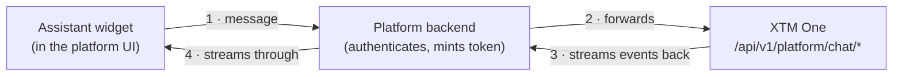

# Chat approvals in client applications

XTM One agent chat can stop mid-answer and ask a person to approve a tool call before it runs. This page is for anyone driving that chat from **outside** XTM One — an embedded assistant, a Suite platform, or your own integration.

For what approvals are and how administrators configure them, see [AI governance](../administration/ai-governance.md). For how the Suite products connect, see [XTM Suite integration](xtm-suite-integration.md).

## Existing clients keep working

**Upgrading XTM One does not break a client that knows nothing about approvals, and no coordinated release is required.**

The interactive prompt is opt-in. A client receives one only if it asks, by sending `supports_tool_approval: true` with the message. Anything that does not — every build predating this feature — gets a **normal assistant message** instead:

> I need approval before running: `delete_entity`. This chat can't collect that approval, so I've stopped rather than acting without it. You can allow this tool for yourself from the Tools page, or an administrator can allow it for everyone from the same place — or you can ask me to do something else.

Ordinary text, rendered by whatever the client already does with an answer. Nothing hangs, nothing errors, and the user learns why the agent stopped.

!!! note "Why opt-in, rather than simply pausing for everyone"
    A client that ignores an approval prompt never answers it. A server that paused anyway would wait indefinitely — no error, no timeout, just a turn that never finishes and a user watching a spinner. Declaring support is a client promising it will answer.

## Most clients reach XTM One through a proxy

The embedded assistant widget is rarely pointed straight at XTM One. Each Suite platform — OpenCTI, OpenAEV, OpenGRC — points it at **its own backend**, which authenticates the browser session, mints a platform token, and forwards the call to XTM One.



That middle hop is why approval has requirements a direct client would never notice. If you operate one, the section below is the checklist.

## What a proxy must do

If your application forwards chat to XTM One on a user's behalf, four things decide whether approvals work through it.

**Forward the whole request body.** A proxy that rebuilds the upstream body from a fixed list of fields silently drops `supports_tool_approval`. The result is safe — XTM One never pauses, and the client gets the plain message — but it is confusing to debug, because from the browser it looks as though the flag was ignored.

**Route the decision back.** Approval needs a path from the browser to XTM One *during* a turn, alongside the streaming response. If you already proxy the mid-run steering endpoint, the approval endpoint is the same shape and belongs next to it.

**Never time out a streaming turn.** This is the one most likely to bite. A paused turn holds its connection open and **silent** for as long as the reviewer takes, so any read timeout between the browser and XTM One becomes an approval deadline that nobody chose. Set the streaming call's timeout to infinite, and confirm any ingress in front of it does the same.

**Pass keepalives through untouched.** XTM One keeps the connection warm during silent windows by emitting SSE comment lines (`: keepalive`) every 15 seconds. These are what stop idle-timeout logic from reaping a legitimate pause, and they only work if your proxy streams bytes through rather than parsing and re-emitting events it recognises.

!!! tip "Accept approval decisions only from a real user session"
    A decision is a person's consent. Require the same browser session your chat endpoint requires, and reject agent or service identities on that route — an agent approving its own tool call defeats the entire control.

    **Then tell the reviewer what a rejected decision means.** The common case is not an attack, it is an expired session: a paused turn can sit for a long time, and the decision POST is the first request after it. Your guard answers 401/403, and "please try again" is the one piece of advice that cannot work — the retry carries the same dead session. Say "sign in again" and keep the prompt on screen; the turn is still waiting, and re-reading `pending-approvals` after the refresh restores it with nothing lost.

    Worth logging the refusal too. A guard that returns before your handler's error path leaves nothing on the server either, so a reviewer whose decision would not send has no explanation on either side.

## Opting in

Send `supports_tool_approval: true` with the message once your client can display a prompt and return a decision. XTM One then pauses the turn instead of ending it, emitting an event describing what it wants to run.

Each proposal carries the tool, what it does, the arguments, and the **schema those arguments came from**.

!!! warning "Show each argument's description, not just its value"
    `cascade: true` tells a reviewer nothing. *"cascade — also delete linked entities"* tells them everything. A prompt that renders names and values alone is a rubber stamp that looks like a safety control.

Your client returns one decision per proposed call — approve, reject with a reason, or approve always. A decision carries no arguments: the reviewer answers the call as proposed, and a wrong call is corrected by rejecting it with a reason the agent can act on. The same turn then continues with the tool result: no restart, no lost context.

Two rules worth designing around:

- **Every proposed call needs a decision.** A turn can propose several at once. A partial set is rejected, because resuming with an undecided call leaves an unanswered tool call that the AI providers refuse outright.
- **"Approve always" outlives the conversation.** It saves a preference for that user and applies to their *scheduled* runs too. It is the only decision with an effect beyond the turn in front of them, so tell them before they confirm.

### Handle the page reloading

The prompt arrives as a single event on the stream. If the page reloads while it is showing, your client has lost it — including the call identifiers a decision has to name — and the turn is left waiting for an answer nobody can give. To the user that looks like a chat that simply stopped replying: no error, no prompt, nothing to retry.

So ask on load:

```
GET /api/v1/platform/chat/conversations/{conversation_id}/pending-approvals
```

An empty list is the ordinary answer — most conversations are not paused. A non-empty one means a turn is still waiting, and you render the same prompt and return the same decision. The turn is kept alive across the disconnect, so the reviewer's answer resumes it with the work it had already done rather than starting over.

!!! warning "The reply arrives in the conversation, not on a stream"
    The resumed turn writes to the connection that carried the prompt, and your reload closed it. So a decision on a recovered prompt succeeds, the answer is persisted — and nothing appears live.

    The same response carries `"turn": "running" | "idle"`. Keep polling this endpoint while it reads `running`, showing your ordinary working indicator, and fetch the conversation once it reads `idle`. That is the completion signal, so you do not have to guess how long to wait.

The one bounded case is a stream that drops and never returns: after 30 minutes with **no sign of a client** and no decision, the turn stops waiting and the pause is discarded. Any request about that conversation counts as a sign — fetching the pending approvals is enough — so reloading restarts that clock rather than running it down. It limits abandonment, never the person deciding.

The full wire format — event shape, decision payload, and error responses — is specified in `specs/006-per-tool-approval/contracts/chat-approval-api.md` in the repository.

## Acting on the host page

An embedded chat can also let the agent act on the page it is shown on. Send `supports_page_actions: true` with the message, once your client can perform an action on its page and answer it; the platform offers the `act_on_page` tool on that turn only, and only while an administrator has set a [decision model](../administration/settings.md#decision-model).

While the tool runs, the turn's stream carries a `status` event with `event: "page_action_required"`, an `action_id` and an `action`: `snapshot`, `navigate` (a `path` within your application), `click`, `open` (hover a menu open, or click it when hovering opens nothing) or `type` (a `ref` from your last snapshot, and the `text` to type; Enter only in a search field or a form of that one field). Perform it, then POST the result to the same approve route, with `page_action` in place of `decisions`:

```json
{
  "conversation_id": "…",
  "page_action": { "action_id": "…", "ok": true, "error": null, "url": "/dashboard", "title": "…", "snapshot": "[e1] link \"Reports\"\n…" }
}
```

The snapshot is one line per element a user could act on, `[eN] role "name"`, at most 20,000 characters, never with a password value. Each wait ends after 20 seconds and a run after 240, so a client that stops answering only costs the turn that step. A 409 means the turn no longer waits for that action: drop it. The platform never asks for a click that saves, creates, sends or deletes unless the user asked for it, and the decision model must be sure enough that a click only moves through the page before it is asked for. A call in which the agent says the user asked for such a click (`submit`) is first sent to your client as an `approval_required` proposal showing its `goal` and `submit`, even when the tool is whitelisted, the user always allows it or approvals are switched off: a client that does not declare `supports_tool_approval` receives the plain message above instead, and nothing is clicked.

## Showing the decks, reports and videos an answer made

An answer that built a presentation, wrote a report or made a video carries a marker where it shows it: `[[PRESENTATION:<id>]]` (or `[[PRESENTATION:<id>#/<slide id>]]` for one slide), `[[REPORT:<id>]]`, `[[VIDEO:<id>]]`. What your client receives depends on what it says it can render:

- **Send `supports_artifacts: true`** with the message, and with the session request that restores a conversation, once your client renders them. The markers stay in `content`, and the `done` event (and each restored answer) carries `artifacts`, one object per marker in the order they stand: `kind` (`presentation`, `report`, `video`), `id`, `title`, the facts to show (`slide_count` and the `slide_ref` a marker names, `section_count`, or `scene_count`, `duration_ms` and the newest render's `status` and `progress`), `url` (the page that shows it in XTM One) and `downloads` (the formats it can be downloaded in: `pdf`, `pptx` and `pptx_native` for a presentation, `pdf` for a report, `mp4` once a video has a finished render). Only what the conversation or the user made is described; a marker with no object is drawn as nothing.
- **Without it**, each marker arrives as a link to that XTM One page, and no marker is ever streamed: an older client shows a link, never raw text.

Two routes serve them, and a proxy forwards them like the file download, with the user's token:

- `GET /api/v1/platform/chat/artifacts/{kind}/{id}` describes one again, as of now: a video whose render was still running when the answer arrived.
- `POST /api/v1/platform/chat/artifacts/{kind}/{id}/download` with `{"format": "pdf"}` answers the file, with its `Content-Disposition`. A presentation or a report is exported on the spot and counts against the user's export budget (six a minute, `429` past it); a video downloads its current render (`409` until it has one).

Both read the item under its own rule (a presentation or a video the user can see, a report of their own) and answer `404` for anything else.

## If you have connected another Filigran platform

Read this before upgrading rather than after.

A platform that registers with XTM One contributes its own tools. **Its read tools are on the whitelist; the rest are not.** Every platform tool is classified as reading or changing data, and the reads — searching, listing, fetching, querying — run without asking, like XTM One's own.

So on upgrade, everything that *changes* your platform starts asking for approval at once, across every agent that uses it. Nothing acts without consent and nothing is lost, but agents that quietly did their work now explain themselves instead, and the change arrives everywhere simultaneously. Reading is unaffected, which is the bulk of what most assistants do.

Two cases will surprise you, so test them rather than assuming:

- **A consolidated `manage_…` tool asks even when the call only lists.** One tool call can list, create or delete depending on its arguments, so it is classified by what it *can* do, not by what a given call happens to do.
- **One read asks on purpose**: reading a file's contents into the AI's context, because it loads a third-party document nobody has looked at. Deliberate, not a classification miss.

**If your platform can display approval prompts, say so when you register.** Send `supports_approval_prompts: true` in the registration payload — the platform-level twin of the per-message `supports_tool_approval`, named differently on purpose: this one says your assistant can ask at all, that one says a given client will answer a given prompt. XTM One then gates your tools normally, because there is somebody to ask — and a platform that adds support later starts gating again by itself on its next registration, with no operator action.

Until then, an administrator decides under **Settings → Access and security → Tool approvals → Approval for connected platforms**: gate your tools, or let them run. The list is built from whatever is actually connected, so a new platform appears there the moment it registers.

Operators deploying beside a platform that cannot prompt yet can set the starting point once, at install, with `TOOL_APPROVALS_PLATFORM_DEFAULT=skip`. That seeds the setting for platforms registering for the first time — it stays visible and changeable on the settings page, and never overwrites an administrator's choice.

!!! warning "That setting covers your tools, not XTM One's"
    `skip` — and the settings page beside it — exempts the tools *your platform contributes*. It says nothing about XTM One's own tools, so an assistant that cannot display a prompt still cannot use one that gates: the turn stops and explains instead of acting.

    The narrowest fix needs no administrator. A user who grants **"Yes, always"** once in XTM One's own chat, or on a run, saves a standing approval — and your client then runs that tool without prompting, because consent already exists.

    Otherwise an administrator has three options, and only the first covers XTM One's own tools rather than one tool at a time:

    - **Turn tool approvals off for the agents your assistant drives.** This works on the agents XTM One ships, which is what an embedded assistant usually drives: built-in agents are read-only in every other respect, but an administrator can set this one switch on them. It applies to the agent's runs and chats alike.
    - **Whitelist the specific tool**, deployment-wide.
    - **Turn off the per-integration toggle**, for tools an integration provides.

## Next step

- [AI governance](../administration/ai-governance.md) — what pauses, what doesn't, and how administrators tune it
- [XTM Suite integration](xtm-suite-integration.md) — how the Suite products register and connect
