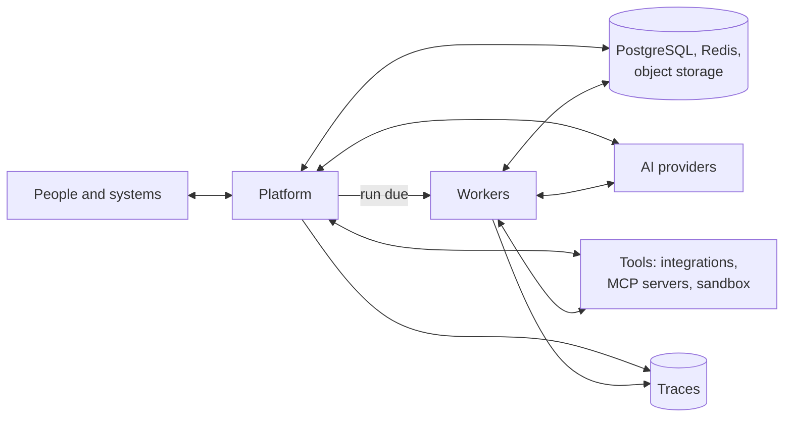
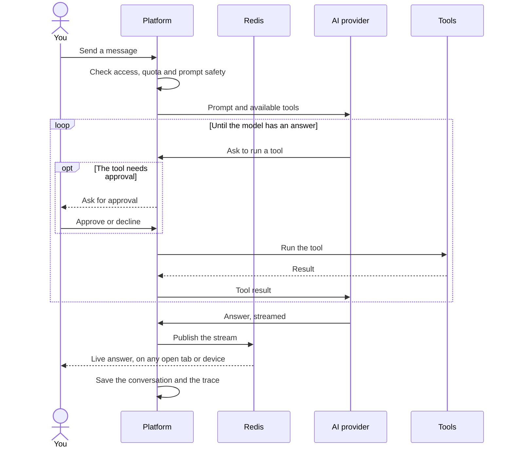
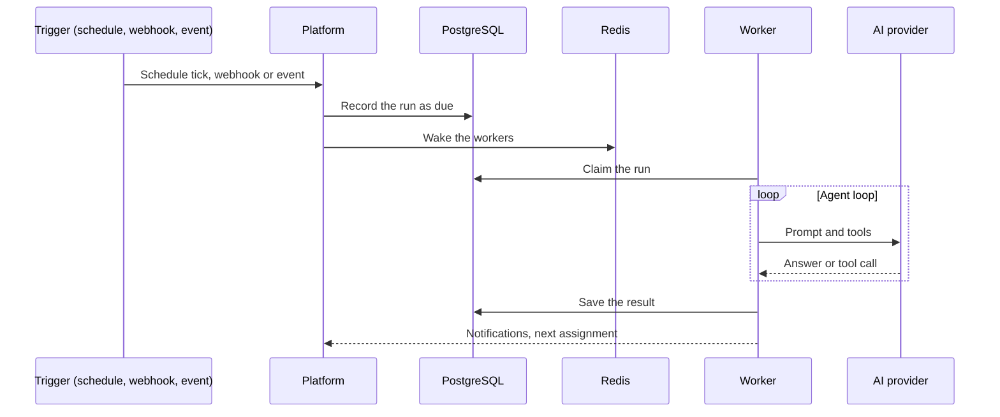
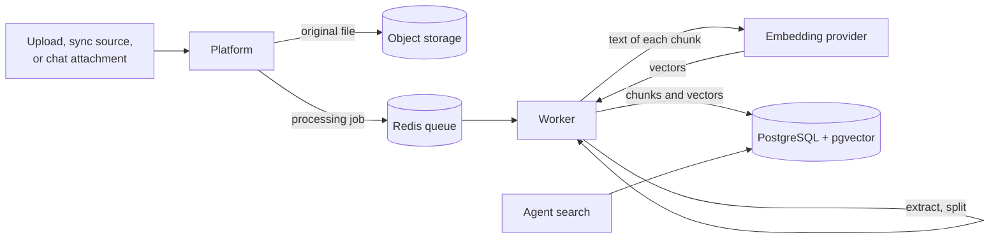

# Data flow

This page follows a request through XTM One: which components handle it, where its data is stored, and what leaves your network. It is written for administrators and security reviewers deciding how to deploy the platform. The components themselves are described in the [Overview](overview.md#architecture); what an agent shares with an AI model, and how to limit it, is in [AI governance](../administration/ai-governance.md).

## How the pieces connect

Two services do the work: the **platform**, which answers people and systems, and the **workers**, which run the work nobody waits for on screen. Both read and write the same stores, and both call the AI providers and the tools agents use.

- **Platform**: the API, the web application, the chat, and every entry point other systems use. It authenticates each caller, runs every interactive turn, and schedules background work.
- **Workers**: assignment runs, sub-agent tasks, and the processing of knowledge-base documents.
- **AI providers**: the services hosting the language, embedding, speech and image models. See [Configuration](configuration.md#ai-providers).
- **Tools**: integrations, MCP servers, built-in tools, and the sandbox that runs custom tools and the code interpreter.
- **Traces**: the record of each AI interaction (prompts, tool calls, tokens, timing, errors). `Settings > Observability` can keep them without their content, or turn them off. See [Monitoring](monitoring.md#request-tracing).

## The agent loop

Every agent answer, whether a chat reply or an assignment run, follows the same loop:

1. The request reaches the platform, which authenticates the caller and loads the agent's configuration.
2. The prompt is assembled: the agent's persona and instructions, its skills, relevant memory and knowledge, the conversation so far, and the list of tools the agent may use.
3. The prompt and the tool list go to the configured AI provider.
4. The model either answers or **asks for a tool**. It cannot run anything itself: it sends back the name of a tool and its arguments.
5. The platform or the worker checks the call (permissions, approval rules, budgets) and runs it: searching a knowledge base, calling an integration, delegating to another agent. The result goes back to the model, which can ask for another tool or write its answer.
6. The answer is delivered and the exchange is recorded as a trace.

!!! info "What is a tool?"
    A tool is a function that runs on the platform, such as "search this knowledge base" or "send a Slack message". The AI provider is given a description of each available tool but never touches your systems: it can only *request* a tool call, and the platform decides whether and how to run it. Credentials never go to the model. See [AI governance](../administration/ai-governance.md).

## A chat message

A message sent from the web application is answered by the platform, while you watch:

- **Safety checks.** Before the model sees the message, the platform checks your quota and, when [Prompt safety (Nova)](../administration/prompt-safety.md) is connected, screens the message against its rules; a blocked message never reaches the AI provider.
- **Approvals.** A tool that changes something can wait for a person to approve it. See [Human approval of tool calls](../administration/ai-governance.md#human-approval-of-tool-calls).
- **Streaming.** The answer streams through Redis, so it reaches you whichever platform replica your browser is connected to. A message you send while the agent is still working is added to the running turn.
- **Long work.** A sub-agent the agent delegates to in the background runs on a worker; when it finishes, the worker writes the follow-up answer in the same conversation.

The same path serves the other interactive entry points: the embedded assistant of OpenCTI, OpenAEV and OpenCRQ, the Office add-in and the browser extension, the [Chat API](../usage/chat-api.md), the LLM proxy, MCP clients and partner agents.

## A background run

An assignment runs without anyone watching. The platform decides that a run is due, and a worker carries it out:

1. **Triggers.** A schedule, an assignment webhook, an event from an integration (polled by the platform, or pushed to it, like the notifications OpenCTI and OpenAEV send), a platform event, a work item, or a person pressing `Run`. See [Assignments and triggers](../usage/assignments.md).
2. **Recording.** The run is written to PostgreSQL before anything else, so it survives a restart of any component.
3. **Claiming.** Workers claim the due runs; two workers never take the same run. The worker renews its claim while the run lasts.
4. **Running.** The worker runs the agent loop. A run that needs a human answer or an approval pauses, holds no worker while it waits, and resumes when the answer arrives.
5. **Recovery.** If a worker stops, its claims expire and another worker resumes the run. A run nobody works on is failed after `STALE_ASSIGNMENT_RUN_SECONDS` (see [Configuration](configuration.md#performance)).
6. **Results.** The outcome, the notifications and the next chained assignment are recorded; the run appears in `Operations`.

## A message from a messaging app

A message sent to a bot in Slack, Microsoft Teams, WhatsApp, Telegram, Discord or Google Chat:

1. The messaging service calls the platform's channel webhook. Discord is the exception: the platform keeps its own connection to Discord.
2. The platform acknowledges at once and processes the message in the background.
3. It identifies the sender (by email or a linked identity), applies the bot's rules, and finds the agent and the conversation.
4. The agent loop runs as for a web chat, with the output shaped for that app.
5. The answer is sent back through the messaging service, split to its size limits. Files are shared as signed links.

See [Channels and bots](../administration/channels/index.md).

## A knowledge base

Adding a document and searching it are two separate paths:

- **Ingestion.** The platform stores the source and queues a processing job. A worker extracts the text (PDF, Word, Excel, PowerPoint and text formats), splits it into chunks, sends each chunk to the embedding provider, and stores the chunks and their vectors in PostgreSQL. When a knowledge base describes figures, PDF pages are also sent to the chat model as images. Sources kept in sync (websites, Notion, cloud drives, GitHub and others) are fetched by the platform on their schedule.
- **Search.** An agent's search combines vector similarity and full-text search in PostgreSQL, so both meaning and exact terms count. Only the chunks it finds go to the model, not the whole knowledge base.

See [Knowledge bases](../usage/resources/knowledge-bases.md).

## Other systems calling XTM One

| Entry point | Who uses it | Authentication |
|---|---|---|
| Embedded assistant and platform registration | OpenCTI, OpenAEV and OpenCRQ | Registration token, then each user's signed identity |
| LLM proxy (`/v1`) | Any OpenAI-compatible client; an `agent:` model runs an agent | Personal API key |
| MCP endpoints (`/mcp/...`) | MCP clients (Claude Desktop, Cursor, ...) | Personal API key or OAuth |
| Agent-to-agent (`/a2a/...`) | Partner agents | Credentials issued to the partner (an OAuth client, or its Microsoft Entra identity); HTTPS only |
| Chat API | Your scripts and client apps | A session token |
| Assignment webhooks (`/api/hooks/...`) | Your SIEM, SOAR and other systems | The assignment's webhook secret |
| Public chat widget | Visitors of a website where an agent is published | None: the agent is public |

Each request runs as an identity the platform knows (a user, or the owner of the assignment or agent), and it reaches only what that identity may use. See [XTM Suite integration](xtm-suite-integration.md) and [Platform MCP servers](../usage/resources/platform-mcp-servers.md).

## Relays and runners

Relays and runners live in your network and open the connection to the platform themselves:

- **Relay.** When an integration or MCP server is bound to a relay group, its calls do not leave from the platform. The platform hands each request, encrypted, to a relay of the group through Redis; the relay makes the call on your network and streams the response back. Only metadata (time, target, status) is logged. See [Relays](../usage/resources/relays.md).
- **Runner.** When an agent acts on a computer, the platform sends the command to that computer's runner over its connection; a shell command can wait for approval first. The runner executes it and returns the result. See [XTM One Desktop and runners](../usage/resources/runners.md).

## Where data is stored

All data stays in the stores you deploy:

| Data | Where it lives |
|---|---|
| Users, groups, agents, assignments, configuration | PostgreSQL |
| Conversations, runs, work items, audit log | PostgreSQL |
| Knowledge-base chunks and vectors, long-term memory | PostgreSQL (pgvector) |
| Uploaded and generated files, knowledge-base sources, code-interpreter workspaces | Object storage (Silo / S3) |
| Job queue, live streams, short-term memory, single-use links, rate limits | Redis |
| LLM traces | PostgreSQL, or PostgreSQL and ClickHouse when configured; large payloads in object storage (see [Monitoring](monitoring.md#request-tracing)) |

Credentials (AI provider keys, integrations, channel bots, MCP servers, secret variables, two-factor secrets) are encrypted before they are written to the database, with a key derived from `SECRET_KEY`. With a [secret vault](secret-vaults.md), the database holds only a reference and the platform reads the secret from the vault when it is used. See [Configuration](configuration.md#security).

How long each kind of data is kept is described in [Data retention](../administration/ai-governance.md#data-retention).

## What leaves the platform

| Destination | What is sent | When | How to control it |
|---|---|---|---|
| AI providers | Prompts: instructions, conversation, tool results, the knowledge chunks found | Every agent turn | Choose the provider and models; use a local model to keep everything inside. See [AI governance](../administration/ai-governance.md) |
| Embedding provider | The text of document chunks, and search queries | Ingestion and search | `Settings > AI Models > Embedding` |
| Integrations and MCP servers | The arguments of the tool calls agents make | Tool calls | What each agent is given; approvals; relays |
| Langfuse | Traces, with prompts and the user's email | When connected | `Settings > Observability` |
| SMTP server | Password resets, invitations, announcements | When configured | `SMTP_*` |
| Filigran telemetry | Anonymous counts, never content | Every 6 hours | `TELEMETRY_ENABLED` (see [Usage telemetry](telemetry.md)) |
| XTM Hub | Platform registration | When you register | `Settings > Parameters` |

The Filigran license is verified offline: checking it sends nothing to Filigran.

## Next step

Continue with [AI governance](../administration/ai-governance.md) to understand what is shared with AI providers and how to control it.
