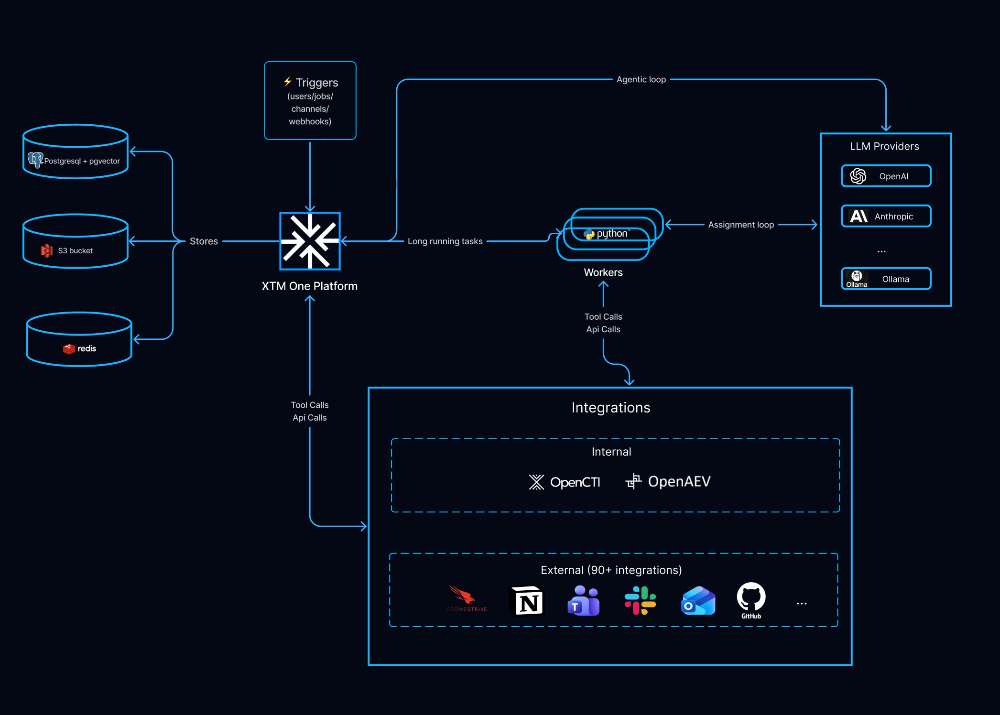
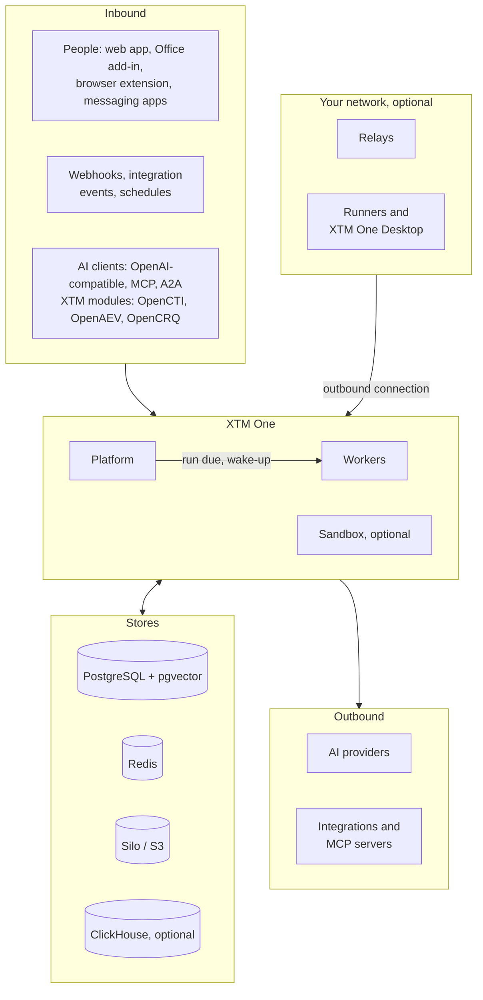

# Overview

Before you install, discover how XTM One is built, which services it relies on, and how it can be hosted.

!!! tip "Docker deployment of the full XTM suite (OpenCTI - OpenAEV - XTM One)"

    If you're looking for information about the deployment of the full eXtended Threat Management (XTM) suite using Docker, please refer [to this repository and documentation](https://github.com/FiligranHQ/xtm-docker).

## Architecture

{ .diagram-wide }

XTM One is the core platform of the XTM Platform. OpenCTI, OpenAEV and OpenCRQ are its modules: they register with it, sign their users in through it, and reach its agents from their own screens. What you deploy is a small set of services: the **platform**, one or more **workers**, and three **stores**. Everything else is either an external service the platform calls, or an optional component you add when you need it.

### Components

### Platform

The `platform` image is the service people and systems talk to. It listens on port 4000 and serves:

- the web application, the REST API, and the live chat (server-sent events);
- the incoming channel webhooks (`/api/channels/...`) and assignment webhooks (`/api/hooks/...`);
- the OpenAI-compatible LLM proxy (`/v1`), the MCP endpoints (`/mcp/...`) and the agent-to-agent endpoints (`/a2a/...`);
- the sign-in service the XTM modules use (`/xtm/auth/...`), their registration, and their embedded assistant;
- the Office add-in (`/office/`) and, when enabled, the Prometheus metrics (`/metrics`).

The platform runs every interactive turn itself: a chat message on the web, in a channel, in a module's embedded assistant, through the LLM proxy, MCP or A2A. It also runs the scheduler (cron triggers, integration polling, knowledge-base syncs, maintenance sweeps) and applies the database migrations when it starts.

It scales vertically first: give it more CPU and memory and raise `WEB_WORKERS`. More replicas are supported, for availability or for load (see [Running more than one platform replica](installation.md#running-more-than-one-platform-replica)).

### Workers

The `worker` image runs the work nobody is waiting for on screen:

- **Agent runs.** Assignment runs, sub-agent tasks and scheduled work items are recorded in PostgreSQL as executions. Each worker claims the ones that are due, runs the agent loop under a renewed lease, and hands a run back if it stops: another worker resumes it. Each worker runs up to `MAX_CONCURRENT_RUNS` assignment runs and `MAX_CONCURRENT_SUB_AGENT_TASKS` sub-agent tasks at once.
- **Queued jobs.** Knowledge-base document processing (extraction, chunking and embedding) and workspace indexing go through a Redis queue, up to `WORKER_CONCURRENCY` jobs per worker.

When a background task started from a chat finishes, the worker also writes the follow-up answer in that conversation. Workers hold no state of their own: add replicas when runs or documents queue up (see [Scaling model](installation.md#scaling-model)).

### Stores

| Store | Role | What happens if it is lost |
|---|---|---|
| **PostgreSQL + pgvector** | System of record: users, agents, conversations, run state, knowledge-base vectors, long-term memory, audit log, and the LLM traces unless ClickHouse holds them. | Everything. Back it up (see [Backup and restore](backup-and-restore.md)). |
| **Redis** | Coordination: the job queue, wake-ups between platform and workers, live chat streams, rate limits, short-term memory, single-use links, usage counters not yet written to the database. | Work in flight and recent working state. Durable records are not affected. |
| **Object storage (Silo / S3)** | Files: uploads, knowledge-base sources, generated files, code-interpreter workspaces, large trace payloads. | Every stored file. Back it up with the database. |
| **ClickHouse** (optional) | A second trace store for high trace volumes: traces are written to PostgreSQL and ClickHouse, and read from ClickHouse. | Trace history only. |

Each store is set with `DATABASE_URL`, `REDIS_URL`, the `S3_*` variables and the `CLICKHOUSE_*` variables: the bundled container or a managed equivalent (RDS or Aurora, managed Redis, S3). See [Configuration](configuration.md).

### AI providers

The platform and the workers call AI providers for chat, embeddings, speech and images. Eleven chat providers are supported (OpenAI, Anthropic, Google Gemini, Mistral AI, SpaceXAI, Azure OpenAI, AWS Bedrock, OpenRouter, Ollama, LiteLLM, and any OpenAI-compatible endpoint), plus an embedding-only server and ElevenLabs for speech. You configure them in `Settings > AI Models` or with `LLM_PROVIDER_*` variables. A local model (Ollama, or an OpenAI-compatible server in your network) keeps every prompt inside your infrastructure.

### Tools and integrations

Agents act on other systems through tools. The platform or the worker runs every tool call; the AI provider only asks for it.

- **Integrations** connect to the XTM modules (OpenCTI, OpenAEV, OpenCRQ) and to more than 100 other services (messaging, email, ticketing, cloud documents, security products). The modules call back in too, through their embedded assistant and the platform MCP servers.
- **MCP servers** are reached over HTTP, or started as local processes inside the platform and worker containers.
- **Built-in tools** include web search and fetch, a headless browser, and document rendering.
- **Custom tools and the code interpreter** run in a sandbox: a local process, a Docker container, or a separate [OpenSandbox](configuration.md#opensandbox) server. Both are off by default on an XTM One platform.

### Components in your network

Two optional components run outside the platform and connect to it, never the other way round, so you open no inbound port for them:

- **Relays** carry integration and MCP server calls to systems on a private network the platform cannot reach. See [Relays](../usage/resources/relays.md).
- **Runners** (XTM One Desktop on a workstation, or a headless runner on a server) let an agent act on that computer: commands, files, applications. See [XTM One Desktop and runners](../usage/resources/runners.md).

### Optional services

| Service | What it adds | How to enable it |
|---|---|---|
| ClickHouse | Trace storage at high volume | `TRACING_STORE_PROVIDER=clickhouse` and `CLICKHOUSE_*` ([Configuration](configuration.md#observability)) |
| OpenSandbox | Isolated containers for custom tools and the code interpreter | The `opensandbox` Docker Compose profile ([Configuration](configuration.md#opensandbox)) |
| Secret vaults | Credentials kept in HashiCorp Vault, AWS, Google Cloud, Azure or 1Password | `Settings > Security` or `SECRET_VAULT_*` ([Secret vaults](secret-vaults.md)) |
| Langfuse | LLM traces in your Langfuse | `Settings > Observability` or `LANGFUSE_*` ([Monitoring](monitoring.md)) |
| SMTP server | Password resets, invitations, announcements | `SMTP_*` ([Configuration](configuration.md#email-smtp)) |
| Prometheus | Platform metrics and alert rules | `PROMETHEUS_ENABLED` ([Monitoring](monitoring.md)) |

How a request travels through these components, and what leaves your network, is described in [Data flow](data-flow.md). The [Installation](installation.md) page turns this into a deployment: [Infrastructure requirements](installation.md#infrastructure-requirements) gives the CPU and memory figures and the database connection budget.

## Deployment models

XTM One can be deployed in two ways: **Filigran SaaS** (Filigran-hosted) and **Self-Hosted** (you run it).

| | Filigran SaaS | Self-Hosted |
|---|---|---|
| **Hosting** | Filigran-hosted cloud instance | Your infrastructure — on-premises or your own cloud |
| **Maintenance** | Filigran | Your team |
| **Upgrades** | Handled by Filigran | Manual |
| **Network** | Outbound HTTPS only | Your choice — on-premises, private cloud, internet-facing, or fully air-gapped |
| **Best for** | Fastest start, no infrastructure to run | Full control, on-premises or data-residency requirements, air-gapped environments |

### Filigran SaaS

Filigran hosts and operates XTM One for you as a fully managed cloud private instance. You access the platform through a Filigran-provided URL.

**What you need**

- A Filigran subscription
- A supported web browser (Chrome, Firefox, Edge)
- Outbound HTTPS access (port 443) to the platform URL provided during onboarding
- Outbound HTTPS to your identity provider (if SSO is configured)
- Outbound HTTPS to any external service your agents connect to (AI providers, messaging platforms, etc.)

**Onboarding**

1. Filigran provisions your tenant and sends you a URL and initial admin credentials.
2. Sign in, then go to `Settings` to configure AI providers, SSO, and integrations.

**Access provisioning**

Users can access the platform through:

- **Admin invitation** — admins create user accounts from `Settings` → `Users`.
- **SSO auto-provisioning** — when OIDC or SAML is configured, users are created automatically on first login. SAML supports automatic group mapping from IdP group claims.
- **Self-registration** — if enabled by the admin, users can register with a valid email domain.

**Your responsibilities**

- User accounts, SSO, and access control
- AI provider configuration (API keys configured from the Settings UI)
- Agent, integration, and knowledge base setup

**What Filigran manages**

- Infrastructure provisioning and monitoring
- Platform upgrades and patches
- Database backups and disaster recovery
- Availability, performance, and scaling

Infrastructure-level requests — custom domains, network peering or VPN access instead of the public internet, and sizing or capacity changes — go through Filigran. Share your sizing and capacity needs with Filigran so the instance is provisioned accordingly.

**Limitations**

- No access to the underlying infrastructure, database, or containers
- No control over environment variables or performance tuning (worker count, pool sizes)
- Upgrade timing is controlled by Filigran
- Custom tool sandbox mode is not configurable

### Self-Hosted

You deploy and operate XTM One on your own infrastructure. The [Architecture](#architecture) above describes the services you run; the [Installation](installation.md) page covers the infrastructure requirements and the step-by-step procedure.

**What self-hosting means**

When you self-host, you take on responsibilities that Filigran handles in the SaaS model:

| Area | Managed (SaaS) | Self-Hosted |
|---|---|---|
| Upgrades | Automatic or coordinated | You pull images and restart manually |
| Database backups | Managed by Filigran | Your responsibility |
| TLS certificates | Included | You provide certificates and a reverse proxy |
| Monitoring and alerting | Included | You set up your own (Langfuse, Prometheus, log aggregation) |
| Scaling | Managed by Filigran | You scale workers and tune connection pools |
| Infrastructure security | Managed by Filigran | You harden the host, network, and containers |

## Next step

Continue with the [Installation](installation.md) procedure to deploy the platform.
