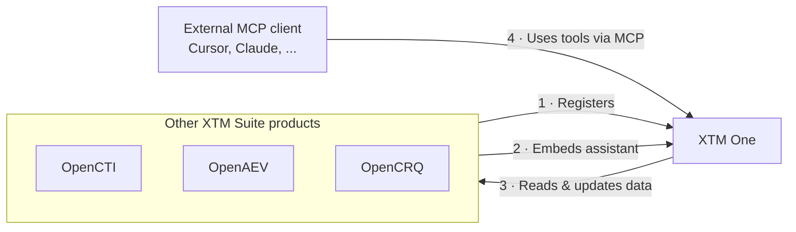

# XTM Suite integration

XTM One is the AI layer of the Filigran XTM Suite. This page covers the technical wiring that connects XTM One to the other Suite products — OpenCTI, OpenAEV, and OpenCRQ — from a deployment and operations point of view.

For the end-user experience of these features, see [XTM One in the XTM Suite](../usage/xtm-suite/index.md). For connecting external MCP clients, see [Platform MCP servers](../usage/resources/platform-mcp-servers.md).

If you are building or operating one of these embedded assistants, see [Chat approvals in client applications](chat-approvals-in-clients.md) — agent chat can now pause for human approval, which places requirements on the proxy each platform runs.

## How the products connect

Each Suite platform **registers itself** with XTM One. Once registered, the platform can surface the embedded "Ask AI" experience, and XTM One can call back into the platform on behalf of the requesting user.

The diagram shows four ways XTM One and the Suite products work together:

1. **Registration** — each platform registers with XTM One at `POST /api/v1/platform/register`, authorized by the shared `PLATFORM_REGISTRATION_TOKEN` (see below). This one-time handshake enables everything else.
2. **Embedded AI assistant** — once registered, OpenCTI, OpenAEV, and OpenCRQ surface an in-product AI assistant. The platform streams each request to XTM One over HTTP with Server-Sent Events (`/api/v1/platform/chat`). The assistant panel also reads the signed-in user's usage quota (`GET /api/v1/platform/chat/quota`, `null` on Community Edition), lists their chat prompts (`GET /api/v1/platform/chat/prompts`) and the conversations they can reference with `@` (`GET /api/v1/platform/chat/conversation-references`) and records their rating of an answer (`POST` / `DELETE /api/v1/platform/chat/conversations/{conversation_id}/messages/{message_id}/feedback`), all as that user, like the chat itself.
3. **Reads & updates platform data** — to answer, XTM One calls the platform's own GraphQL / REST API. Every call runs **as the signed-in user**: XTM One signs a short-lived per-user token that the platform verifies against XTM One's public keys at `GET /xtm/auth/jwks`, so each user's permissions and audit trail apply exactly as if they acted directly (see [Acting as the user](#acting-as-the-user)).
4. **Platform tools over MCP** — connecting a platform also exposes its native tools to external MCP clients (Cursor, Claude, custom agents) through XTM One at `/mcp/opencti`, `/mcp/openaev`, and `/mcp/opencrq`. This is a separate capability from the in-product assistant — see [Platform MCP servers](../usage/resources/platform-mcp-servers.md).

Registration is authorized by a shared token:

| Variable | Where it is set | Purpose |
|---|---|---|
| `PLATFORM_REGISTRATION_TOKEN` | XTM One **and** each Suite platform | Shared secret authorizing a platform to register. Must be identical across all services. |

!!! warning "Use the same token everywhere"
    Every product that registers with XTM One must use the exact same `PLATFORM_REGISTRATION_TOKEN`. Set a strong shared secret before connecting production instances, for example the output of `python -c "import secrets; print(secrets.token_urlsafe(32))"`.

    - **Unset**: registration is disabled. Every registration request is refused with a message naming the variable to set.
    - **The published default** `xtm-default-registration-token` (the `docker-compose.yml` fallback): accepted only so the platforms already registered with it stay connected. It cannot register a new platform, change a registered platform's URL, rename one or unregister one: a registered platform's URL is trusted to sign XTM One users in, and its name is what the agents bound to it read, so a token everyone knows must never choose either. Nor can it change the intents and business vertical a platform declares, or clear, downgrade or swap a connected platform's license: only a renewal that XTM One validates - a newer license issued to the same customer and instance - replaces the one registered. XTM One logs a warning at startup and the [security audit](../administration/settings.md#security-audit) (`Settings` → `Security`) reports a critical finding until you replace it on XTM One and on every platform. Meanwhile the license certificate described below is withheld, so a platform sub-licensed by your Filigran license cannot prove its Enterprise Edition; the registration answer says why (`xtm_license_withheld_reason: registration_token_published_default`), so the platform can point you to this setting.
    - **Failed attempts**: after 10 failed attempts in a minute, a client is refused with HTTP 429 until the minute ends, whatever token it presents. A call the published default may not make counts as a failed attempt.

!!! warning "The registration answer can carry your Filigran license"
    When your Filigran license is what puts a platform in Enterprise Edition (it sub-licenses that platform, or every platform of its type), the registration answer carries the license certificate itself, so the platform can verify its entitlement against Filigran's certificate authority instead of taking XTM One's word for it. That certificate is a license: whoever obtains it can use it until it expires. XTM One sends it only to a caller that presents the registration token, and only in that case, and it refuses every registration while `PLATFORM_REGISTRATION_TOKEN` is unset - so treat the token like the license itself: a strong secret, shared only with the platforms you connect, never the placeholder.

Once a platform is registered, its native capabilities become available automatically — including the [platform MCP servers](../usage/resources/platform-mcp-servers.md) (`/mcp/opencti`, `/mcp/openaev`, `/mcp/opencrq`), which activate as soon as the corresponding platform is connected.

!!! note "Under construction"
    The exact registration procedure on the OpenCTI / OpenAEV / OpenCRQ side (which settings to fill, in which UI or configuration file, and how to verify a successful registration from XTM One) is being documented and will be added here.

## Network reachability

XTM One calls the registered platform's API when an agent works with its data. By default it uses the public `platform_url` supplied during registration.

The `platform_url` must be an `http://` or `https://` address with a host, without credentials, query string, fragment, spaces, control characters or backslashes, and at most 2048 characters long: XTM One refuses any other registration with a `422` response.

For deployments where XTM One and the platforms share an internal network, you can override the API URL XTM One calls:

| Variable | Effect |
|---|---|
| `OPENCTI_API_URL` | Call the OpenCTI API, fetch its signing keys and send its callbacks on this internal URL instead of the registered public URL |
| `OPENAEV_API_URL` | Same, for OpenAEV |
| `OPENCRQ_API_URL` | Same, for OpenCRQ. The pre-rename name `OPENGRC_API_URL` is still read, with a deprecation warning in the logs, until 2026-12-31 - see [Upgrade](upgrade.md#deprecated-environment-variables) |

!!! note "Links stay on the public URL"
    The override is only where XTM One calls the platform. Every link a person is given - the "Open in ..." links of the platform tools, the platform URL the agents build their links from, the links in their answers, `trigger.platform_url` in an assignment prompt - is on the registered public URL, the one a browser reaches. A link the agent writes on the internal URL (from a conversation older than the upgrade, for example) is shown on the public URL too, except inside code blocks, which are left as written. With `URL_GUARD_ENABLED=false` the answers are left as written.

### Public and internal URLs

In Docker Compose or Kubernetes, each product usually has two URLs: the public one your users open in their browser (`http://localhost:8080`), and the internal one the other containers reach it on (`http://opencti:8080`). The signed calls between the products use them for different things:

- The **public URL** is the product's identity. It is `BASE_URL` for XTM One and the base URL a platform registers with (for OpenCTI, `APP__BASE_URL`). Every token a product signs names it as the issuer, and every token sent to a product must be addressed to it.
- The **internal URL** is only where the other side connects: the platform's API, its signing keys and, for OpenAEV, the autonomous run callbacks. No link a person is given is ever on it.

On the XTM One side, the internal URL of a platform is the `*_API_URL` override above, recorded at the platform's next registration (its heartbeat, every few minutes). On the platform side, it is the XTM One URL the platform is configured with (`XTM__XTM_ONE_URL` for OpenCTI, `OPENAEV_XTM_ONE_URL` for OpenAEV): the platform reads XTM One's public identity from `GET /xtm/auth/metadata` on that URL.

Two settings keep the signed calls working when the URLs differ:

| Variable | Where | Purpose |
|---|---|---|
| `BASE_URL` | XTM One **and** its worker | The worker signs the tokens of background work (assignments, delegated tasks, autonomous runs). Without it, those tokens carry a default issuer the platforms refuse. Set it to the same value on both containers. |
| `XTM_AUTH_ACCEPTED_AUDIENCES` | XTM One | Comma-separated URLs the platforms reach XTM One on when they differ from `BASE_URL`, for example `http://xtm-one:4000`. Platform versions that do not read `/xtm/auth/metadata` address their tokens to that URL, and XTM One refuses them unless it is listed here. |

If the embedded assistant answers but every action on the platform's data fails with `401`, check the XTM One logs for `XTM JWT rejected`: the message names the issuer, the audience or the key URL that did not match.

## Acting as the user

When a Suite platform calls XTM One (or when a request from XTM One calls back into a platform), the action runs **as the requesting user**, not as a shared service account.

XTM One signs a short-lived, per-user token that the platform verifies, and verifies the platform's tokens the same way. Each product signs its tokens for 10 minutes; XTM One refuses a platform token that carries no expiry or is signed to live longer than 15 minutes, and tolerates up to 60 seconds of clock difference between the products. Keep their clocks synchronised (NTP): a token from a clock more than 60 seconds ahead is refused. Users are matched by email between the two products, so each user's platform permissions, data markings, and audit trail apply exactly as if they acted directly. Platform API tokens are never stored in or proxied through XTM One.

The public keys used to verify these tokens are served from XTM One:

| Endpoint | Purpose |
|---|---|
| `GET /xtm/auth/jwks` | Public JWKS keys for verifying XTM One's cross-platform tokens (unauthenticated, public) |
| `GET /xtm/auth/metadata` | The `issuer` XTM One's tokens carry, the `audience` it expects (both its public `BASE_URL`, whichever URL you reach it on), its `jwks_uri` and signing algorithm (unauthenticated, public) |

!!! note "Under construction"
    The cross-platform token verification setup on the platform side — including how each platform is configured to trust XTM One's JWKS endpoint and how key rotation is handled — is being documented and will be added here.

## Acting on the platform's page

With a [decision model](../administration/settings.md#decision-model) set, the embedded "Ask AI" assistant can also act on the page the user is looking at: open a section, switch a tab, type a search term. The assistant in the product performs each click itself, in the user's own session, so it can do nothing the user could not do by hand, and it stops before a button that saves, creates, sends or deletes unless you asked it to. Nothing has to be configured in the product beyond a widget version that supports it; the [client protocol](chat-approvals-in-clients.md#acting-on-the-host-page) uses the approval route the product already forwards.

## OpenCRQ tools follow each instance

The OpenCRQ tools your agents use follow the OpenCRQ instance you connect. XTM One keeps no list of OpenCRQ versions: each instance describes the operations it serves, and the fields each one accepts, itself.

- **How XTM One learns it.** OpenCRQ sends a fingerprint of that description with every registration (its heartbeat, every few minutes). When XTM One does not hold the description for that fingerprint, it asks, and OpenCRQ registers again at once with the description. An OpenCRQ that is not registered with XTM One is not asked ahead of time: its description is read from the instance at the first OpenCRQ call of each conversation or run.
- **A tool the instance cannot serve is hidden from your agents**, and refused if something calls it by name. The refusal names what is missing.
- **A field the instance would drop is refused before anything is sent.** OpenCRQ drops a field it does not know without saying so, so without this check the tool would look as if it had worked. A field left empty, or one the instance accepts, goes through as usual.
- **The default registration token stores nothing.** An OpenCRQ registered with the published default `PLATFORM_REGISTRATION_TOKEN` (see above) is accepted without a description being kept: nothing is hidden and no field is checked. Set a registration token of your own.
- **Between two versions, nothing is hidden.** While OpenCRQ reports a fingerprint XTM One has no description for, for example just after an upgrade, no tool is hidden and no field is checked. The new description arrives with the next heartbeat, within 5 minutes. A description that is out of date never decides.
- **Several replicas behind one URL.** During a rolling deploy the replicas can describe themselves differently, so what is hidden can change from one heartbeat to the next until the rollout ends.

Open the integration and read the `OpenCRQ version` card of its `Overview` tab: it shows the connected version, whether XTM One holds the description (`up to date`, `pending`, `unavailable`, or `not accepted` under the default token), its short fingerprint and when it was received, the tools that are hidden and the operations they miss, and the fields a tool sends that the instance does not accept. Everyone who can open the integration sees it.

!!! note "Limits"
    XTM One checks which fields an instance accepts, not their values: OpenCRQ itself refuses a wrong value with an error. An OpenCRQ that does not answer the description is treated as one that hides nothing.

## Verifying the integration

After registering a platform, confirm the connection from XTM One:

- The platform MCP server for that product reports `Connected` in `My Profile` → `MCP Endpoint` (and in `Settings` → `MCP Endpoint` for admins).
- The embedded "Ask AI" experience appears inside the registered product.

If a platform shows as not connected, see the platform MCP [troubleshooting table](../usage/resources/platform-mcp-servers.md#troubleshooting) and the general [Troubleshooting](troubleshooting.md) page.

## Next step

Review [Data flow](data-flow.md) to understand how cross-product requests are processed, and [AI governance](../administration/ai-governance.md) for what is shared with AI providers.
